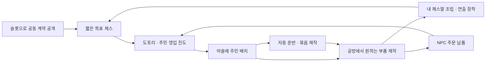
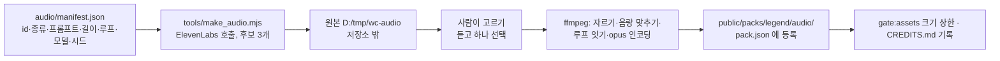

# WILD CROWN — 왕관 계약전과 살아 있는 공방

작성: 2026-11-11. 상태: **조사에 근거한 제안서, 구현·출시 승인 아님**.

**사용자 확정(2026-11-11): 대전은 공정하게, 모험에서 능력 강화.** 대전에서는 성장·장비에 따른 성능 차이를 없애고 외형·연출·성취를 표현한다. 모험에서는 제작·업그레이드가 실제 능력과 공략 선택을 바꾼다. 이 결정은 성장 방향에 대한 확정이며, 계약 규칙·경제 수치·전체 구현 승인을 뜻하지 않는다.

사용자 요청: 슬롯으로 판마다 다른 미션을 만들고, 킹 제압 또는 목표 포획으로 승리한다. 코인·주민 카드를 얻어 마을을 발전시키고, 마을에서 만든 물건으로 나만의 체스말을 수집·성장시킨다. 경쟁·생산·소비가 이어지되 반복 노동처럼 느껴지지 않게 한다.

**업그레이드(2026-11-12, 사용자 요청 「더 재밌고 독창적으로, 특수효과가 팡팡 터지고 계속 하고 싶게」):** §4-2 「팡팡 무대」를 새로 넣고 §1·§2.1·§2.3·§4·§6·§9·§10·§11·§12 를 맞춰 고쳤다. 같은 날 사용자 지시로 §9-2 「ElevenLabs 로 BGM 과 효과음」을 더했다(키 연결만 했고 아직 한 번도 생성하지 않았다). 새 측정 하나([연출 밀도](../research/2026-11-11-slot-chess/fx-density.json))를 근거로 썼다. 나머지 수치는 모두 시작값이고 사람에게 재 보지 않았다.

근거와 확인 한계: [조사 기록](../research/2026-11-11-slot-chess/README.md). 이 문서의 가격·판 수·시간·승률 기준은 **초기 실험값**이다. 실제 이용자의 재미·체류·구매·경제 안정성을 측정한 결과가 아니다.

## 1. 제안의 중심

**“슬롯이 이번 판의 승리 경로를 열고, 내가 키운 마을이 다음 판에서 자랑할 말을 만든다.”**

**11-12 한 줄 더: “한 판은 3분짜리 공연이다. 릴이 막을 올리고, 잡을 때마다 내가 조립한 연출이 터지고, 마지막 한 방은 바다 전체가 받아 준다.”** 판이 짧아져 잡기가 한 판에 다섯 번쯤만 오므로(§4-2.1 측정) 한 번 한 번을 크게 쓸 수 있다. 상세는 §4-2.

추천하는 제품은 ‘짧은 목표 체스 + 살아 있는 제작 마을’이다. 슬롯은 시작할 때 두 사람이 공유하는 계약을 공개한다. 성장의 주요 보상은 새로운 외형, 세계와 연결되는 잡기 연출, 공방의 생산 방식, 주민의 생활 변화다. 실제 전투 능력은 나중에 별도 모험 모드에서 시험한다.

좋아 보이는 점은 세 가지다. 매 판 오프닝 암기와 다른 판단을 만들 수 있고, 체크메이트 이전에 끝나는 경로가 생기며, 내 체스말에 돈을 쓴 이유가 다음 대전에서 보인다. 가장 위험한 점도 세 가지다. 목표물을 숨기면 판이 길어지고, 부자가 더 쉽게 이겨 더 부자가 되며, 장비를 얻으려고 재미없는 판을 반복할 수 있다. 아래 규칙은 이 세 위험을 실제로 시험하고 줄이는 구조다.

### 선택지 비교

| 방향 | 얻는 것 | 잃는 것 | 판단 |
| :-- | :-- | :-- | :-- |
| A. 기존 체스 + 슬롯 보너스 | 현재 코드·규칙과 가장 가까움 | 미션이 승리가 아니어서 판 길이를 직접 줄이지 못함 | 기존 일반 체스에 유지할 선택지 |
| **B. 목표로 이기는 계약전 + 제작·수집** | 짧은 결판 가능성, 매 판 다른 우선순위, 마을과 대전 연결 | 새 종료 판정·AI·매칭 검증 필요 | **추천. 첫 시제품의 범위** |
| C. 슬롯 + 능력치·광역 주문 PvP + 거래소 | 강한 성장·전투 변화·거래 욕구 | 전투 규칙과 경제와 서버를 동시에 풀어야 함, 자산 격차가 승패로 번짐 | 성장에 따른 PvP 능력 차이는 사용자 결정으로 제외. 실제 능력 성장은 모험에 적용 |

계약전과 제작 구조는 작성자의 추천이다. 그중 **대전의 동일 성능·모험의 실제 능력 강화**는 사용자 답변으로 확정했다. 계약 세트·생산식·출시 범위는 여전히 제안과 검증 대상으로 남는다.

## 2. 원안에서 바꿀 부분

### 2.1 세 종류 전부보다, 세 목표 중 두 개

`폰 + 나이트 + 룩`을 전부 잡아야 한다면 마지막 룩을 숨기는 것이 방어 전략이 된다. `비숍 + 퀸 + 폰`은 퀸을 잡기까지 후반으로 갈 수 있다. 일반 체스보다 빨리 끝날 가능성은 있지만, 모든 판이 짧아진다는 보장은 없다.

추천 규칙은 **“공개된 세 포획 목표 중 두 개를 먼저 끝내면 승리. 왕을 제압해도 승리.”**다. 상대는 하나의 마지막 표적만 숨겨서는 모든 경로를 막지 못한다. 반대로 너무 쉽게 끝날 수 있으므로 처음부터 전체 조합을 무작위로 열지 않는다.

- 기준 비교는 `폰×1·나이트×1·룩×1`의 2개/3개 방식이다. 실제 기본 풀을 확정한 것은 아니다.
- 첫 추천 시제품 후보는 **`폰×2·나이트×1·비숍×1` 중 2목표**다. 폰 목표의 수량을 늘려 너무 쉬운 계약을 줄이고, 초반 접근성이 크게 다른 룩·퀸은 기본 풀에서 뺀다. 11-11 분석에서는 재지 않았고, **11-12 에 같은 기보로 후향 측정했다**(§4-2.1): 멈춤 중앙 21반수(×1 조합 16~20), 계약으로 끝난 판의 백 선착 28/59·27/57(×1 폰·나이트·룩은 34/60·35/58). 계약을 모르는 AI 의 기보라 확정이 아니다. SC-0에서 계약을 아는 AI 로 다시 비교한다.
- 각 종류의 요구 수량을 채우면 해당 계약 하나가 완료된다. `폰×2`는 폰 두 마리를 잡아야 1점이며, 완료 뒤 같은 종류를 더 잡아도 계약 점수는 늘지 않는다. 한 포획은 한 목표에만 기여한다.
- 퀸 포함 조합은 후속 실험에 둔다. 드물게 나온다고 추가 배수를 주지 않는다.
- 세 릴을 독립적으로 굴리지 않고, **유효성이 검증된 계약 세트** 하나를 고른 뒤 세 릴로 공개한다. 중복 퀸·없는 말·달성 불가능한 수량을 막는다.
- 목표 종류와 필요한 횟수는 항상 아이콘+수량으로 표시한다. 기술·점령·주문 조건은 첫 버전에 섞지 않는다.

**왜 이 보정이 필요한가:** 두 개 방식에서 늘 폰과 나이트만 노린다면 세 번째 릴의 룩은 장식에 불과해진다. 목표별 선택·완료 비중도 기록하고, 특정 목표가 80% 이상의 판에서 사실상 무시되면 해당 세트를 풀에서 제외하거나 수량을 조정한다. 80%는 시작 기준이지 검증된 기준값이 아니다.

### 이번에 실제로 계산한 결과

기존 AI 기보에 조건을 대입한 후향 분석. 각 난이도60판, 모두 표준 시작, 최대160반수. ‘목표 중앙’은 달성한 판에서의 최초 달성 반수다. 반수는 한쪽이 한 번 움직이는 단위다.

| 조건 | 쉬움 달성 / 60 · 목표 중앙 | 보통 달성 / 60 · 목표 중앙 | 해석 |
| :-- | :-- | :-- | :-- |
| 폰·나이트·룩 전부 | 46/60 · 51반수 | 57/60 · 54반수 | 원안도 조기 결판 기회가 있지만 종료까지 미완료인 판 존재 |
| 폰·나이트·룩 중2 | 60/60 · 16반수 | 60/60 · 20반수 | 매우 빠름. 깊이·편향·세 번째 목표 무시 여부 확인 필요 |
| 비숍·퀸·폰 전부 | 44/60 · 37반수 | 56/60 · 44반수 | 조합마다 달성 특성이 다름 |
| 비숍·퀸·폰 중2 | 60/60 · 21반수 | 60/60 · 25반수 | 퀸을 전혀 노리지 않아도 끝나는 구조인지 추가 확인 |
| 폰·나이트·비숍 전부 | 58/60 · 27반수 | 58/60 · 29반수 | **원안의 가벼운 3종 조합도 유력한 비교 후보** |

기존 기보 길이 중앙은 쉬움102·보통130반수이며 각각10·13판은160반수에서 잘렸다. 완전한 대국 길이 추정치가 아니다. 폰·나이트·룩 중2의 백 선달성은34/60·35/60, 폰·나이트·룩 전부는 달성판 중21/46·41/57이었다. 따라서 공정성 검증 완료라고 할 수 없다. AI는 계약을 모르며 방어·목표 집중을 하지 않았고 사람 생각 시간도 없다. 실제 신규 AI·플레이어의 시간 단축률로 환산하지 않는다. [원시 결과](../research/2026-11-11-slot-chess/mission-audit.json).

추가 승리 조건의 선례는 [Three-check](https://lichess.org/variant/threeCheck)와 [King of the Hill](https://lichess.org/variant/kingOfTheHill)에서 확인했다. 이 선례가 슬롯 조합의 균형을 보장하지는 않는다.

### 2.2 킹을 잡는다는 표현과 실제 규칙

현재 엔진은 킹을 포획하지 않고 체크메이트에서 끝난다. **첫 버전은 왕 제압=체크메이트**로 제안한다. 메이트가 나면 왕이 왕관을 내려놓거나 항복하는 연출을 보여 준다. 체크 중에는 반드시 체크를 해소해야 하므로, 목표를 완성한다며 자기 킹을 노출하는 불법 수는 허용하지 않는다.

‘체크를 무시해도 되고 왕을 실제 잡아야 끝나는 게임’을 원한다면 별도 규칙을 만들어야 한다. 단순 문구 수정이 아니며 체크·캐슬링·왕 인접·AI 탐색까지 달라진다. 이 계획의 권장 초안에는 넣지 않았다.

### 2.3 슬롯은 한 번의 짧은 공개 행사

- 매 판 시작 시 무료로 자동 회전. 총 1.2~1.8초를 시작값으로, 즉시 건너뛰기 가능. 연출 중에는 대국 시계가 흐르지 않는다.
- 릴에 동물과 체스 기호를 함께 사용한다. ‘캥거루=나이트’를 몰라도 읽힌다.
- 마지막 릴에서 일부러 아슬아슬하게 실패시키는 연출·판돈·재추첨 판매는 사용하지 않는다. 결과는 승리 경로이지 지급 재화의 잭팟이 아니다.
- 두 사람에게 같은 목표·같은 룰 버전을 보이고, 둘 다 받은 뒤 대국을 시작한다. 재접속·새로고침으로 바뀌지 않는다.
- 첫 2판은 고정된 목표 세트로 규칙을 익히고, 그 다음부터 검증된 풀을 사용한다.
- **11-12:** 릴은 화면 위 UI 가 아니라 **판 옆 바다에서 솟는 소라 세 개**다. 멈출 때마다 판 위 말들이 파도타기로 반응하고, 표적이 된 종류의 말에 현상 딱지가 붙는다(§4-2.3 ①). 길이·건너뛰기·「아슬아슬 실패 연출 없음」은 위 그대로다.

## 3. 한 판을 끝까지 정의하기

### 3.1 첫 실험의 규칙표

| 항목 | 권장 초안 |
| :-- | :-- |
| 보드 | 현재 8×8, 표준 시작 배치·표준 합법 행마 |
| 승리 | 체크메이트 또는 계약 2개 선착순 완료 |
| 표시 | 상단: 세 목표와 양쪽 진도. 자신의 완료칸은 색+체크, 상대는 별도 점 표시 |
| 길이 | 최대 **양쪽 24차례씩, 48반수**. 시작 전에 표시. 실제 시간 목표 중앙값3~6분, p90≤8분은 검증 항목 |
| 제한 차례 도달 | 흑의 24번째 수까지 마친 뒤 완료 계약 수 비교. 많으면 승리, 같으면 무승부. 남은 기물 가격으로 재역전 판정을 덧붙이지 않음 |
| 시간 설정 | AI 연습은 생각 시간 제한 없음·이어 하기. 친구 대전의 빠른 시계는 선택. 차례 상한만으로 실제 몇 분을 보장하지 않음 |
| 표준 종료 | 메이트·스테일메이트·반복·50수 등 중 모드에 맞는 종료를 명시적으로 적용 |
| 기본 전투 성능 | 계정 성장·장비 등급과 무관하게 동일. 체력·명중률·치명타 없음 |
| 경쟁 기록 | 계약전과 일반 체스의 결과·레이팅을 분리. 초기 계약전은 AI·친구 비랭크부터 |

24차례는 초안이다. 지나치게 무승부가 많거나 도망 다니기가 최선이면 숫자를 늘리는 것부터 하지 않는다. 목표 풀·시작 배치·승리 조건을 먼저 재검토한다. 필요하면 동일한 합법 오프닝이 진행된 사전 국면을 양쪽 색 교대로 시험한다. 6×6 보드·다른 행마는 별도 연구로 남긴다.

### 3.2 경계 사례

1. 한 수 처리 순서: 합법 수 확정 → 포획·승급 기록 → 계약 진도 갱신 → 체크메이트 → 계약2개 승리 → 스테일메이트 → 3회 반복 → 50수 → 킹만 남음 → 48반수 점수 판정 → 결과 이벤트1회. 같은 수가 메이트와 계약을 모두 만족하면 승자는 같고 종료 사유는 메이트다. 예를 들어 48번째 반수가 스테일메이트이고 계약은 백1·흑0이면 **무승부**다. 48번째 수로 계약2개를 채웠다면 스테일메이트·상한보다 계약 승리가 먼저다.
2. 상대 목표물도 보인다. 목표는 비밀이 아니며, 상대 진도를 보고 길을 막거나 왕을 공격하는 판단이 핵심이다.
3. 앙파상은 폰 포획1회. 승급한 폰을 잡으면 **잡힌 순간의 종류**로 센다. 승급 직전 폰의 출신 종류를 따로 기억시키지 않는다.
4. 초반에 없는 목표·중복 목표·킹 목표를 생성하지 않는다. 목표는 판 중 재추첨하지 않는다.
5. **기물 부족 무승부를 표준 chess.js 그대로 쓰지 않는다.** 메이트가 불가능해도 남은 목표 포획으로 이길 수 있는 국면이 있다. 초안에서는 ‘양쪽 킹만 남음’ 외의 기물 부족 자동 무승부를 끄고, 스테일메이트·반복·차례 상한을 사용한다. 킹만 남아도 방금 수의 계약 승리가 먼저다.
6. 차례 상한은 동수 기회를 주는 마지막 흑 수 뒤 판정한다. 그 전에 먼저 계약2개를 채우면 즉시 종료한다. 백 선착순 이점은 색 교대 실험으로 확인한다.
7. AI 연습 되감기는 계약 진도와 장면도 함께 되돌린다. 지급은 확정 종료 때1회이며 되감기·재접속으로 중복 수령할 수 없다. 경쟁 판에는 되감기 없음.
8. 기권은 패배지만 정상 완주 보상과 동일하게 주지 않는다. 초단기 연속 기권·합의 포획으로 생산을 돌리는 행위를 별도 분류한다. 세부 보상 적격 판정은 §7과 구현 단계의 검증 대상이다.

### 3.3 AI도 새 게임을 알아야 한다

현재 미션은 보너스라 AI가 몰라도 대국이 진행됐다. 이제 미션이 승리라 **AI를 그대로 두면 안 된다**.

- 탐색 상태에 양측 계약 진도·계약 세트·남은 차례를 넣는다. 메이트와 계약 승리는 같은 승패 가치로 평가한다.
- 바로 계약을 완성하는 수를 최우선으로 찾고, 상대의 즉시 계약 승리를 막는다. 목표물을 공짜로 주는 ‘표준 체스상 유리한 교환’도 다시 평가한다.
- 기보·진도·남은 차례를 포함한 캐시 키를 쓴다. 같은 FEN이어도 지난 포획 종류가 다르면 다른 게임이다.
- 현재 `aiWorker.js`와 난이도 선택 흐름을 유지하되 계약전 전용 평가를 분리한다. 세기가 약해도 자신이 무엇으로 지는지 모르는 AI는 허용하지 않는다.

## 4. 플레이어가 경험할 한 바퀴

예시는 목표이지 현재 구현된 동작이 아니다. 설명을 간단히 하기 위해 기준 비교용 ×1 계약을 썼으며, 실제 기본 풀 후보의 폰×2에서는 폰 두 마리를 잡아야 첫 칸을 채운다.

1. 마을에서 코뿔소의 ‘조개 성채 방패’를 눌러 갖고 싶은 물건으로 지정한다. 필요한 것과 완성 모습이 바로 보인다.
2. ‘계약전 시작’을 누른다. 릴이 돌아 `폰·나이트·룩`을 공개하고 “둘을 먼저 잡거나 왕을 제압하세요”가 한 번 나온다.
3. 상대 폰을 잡아 첫 칸을 채운다. 이제 나이트·룩 중 무엇을 노릴지, 상대의 같은 목표를 지킬지 선택한다.
4. 상대가 나이트를 숨기면 룩 쪽으로 압박한다. 상대는 기물이 불리해도 내 목표물 하나를 잡아 두 번째 계약을 먼저 끝낼 수 있다. 자동 역전 보너스는 없다.
5. 종료 후 ‘도토리18 / 공방 작업 +0.5일 / 방패 제작50%’처럼 세 줄. 장황한 보상 팝업을 이어 띄우지 않는다.
6. 마을에 돌아오면 일꾼이 실제로 방패를 망치질한다. 다음 정상 완주로 작업1일이 채워지면 곡물1→부품2를 만들고, 도토리24·부품2로 방패를 확정 제작한다. 완성품을 누르면 코뿔소 손에 바로 장착된다.
7. 다음 판에서 룩이 합법적으로 말을 잡으면, 방패 문양이 바닥에 뜨고 조개 성벽이 짧게 솟았다 사라진다. **획득한 물건·마을의 생산·대전의 표현이 같은 물건으로 이어진다.**

**11-12 같은 한 바퀴를 「팡팡 무대」로 다시 보면**(§4-2, 전부 목표이지 구현된 동작이 아니다):

- 2번: 판 옆 바다에서 소라 셋이 솟아 쿵·쿵·쾅 멈추고, 말들이 파도타기를 한다. 상대 폰·나이트·비숍에 현상 딱지가 붙는다.
- 3번 전: 아직 아무것도 못 잡았지만, 내 비숍이 상대 나이트를 겨누자 딱지가 흔들리고 왕관 열기가 차오르며 북소리 한 겹이 얹힌다.
- 3번: 첫 잡기 — 내가 조립한 「별 조준선 + 붓획 + 꽃가루 + 종소리」가 터지고, 도토리가 튀어 주머니로 날아든다. 상대가 되잡으면 「2연쇄」.
- 4번: 하나 남았다. 하늘이 어두워지고 심장 박자만 남는다.
- 결정타: 느린 화면, 잡힌 말이 바다로 풍덩, 고래가 뗏목에 태우고, 수평선의 내 마을에서 폭죽이 오른다. 흔적이 남은 판이 「판 그림」 한 장이 된다.
- 5번 결산 넷째 줄: 「다음 판은 노을 무대」.
- 6번: 마을에 들어서면 쌓인 작업이 3초 연쇄로 풀리고, 뗏목을 타고 온 손님들이 선물을 내려놓고, 주민들이 한 번 춤춘다.

## 4-2. 팡팡 무대 — 한 판을 3분짜리 공연으로 (11-12 추가)

이 절은 전부 **연출·표현·수집**이다. 합법 수·승패·차례·AI 는 건드리지 않으므로 문서 머리의 사용자 확정(대전은 같은 성능)과 부딪히지 않는다. 유일한 예외인 ⑨ 와일드 크라운은 양쪽에 똑같이 적용되는 규칙 후보라 따로 표시했다.

### 4-2.1 먼저 잰 것 — 한 판에 터뜨릴 순간이 몇 번 오는가

`node docs/research/2026-11-11-slot-chess/fx-density.mjs` — 11-11 분석과 같은 120기보(쉬움 60·보통 60, 계약을 모르는 AI)에 「계약 2개 선착 / 표준 종료 / 48반수」 멈춤을 대입해 센 후향 분석. [원시 결과](../research/2026-11-11-slot-chess/fx-density.json).

| `폰×2·나이트×1·비숍×1 중 2` | 쉬움 | 보통 | 연출 설계에 주는 뜻 |
| :-- | :-- | :-- | :-- |
| 멈춤 반수 중앙 · p90 | 21 · 31 | 21 · 41 | 한 사람이 10~11번 둔다 |
| **잡기 횟수** 중앙 · p90 · 최소 | 5 · 7 · 3 | 5 · 7 · 3 | 일반 판은 봇 21판에 425번, 판당 약 20번(CX-6). **잡기가 4분의 1로 귀해진다** → 한 번을 크게 써도 닳지 않는다 |
| **첫 잡기** 반수 중앙 | 11 | 11 | **판의 앞 절반은 아무것도 안 터진다** → 잡기 없이도 손맛이 나는 장치가 필요(②) |
| 잡기 사이 간격 중앙 · p90 | 1 · 12 | 1 · 12 | 잡기는 맞교환으로 **몰려서** 온다 → 연쇄 연출이 자연스럽다(④) |
| **매치 포인트**(누군가 하나 남김) 반수 중앙 · p90 | 5 · 16 | 9 · 24 | 판의 4분의 1~절반 가까이가 「한 방 남은」 상태 → 이 구간 전용 무대(⑤) |
| 앞선 쪽이 뒤집힌 판 | 18/60 | 25/60 | 역전은 셋 중 하나 꼴 → 「역전!」을 흔한 말로 쓰지 않는다 |
| 체크 횟수 중앙 · p90 | 0 · 1 | 1 · 2 | 체크는 거의 없다 → 「체크 3번」 목표(⑨)는 지금 AI 로는 잘 안 채워진다 |
| 끝난 이유 | 계약 59 · 메이트 1 | 계약 57 · 상한 3 | 피날레의 거의 전부가 「잡기 한 방」이다 → 결정타 연출이 주인공(⑥) |

한계: AI 가 계약을 모르고, 사람 생각 시간이 없고, 색·시드가 11-11 과 같다. 계약을 아는 AI 가 표적을 숨기면 잡기는 더 드물고 매치 포인트는 더 길어질 수 있다. SC-0 에서 같은 스크립트로 다시 잰다.

### 4-2.2 한 판의 감정 곡선 — 여섯 박자

| 박자 | 때 | 플레이어가 느낄 것 | 맡는 장치 |
| :-- | :-- | :-- | :-- |
| 1 막 올림 | 시작 0~1.8초 | 「이번 판은 뭐지?」 | ① 소라 릴과 파도타기 |
| 2 장전 | 첫 잡기 전(중앙 10반수) | 조용하지만 뭔가 차오른다 | ② 현상 딱지·노림 불빛·왕관 열기 |
| 3 첫 방 | 첫 잡기 | 「터졌다!」 | ③ 조립식 연출 · 도토리 튀기 |
| 4 몰아치기 | 맞교환 | 주고받는 리듬 | ④ 맞교환 연쇄 |
| 5 한 방 남음 | 매치 포인트(중앙 5~9반수) | 숨죽임 | ⑤ 매치 포인트 무대 |
| 6 결정타 | 마지막 수 | 해냈다, 보여 주고 싶다 | ⑥ 왕관 피날레 · ⑦ 판 그림 |
| (판 밖) | 결산·마을 | 「한 판만 더」「저거 만들고 싶다」 | ⑧ 무대의 하루 · ⑩ 마을 축제 |

지금 엔진은 잡기마다 세기 3단(작게·중간·크게, `src/fx/impactTier.js`)을 **잡힌 말의 값**으로 고른다. 계약전에서는 세기를 **이야기의 자리**로 고른다: 계약과 무관한 잡기는 작게, 계약 칸을 채우는 잡기는 중간, 매치 포인트를 만드는 잡기와 결정타는 크게. 같은 폰 잡기라도 판의 어디냐에 따라 다르게 터진다.

### 4-2.3 장치 열 가지

**① 판 옆에서 솟는 소라 릴과 파도타기.** 판 옆 바다에서 큰 소라 세 개가 물기둥과 함께 솟아 돌다가 「쿵·쿵·쾅」 하나씩 멈춘다. 멈출 때마다 판 위 말 32개가 그쪽에서부터 차례로 폴짝 뛰는 파도타기를 하고, 표적으로 뽑힌 종류의 말은 뜨끔 놀란다. 세 번째가 멈추면 소라가 왕관 모양 물보라를 뿜고 가라앉는다. 총 1.2~1.8초, 누르면 바로 끝. 결과는 시드로 이미 정해져 있고 **누른다고 바뀌지 않으며, 그렇게 보이게 만들지도 않는다**(멈춤 버튼 없음).
- 왜 다른가: 슬롯이 UI 창이 아니라 **세계의 사건**이고, 말들이 관객이 아니라 당사자로 반응한다.
- 측정: 건너뛰기 비율(판 수가 늘수록 올라가는 것은 정상, 첫 3판에서 50% 넘으면 길다) · 릴 뒤 「이기는 법」 설명 정답률(§11).

**② 현상 딱지 · 노림 불빛 · 왕관 열기 — 조용한 초반을 채운다.** 표적 종류의 상대 말에 작은 현상 딱지가 붙는다(색+무늬+체스 기호). 내 말이 그 말을 **실제로 공격하고 있으면** 딱지가 흔들리고 그 말이 흘끔 돌아본다. 판 가장자리에는 두 왕국의 「왕관 열기」 띠가 있어, 표적을 노릴 때·전개할 때·체크할 때 조금씩 차고 잡으면 크게 찬다. 열기가 찰수록 바다 색이 깊어지고 배경 음악에 악기가 한 겹씩 얹힌다(곡과 겹은 §9-2 의 ElevenLabs 음원, 음원이 없을 때는 합성 레시피 `src/audio/recipes.js` 로 박자 겹만). 열기는 **보여 주기만** 하고 아무 보상도 능력도 주지 않는다.
- 왜 다른가: 「잡을 수 있음」을 알려 주는 표시가 곧 전술 수업이다 — 초보가 「내가 뭘 노리고 있는지」를 판에서 읽는다.
- 주의: 딱지는 상대에게도 똑같이 보인다(§3.2-2 목표는 비밀이 아님). 수를 추천하지 않는다 — 이미 공격 중인 사실만 표시한다.
- 측정: 봇 판에서 첫 잡기 전 10반수 동안 화면에 생기는 반응 사건 수(지금 0에 가깝다 → 반수당 0.5 이상을 목표) · 초보의 「놓친 공짜 잡기」 횟수 전후.

**③ 조립식 연출 — 내 「한 방」을 부품 넷으로 짓는다.** 잡기 연출을 통짜 스킨이 아니라 네 칸으로 나눈다: **예고**(잡기 직전 0.15초, 예: 번개 구름·별 조준선·먹물 번짐) × **궤적**(움직이는 길, 예: 해류 붓획·별자리·산호 줄기) × **폭발**(닿는 순간, 예: 조개 거품·불꽃놀이·종이 꽃가루) × **소리**(음색, 예: 종·실로폰·북). 부품 12개면 조합이 81가지(3⁴), 24개면 1,296가지(6⁴)다. §6.2 의 테마(조개 성채·별자리 궤적…)는 「네 칸을 한 벌로 맞춘 세트」가 되고, 한 벌을 다 모으면 세트 전용 피날레(⑥)가 열린다.
- 왜 다른가: 에셋은 조금인데 **내 것**은 많다. 「번개 예고 + 붓획 궤적 + 꽃가루 폭발 + 종소리」는 나만 쓰는 서명이 된다.
- **허수아비 시험장:** 마을 공방 앞 허수아비에게 조립한 연출을 아무 때나 쏴 볼 수 있다. 판을 두지 않아도 터뜨리는 재미가 있고, 장착 전에 결과를 본다(§9 「대국 카메라에서 미리보기」와 같은 카메라).
- 읽기 쉬움: 어떤 조합이든 「누가 무엇을 잡았는지」는 기존 동물별 서명 동작(`signatureFx.js`)이 그대로 알려 준다. 부품은 그 위에 얹는 색·모양이다.
- 측정: 부품 3개 이상 가진 사람 가운데 기본 세트가 아닌 조합을 쓰는 비율 · 허수아비 발사 횟수 · 잡기 한 번의 드로우콜(§4-2.4).

**④ 맞교환 연쇄.** 잡기가 이어서 오면(간격 중앙 1반수) 연쇄 숫자가 「2연쇄, 3연쇄」로 오르고 타격음이 반음씩 오른다(DR-1a 음 계단을 그대로 쓴다). 내가 잡든 상대가 잡든 연쇄는 이어진다 — 두 사람이 **함께 만드는** 리듬이라 진 쪽도 장면의 주인공이다. 연쇄가 끊기면 조용히 사라진다.
- 측정: 판당 2연쇄 이상 횟수(봇) · 연쇄 표시가 켜진 판과 꺼진 판의 「잡기가 시원했다」 5점 척도.

**⑤ 매치 포인트 무대.** 누군가 계약 하나를 남기면 무대가 바뀐다: 하늘이 한 톤 어두워지고, 바다가 잔잔해지고, 음악이 심장 박자 하나만 남고, 남은 표적의 딱지가 은은하게 빛난다. 양쪽 다 하나 남으면 「결승점」 글자가 한 번 뜬다. 번쩍임·경고음·진동 반복은 없다(§9). 이 구간이 판의 4분의 1~절반이므로(§4-2.1) 여기서는 **덜어 내는 연출**이 터뜨리는 연출보다 세다.
- 측정: 매치 포인트 동안 생각 시간이 늘어나는가(몰입 신호) · 사람 시험 「긴장됐다 / 조마조마해서 싫었다」 응답 비율.

**⑥ 왕관 피날레 — 결정타는 수집품이다.** 계약을 끝내는 잡기나 메이트에서만 1.0~1.5초 피날레가 나온다(건너뛰기 가능, §6.2 길이 그대로). 느린 화면 한 박자 → 잡힌 말이 판 밖 바다로 날아가 풍덩 → 고래가 받아 올려 뗏목에 태움 → 수평선의 **내 마을 실루엣에서 폭죽**이 오르고, 계약 아이콘 셋이 날아와 왕관으로 합쳐진다. 피날레는 공방에서 만드는 가장 큰 작품이다: 기본(물보라) / 세트 피날레(조개 성벽이 판을 한 바퀴 두름, 별자리가 하늘에 내 문장을 그림, 해류가 판을 감아 올림…).
- 왜 다른가: 폭죽이 **내가 꾸민 마을에서** 올라온다. 마을을 키울수록 수평선 실루엣이 커지고 폭죽 자리가 늘어난다 — 마을과 판을 잇는 가장 짧은 선.
- 진 사람 배려: 진 쪽 화면에서는 길이를 절반으로 하고 놀리는 동작을 넣지 않는다. 잡힌 말은 다치지 않고 뗏목을 타고 손을 흔든다(⑩ 과 이어진다).
- 측정: 피날레 건너뛰기 비율(이긴 쪽·진 쪽 따로) · 진 쪽의 다음 판 선택률이 피날레 없는 조건보다 떨어지지 않을 것.

**⑦ 판에 남는 흔적 → 「판 그림」 한 장.** 잡기가 일어난 칸마다 그 연출의 흔적이 판이 끝날 때까지 남는다(산호 새싹, 별 자국, 붓획 얼룩 — 인스턴스 한 묶음이라 드로우콜 1). 판이 끝나면 흔적이 남은 판을 위에서 본 **판 그림**이 한 장 만들어진다: 결정타의 길이 금색 선으로, 계약 셋과 걸린 반수가 낙관처럼 찍힌다. 마을 전시대에 걸 수 있고 이미지로 저장할 수 있다. 가장 크게 터진 한 순간은 「오늘의 한 방」 3초 느린 되감기로 결산에서 한 번 보여 준다(캔버스 녹화는 CX-0 도구로 이미 한다).
- 왜 다른가: 기보가 아니라 **그림**이 남는다. 체스를 모르는 가족에게도 보여 줄 수 있다.
- 측정: 판 그림 저장·전시 횟수 · 결산에서 「오늘의 한 방」을 끝까지 본 비율.

**⑧ 무대의 하루 — 「다음 판은 노을」.** 한 번 접속해 두는 판마다 무대의 시간이 흐른다: 아침 → 한낮 → 노을 → 밤(야광 바다, 움직인 말 뒤로 푸른 빛 꼬리) → 오로라. 결산 화면 한 줄이 다음 무대를 예고한다. 밤과 오로라 무대에서는 같은 연출이 더 화려하게 보인다(어두운 배경 덕분이지 효과를 더 얹는 것이 아니다). **끊어도 잃는 것이 없다** — 다음 접속은 다시 아침부터이고, 연속 출석·연승 기록이 아니다. 하늘 시간 흐름은 DR-A2 에 이미 올라 있는 작업이다.
- 측정: 접속 한 번에 두는 판 수(도토리 보상을 끈 시험 조건에서도 늘어나는가) · 「그만두기 아까워서 억지로 했다」 응답은 낮아야 한다.

**⑨ 와일드 크라운 릴 — 드물게 오는 황금 판(규칙 후보, 뒤 단계).** 여덟 판에 한 번쯤(확률은 화면에 적는다) 세 번째 소라가 금색으로 멈춘다. 그 판은 세 번째 목표가 포획이 아니라 **양쪽에 똑같은 특별 목표**다. 첫 후보는 「체크 2번」(선례: Three-check, 조사 기록 §4). 판 전체가 금빛 노을 무대가 된다. **보상은 더 주지 않는다**(§2.1 「드물다고 배수를 주지 않는다」 유지) — 특별한 것은 무대와 판 그림의 금테뿐이다.
- 주의: 체크는 지금 기보에서 판당 중앙 0~1번이라(§4-2.1) 「3번」은 거의 안 채워진다. 2번도 계약을 아는 AI 로 색 교대 편향을 잰 뒤에만 넣는다. 승패에 닿는 유일한 장치라 SC-0 통과 전에는 만들지 않는다.
- 측정: 황금 판의 백 선착 비율(색 교대) · 황금 판 직후 다음 판 선택률.

**⑩ 마을이 받아 주는 판 — 뗏목 손님 · 공방 연쇄 · 축제.**
- **뗏목 손님:** 이번 판에 내가 잡은 상대 말들이 뗏목을 타고 내 섬에 놀러 와 선물을 두고 간다. 지금 있는 바다 손님(DR-3, 소품에 판마다 손님이 온다)의 한 종류로 넣고 **보상 총량은 DR-3 예산 안에서 나눈다**(새 수입원이 아니다). 잡는다는 일이 「없애기」가 아니라 「초대하기」가 된다.
- **공방 연쇄:** 마을에 들어서면 그동안 쌓인 작업 진도가 3초 안에 한꺼번에 풀린다 — 일꾼들이 차례로 망치질하고, 부품이 통통 튀어 올라 선반에 꽂히고, 숫자가 음 계단을 타고 오른다. 누르면 더 빨라진다. 생산량은 §7.2 식 그대로이고 **보여 주는 방식만** 바꾼다(§8 「돌아왔을 때 빨리 처리하는 연출」을 기본으로 올림).
- **마감 세 번:** 제작의 마지막은 망치 세 번 누르기다. 어떻게 눌러도 완성되고, 박자에 맞으면 그 순간 불꽃만 더 튄다. 품질 등급·실패는 없다(§6.1 유지).
- **축제:** 계약으로 이긴 판 뒤 첫 마을 방문에서는 주민들이 한 번 춤추고 폭죽이 오른다. 사자(킹) 주민의 「전시·축제」 역할(§5.2)이 여기서 쓰인다.
- 측정: 마을 방문당 필수 조작 수와 시간이 늘지 않을 것(§11 「강제 관리 30초 이하」) · 공방 연쇄를 끝까지 본 비율.

### 4-2.4 연출 예산 — 팡팡 터져도 느려지지 않게

| 예산 | 지금 잰 값 | 규칙 |
| :-- | :-- | :-- |
| **입력** | 미리 두기 뒤 한 순환에 내 말을 못 집는 시간 0초(DR-2a, [qa](../qa/2026-11-11-dr2.md)) | 모든 연출은 입력을 막지 않는 층에서 돈다. 연출 중에도 다음 수를 고르고 미리 둔다. 피날레만 예외(판이 끝난 뒤라 막을 입력이 없다) |
| **시간** | 내 잡는 수 연출 2.45초(DR-1, 누르면 0.66초) | 조립식 부품은 지금 잡기 클립 **안에서** 돈다. 클립을 늘리지 않는다. `tempo_probe` 의 막힌 시간이 늘면 불합격 |
| **드로우콜** | 첫 국면 68 · 잡기 최대 75 · 상한 100(`gate:drawcalls`) | 부품 한 칸은 인스턴스 한 묶음(드로우콜 1). 예고·궤적·폭발·흔적·딱지를 다 켜도 +8 이하를 목표. 쉬는 동안은 숨겨 0 |
| **GPU** | 체스 장면 GPU 약 21.6ms(이전 측정, 이번에 다시 재지 않았다) | 화면 전체 후처리(블룸·흐림)는 쓰지 않는다. 빛 번짐은 덧셈 스프라이트로 흉내 낸다. 매치 포인트·밤 무대는 조명 색만 바꾼다 |
| **번들** | 첫 화면 JS gzip 384KB / 상한 400KB | 릴·피날레·부품은 늦게 받는 묶음에 둔다(전체 상한 600KB). 첫 화면 묶음에 넣지 않는다 |
| **눈** | 흔들림 끄기 설정이 이미 있음(`src/fx/settings.js`) | 화면 전체 흰 번쩍임 없음(§6.2 유지) · 연출 세기 3단(크게·보통·차분하게) · **상대 연출 줄이기**(상대 부품을 기본 세트로 보기) · 어떤 단계에서도 계약 진도와 잡힌 종류는 똑같이 읽힌다 |

### 4-2.5 「계속 하고 싶다」를 만드는 것과 넣지 않는 것

끌림은 네 군데에서 만든다. 전부 **끊어도 잃는 것이 없다**는 점이 같다.

| 끌림 | 장치 | 결산 화면에서 보이는 한 줄 |
| :-- | :-- | :-- |
| 다음이 궁금하다 | ⑧ 무대의 하루 · ① 릴 조합 · ⑨ 황금 판 | 「다음 판은 노을 무대」 |
| 거의 다 됐다 | 찜한 작품의 제작 진도(§4 의 1·5번) | 「별 궤적까지 한 판」 — 실제 진도일 때만 표시한다 |
| 모으고 싶다 | ③ 부품·세트 · ⑦ 판 그림 · 계약 도감(만나 본 계약 세트 n/전체) | 「새 계약 발견: 폰×2·나이트·비숍」 |
| 더 잘하고 싶다 | ② 노림 불빛 · ④ 연쇄 · 오늘의 한 방 | 「오늘의 한 방: 3연쇄 끝에 계약 완성」 |

넣지 않는 것은 그대로다: 돈 내고 릴 다시 돌리기 · 일부러 아깝게 빗나가는 릴 · 끊으면 깎이는 연속 기록 · 기다려야 두는 에너지 · 판 중에 몰래 세기 바꾸기. 아이도 하는 게임이라 「그만두지 못하게」가 아니라 **「또 하고 싶게」**까지만 간다. 이 선을 넘지 않고도 재대국이 늘어나는지는 §11 의 「보상 없는 재대국」 시험으로 본다.

## 5. 마을과 주민: 수금판에서 제작 현장으로

### 5.1 기존 마을을 활용한다

현재 밭·물레방아·빵집·장터·발전소 등이 있고, 주민의 체스 행마 모양으로 주변 건물에 도움을 준다. 이 독특한 문법을 유지한다. 별도의 농장 게임을 처음부터 만들지 않는다.

새 중심 시설은 **작은 공방 하나**다. 첫 공방은 짧은 소개 과정을 마치면 무료로 배치하며 기본 일꾼1명·곡물3개를 함께 준다. 드문 카드를 기다리지 않아도 일한다. 기존 곡물·빵 생산을 공방 수급에 연결하되, 공방을 즐기려고 건물8채를 먼저 완성하도록 강요하지 않는다.

### 5.2 카드가 사람으로 기억되게 한다

| 주민 | 기본 역할 제안 | 배치에서 생기는 재미 |
| :-- | :-- | :-- |
| 미어캣·폰 | 기본 재료 모으기 | 앞쪽 칸 공방에 재료를 전달 |
| 캥거루·나이트 | 배달 | 떨어진 L자 구역까지 물류 연결 |
| 판다·비숍 | 염색·연마 | 대각선 공방과 공동 작업 |
| 코뿔소·룩 | 금속·방패 | 같은 행·열의 제작 구역 지원 |
| 호랑이·퀸 | 전문 공예 | 가까운 여러 공방 지원, 혼자 모든 생산을 해결하지는 않음 |
| 사자·킹 | 전시·축제 | 주변 작품을 전시하고 방문객 반응 변화 |

이 직무는 작성자의 새 제안이다. 첫 버전은 공방1개와 기본 주민2종만 구현하고, 생산식은 현재 영향권 상한을 활용한다. 주민마다 새 복잡한 재화를 만들지 않는다.

- 카드 첫 획득은 영구 영입이다. 배치한다고 소모되지 않으며 일터 이동은 무료다.
- 초기 소개 보상으로 기본 일꾼을 보장한다. 완주2판 뒤 기본 직무 중 하나를 선택하는 영입 경로를 제안한다. 운 나쁜 이용자가 생산 입구에서 막히지 않아야 한다.
- 중복 카드는 같은 주민의 숙련 진도로 바꿀 수 있다. 수동 변환은 미리보기·확인을 제공한다. 자동 소각은 하지 않는다.
- 숙련 보상은 공동 주문·배달·작업대 외형·배치 저장 같은 관리 개선 중심이다. PvP의 이동거리·포획 우선권은 증가하지 않는다.

### 5.3 생활 시뮬레이션은 보이는 이유를 만든다

[스마트 오브젝트 예제](https://game.bobthief.com/smart-object)를 참고해 벤치는 쉬는 자리, 작업대는 제작 자리, 전시대는 작품을 바라보는 자리로 만든다. 주민은 간단한 점수로 현재 행동을 고른다. 중요한 공방 작업은 예약된 일과로 우선하고 그 사이에 휴식·이동을 한다.

**생산 장부와 주민 애니메이션은 분리한다.** 캐릭터가 길에 걸리거나 화면을 닫았다고 생산을 잃지 않는다. 배고픔·수면·병을 매번 관리시키는 생존 게임으로 확장하지 않는다. 모자란 재료 때문에 주문은 잠시 멈출 수 있지만 마을 전체가 죽거나 기존 재산이 훼손되지는 않는다.

## 6. 체스말 수집과 특수효과

### 6.1 수집 단위는 여섯 가지

본체 / 손에 든 소품 / 머리 장식 / 등 장식 / 재질·색 / 잡기 연출. 처음에는 본체+소품+연출 세 슬롯만 연다. **11-12: 「잡기 연출」 칸은 예고·궤적·폭발·소리 네 부품으로 나뉘고(§4-2.3 ③), 그 위에 계정당 하나 끼는 「왕관 피날레」(⑥)와 전시용 「판 그림」(⑦)이 수집 대상으로 더해진다.** 첫 버전은 부품 6개(예고 1·궤적 2·폭발 2·소리 1)와 피날레 1개로 시작한다. 종별 실루엣과 바닥의 체스 기호는 유지한다. 상대가 내 비싼 스킨 때문에 기물을 구분하기 어려워지면 실패다.

‘성장’은 한 줄 숫자가 아니라 단계마다 보이는 변화로 만든다.

| 단계 | 플레이어가 받는 변화 | 획득 구조 |
| :-- | :-- | :-- |
| 기본 | 나무 소품·기본 재질 | 소개 보상·상점, 즉시 체험 |
| 공예 | 부품 교체·테마 염색 | 코인+부품, 확정 제작 |
| 걸작 | 테마 잡기 연출·제작자 도장 | 긴 제작 목표, 중간에 부분 외형 사용 가능 |
| 명작 | 전시대·입장식·모드별 성취 표식 | 같은 작품으로 거둔 기록·수집, 일괄 전투력 상승 없음 |

제작 실패·등급 하락·내구도 수리비는 첫 버전에 없다. 원하는 완제품의 레시피를 처음부터 보여 주고, 다른 재료로 대체하거나 코인으로 완제품을 사는 경로도 제공한다. 희귀 무작위 드롭이 유일한 길이 되지 않게 한다.

### 6.2 번개·바다를 넘는 연출 방향

| 테마 | 대전의 잡기 표현 | 마을과의 연결 |
| :-- | :-- | :-- |
| **조개 성채** | 룩의 도착 칸 둘레에 낮은 조개 방벽이 솟고 대상이 조개 거품으로 물러남 | 코뿔소 공방에서 만든 방패 문양을 그대로 사용 |
| **별자리 궤적** | 나이트가 이동한 L자에 짧은 별자리를 남기고 착지 순간 별이 모임 | 천문 작업대에서 만든 망토·별 장식 |
| **해류 서예** | 비숍의 대각선을 따라 바닷물이 붓획처럼 올라와 대상 칸에서만 터짐 | 판다 염색소의 문양·색상과 일치 |
| **산호 정원** | 폰이 잡는 짧은 대각선에 산호 새싹 세 개가 피었다 접힘 | 미어캣이 기른 정원의 형태 |
| **폭풍 왕관** | 퀸이 잡은 칸 위로 작은 폭풍 고리가 모이고 한 번의 번개 | 발전소·공방에서 완성한 왕관, 화면 전체 백색 번쩍임은 제외 |
| **왕의 인장** | 메이트 순간 킹의 왕관 문양이 판 바깥 바다에 비치고 상대 왕이 항복 | 내 마을 전시대에 걸린 왕국 문장 |

번개가 맞았다는 이유로 옆 기물을 추가 제거하지 않는다. 대전 결과를 확정한 합법 포획의 시각화다. 주변 말은 놀라거나 바람에 흔들려도 위치·행동 가능 상태가 바뀌지 않는다.

**11-12:** 위 표의 테마는 이제 「네 부품을 한 벌로 맞춘 세트」다(§4-2.3 ③). 부품은 섞어 쓸 수 있고, 한 벌을 다 모으면 그 세트의 피날레가 열린다. 잡기의 세기는 잡힌 말의 값이 아니라 판에서의 자리(계약 칸을 채우는가, 매치 포인트를 만드는가, 결정타인가)로 고른다(§4-2.2).

보통 잡기에는 0.3~0.6초 안의 작은 효과, 계약 승리·메이트에는 건너뛸 수 있는 1.0~1.5초 마무리를 시작값으로 제안한다. 연출의 희귀도를 길이로 표현하지 않는다. [타격감 예제](https://game.bobthief.com/game-juice)의 접촉 타이밍·반응 선명도를 참고하되 그 예제의 수치를 그대로 3D 장면에 복사하지 않는다.

### 6.3 모험에서 실제 능력 강화 — 사용자 확정

후속 ‘유적 모험’에서 시험한다. 한 판 한 유물, 다음 행동을 소비해 사용, 적용 범위와 결과를 사용 전에 표시하는 것을 시작 원칙으로 한다. 예: 다음 차례의 정해진 해류로 빈 칸에 이동, 예고된 번개를 피하는 보스전. 구체적 주문 규칙은 별도 설계다.

같은 장비라도 대전에서는 외형·잡기 연출만 적용하고, 모험에서는 해금한 능력을 적용한다. 장비 설명과 미리보기에서 두 모드의 적용 효과를 구분한다. 대전 승패 판정·이동·포획·차례에는 계정 레벨·장비 강화값을 반영하지 않는다. 주문 PvP는 현재 로드맵에서 제외하며, 이번 MVP에 모험 주문 엔진을 앞당겨 넣지는 않는다.

## 7. 경제: 진짜 시장에서 가져올 것과 줄일 것

### 7.1 돈의 목적부터 정한다

돈이 더 필요한 이유는 ‘기존 말을 유지하지 않으면 손해’가 아니라 **다음에 만들고 싶은 작품이 있기 때문**이어야 한다. 예산을 공방 확장·한 말의 걸작·마을 꾸미기 중 어디에 쓸지 선택한다. 초반에 모든 선택을 해야 다음 대전에 들어갈 수 있는 구조는 피한다.

| 항목 | 획득 | 사용·소모 | 운영 원칙 |
| :-- | :-- | :-- | :-- |
| 도토리 | 대전·NPC 주문, 기존 시장 | 장비·시설·제작 공임·꾸미기 | 현재 이름 유지, 범용 코인1종 |
| **공방 부품** | 마을 생산, 일부 확정 보상 | 장비 제작·테마 가공 | 새 생산 재료1종을 추가하는 제안. 이름만 바꾼 숨은 화폐 증가로 보지 않고 명시적으로 관리 |
| 곡물·빵 | 기존 생산망 | 공급·납품·기존 기능 | 마을 상세에서 표시, 전투 상단 지갑에는 노출하지 않음 |
| 하트·주민 카드 | 기존 활동·영입 | 친밀도·인력 배치·숙련 | 거래 화폐로 바꾸지 않음 |
| 설계도·작품 | 성취·연구·확정 선택 | 영구 제작 권한·착용·전시 | 반복해서 같은 설계도를 구매시키지 않음 |

‘새 재화 없음’이라는 11-10 계획에서 한 단계 변경한 제안이다. 제작이 실제 재미로 확인되지 않으면 새 부품도 넣지 않고 기존 코인 구매만 유지한다. 프리미엄 보석·강화석·속성가루를 동시에 추가하지 않는다.

### 7.2 산술이 보이는 시작값

짧은 판이 기존 대전보다 빠르므로 기존 30/20/15를 그대로 복제하면 분당 수입·마을 진행이 뛸 수 있다. 아래는 보상 재조정의 **예시**이며 라이브 경제에 아직 반영하지 않는다.

| 예시 | 시작값 |
| :-- | :-- |
| 계약전 승/무/패 | 도토리18/12/10 |
| 정상 완주한 짧은 판 | 공방 작업 진도0.5일. 부품을 대국 보상으로 직접 지급하지 않음 |
| 기존 일반 대전 | 기존30/20/15 유지 후보, 공방 진도2개 상당 후보 |
| 기존 마을 생산 | 짧은 판0.5일, 일반 판1일로 비교. 소수 진도는 저장·누적, 버리지 않음 |
| 기초 소품 | 도토리24 + 부품2 |
| 테마 잡기 연출 | 도토리72 + 부품6 |
| 초기 지급 | 무료 공방·기본 일꾼·기초 소품 미리보기, 첫 외형 보상 보장 |

**최소 생산식:** 공방에 일꾼1명이 배치되어 있고 작업 진도≥1일·곡물≥1이면, 진도1일과 곡물1을 소비해 부품2개를 만든다. 대국은 작업 진도를 주고 **마을은 입력 재료를 소비해 부품을 생산**한다. 일꾼이 없거나 재료가 부족하면 진도는 저장되어 나중에 쓰며, 진도만으로 부품을 지급하지 않는다. 첫 버전의 숙련·주변 영향권은 이 수율을 바꾸지 않고 운반·묶음 주문 같은 조작 개선에만 쓴다. 곡물은 자기 밭에서 만들거나 도토리3/개로 구입하는 대체 경로를 제공한다(기존 판매가2보다 높음). 빵은 첫 기본 부품 생산에 요구하지 않고 후속 테마 주문의 선택 재료다.

계약전6판, 3승3패, 초기 곡물3·공방 일꾼 배치·추가수입0이라고 가정하면 **도토리84·부품6**이다. 곡물3을 전부 소비한 결과다. 연출 하나를 만들면 도토리12가 남고 부품0. 6패여도 도토리60·부품6이 쌓이며 기초 소품은 만들 수 있다. 이후 곡물을 구매하면 그만큼 코인이 줄고, 밭을 지으면 직접 조달할 수 있다. 장비를 만들려고 반드시 이겨야 하지는 않는다. 첫 공방이 유료라 이 산술이 막히지 않게 무료 도입이 필요하다.

단, 이 예제는 새로운 공방 진도의 예산만 계산한 것이다. 기존 현상금·퀘스트·곡물·빵·건물 수입을 모두 합친 경제는 다시 시뮬레이션한다. **기존 미션 보상8을 계약 승리 보상 위에 자동 중첩하지 않는다.** 첫 계약전에서는 공유 미션을 계약 HUD로 대체하고, 현상금·일일 퀘스트의 판중 표시는 접는다. 추가 지급액도 모드별 통합 예산 안에서 정한다.

### 7.3 시장의 재미는 생산 선택과 수요 변화에서

초기에는 **NPC 주문 시장**을 권한다. 실제 유저 거래소로 부르지 않는다.

- 주문은 같은 것을 무작위 개수만 바꿔 요구하지 않는다. 전시대를 만든 주민, 특정 색의 작품을 모으는 손님, 내가 찜한 장비의 부품 필요처럼 마을 상태가 이유가 된다.
- 개인 마을의 필요는 **개인 보상·공방 주문**을 고른다. PvP의 공동 승리 계약을 한 사람의 재료 사정에 맞춰 유리하게 바꾸지 않는다.
- 판매 가격은 예시로 기준가의80~120% 안에서만 변한다. 현재 수요·다음 판매 후 가격을 보여 주고 내 판매가 그 수요를 채운다. ‘실제 시장 데이터’처럼 표현하지 않는다.
- NPC가 주문에서 사는 양은 유한하다. 주문이 소진되어도 자유 제작·꾸미기·대전은 가능하다. 기본 성장 경로를 매일 주문 갱신에 묶지 않는다.
- 구매→즉시 되팔기 순환은 비용과 판매 가격을 대조해 차익이 나지 않게 한다. 되팔기 가격은 가장 싼 취득 비용보다 낮아야 하고, 새로고침으로 수요를 초기화하지 않는다.
- 재화 소모처는 새로운 디자인·시설 기능·전시·선택적 재배치 확장이다. 수리·부패·세금 납부를 매일 숙제로 만들지 않는다. 기존 건물 이동은 계속 무료다.

동일 주문의 낮은 매입가만 반복해서 보여 주는 것도 피한다. 포화된 주문은 접고 다른 제작 기회를 제안한다. 소품은 쓰지 않게 되어도 전시·분해의 선택지가 남는다. 분해 회수율은 제작 원가보다 낮은 공개된 고정값으로, 무한 변환 순환을 검사한다.

### 7.4 초기 보상 악용과 온라인 경제의 선

AI·친구 비랭크 시험은 **별도 시험 지갑과 마을 사본**에서 한다. 기존 재산을 덮어쓰지 않고, 시험 코인은 나중에 거래 가능한 재화로 자동 승격하지 않는다.

구현 시 정상 완주의 적격 조건을 정의한다. 제안은 ‘규칙상 종료 또는 충분한 대국 후 패배’를 중심으로 하며, 단순 체류 시간 지급은 하지 않는다. 빠른 정당한 메이트/계약 승리는 보상하되, 반복 상대·동일 초단기 기보·기권 반복은 검증 대기 대상으로 분류한다. 구체적인 문턱은 정상 빠른 승리를 함께 재생해 오탐률을 보고 정한다. 고정 ‘최소10수’만으로 해결했다고 하지 않는다.

실제 유저 거래는 동시 사용자·상품 수요가 확인되고 서버 소유권 장부, 거래 원자성, 중복 지급 방지, 제작 원가·재고 검증이 갖춰진 뒤다. 지금의 로컬 저장과 서명된 랭크 보고만으로 신뢰할 수 있는 시장을 열 수 없다. 현금 환전이나 투자 수익은 이 제품의 목표에 포함하지 않는다.

## 8. 노가다를 줄이는 구체적 장치

[사용자 제공 영상](https://www.youtube.com/shorts/eHn7TLjzVFU)의 주장을 우리 게임으로 옮길 때 중요한 것은 자동화되는 대상이다. **관리 작업은 줄이고, 체스에서 판단하는 재미는 남긴다.**

| 지루해지는 원인 | 설계 | 관찰할 신호 |
| :-- | :-- | :-- |
| 똑같은 잡기만 반복 요구 | 원하는 작품을 직접 제작·구매·대체 재료로 획득 | 한 레시피 때문에 같은 모드만 억지로 고르는 비율 |
| 성장해도 관리할 버튼만 늘어남 | 시작부터 모아 받기, 이후 주문 묶음·재료 자동 운반·배치 프리셋 | 마을 방문당 필수 클릭 수·소요 시간 |
| 큰 목표만 있고 당장 변화 없음 | 2~3판 안 첫 부품, 이후 실제 외형을 사용하며 나머지 제작 | 첫 장착까지 걸린 판 수 |
| 희귀 카드가 안 나와 입구 막힘 | 기본 일꾼 보장·영입 진도·직무 선택 | 초보가 생산을 시작하지 못한 원인 |
| 졌으니 시간 전부 낭비 | 정상 패배에도 코인·생산 진도 | 패배 후 다음 활동 선택률, 반복 기권 |
| 원하는 물건을 못 찾아 메뉴 배회 | ‘갖고 싶음’1개 지정, 필요한 경로1개 안내 | 목표를 말로 설명할 수 있는지 |
| 접속하지 않아 재산 손실 | 초기엔 판 완료 기준 생산, 저장된 주문·진도 유지 | 복귀 시 손해·불안 응답 |
| 모든 것을 하루마다 해야 함 | 의뢰는 만료 없이 보관·교체, 출석 연속 벌 없음 | 숙제 같다는 응답 |
| 생산을 돌리려고 재미없는 판 반복 | 보상 없는 재대국도 하고 싶은지 먼저 검증 | 자원 보상 제거 실험의 재대국 선택 |

실시간 방치는 첫 버전에서 제외한다. 이후 채택한다면 누적 작업량을 저장했다 돌아왔을 때 주민들이 빨리 처리하는 연출로 보여 주는 방식을 시험한다. 창고 상한에 닿으면 생산만 멈추고 기존 물건이 사라지지 않게 한다. 시간을 기다려야 대전을 할 수 있는 에너지는 넣지 않는다.

## 9. 화면과 사운드의 우선순위

- 대국 중 읽을 것은 **이번 판 목표·양쪽 진도·현재 차례**다. 공방 알림, 일일 과제, 현상금, 도장 알림을 한꺼번에 띄우지 않는다. 영구 성취는 결산에서 확인한다.
- 마지막 목표물만 찾게 화면을 번쩍이지 않는다. 목표 아이콘을 누르면 해당 상대 기물을 잠깐 표시한다. 아이콘·글자·색을 함께 사용한다. **11-12:** 표적 말에는 작은 현상 딱지가 늘 붙어 있고, 내가 공격 중일 때만 흔들린다(§4-2.3 ②). 번쩍이지 않고, 수를 추천하지 않는다.
- **11-12 소리:** 왕관 열기에 따라 음악에 악기가 한 겹씩 얹히고, 매치 포인트에서는 심장 박자만 남기고 덜어 낸다. 연쇄·도토리·공방 숫자는 모두 같은 음 계단을 쓴다(DR-1a). 소리를 끄고도 진도·잡힌 종류·매치 포인트가 화면만으로 읽혀야 한다.
- 슬롯→대국은 같은 무대에서 이어진다. 슬롯 기계가 멀리 사라지는 긴 카메라 여행은 피한다.
- 장비 미리보기는 결과에 가까운 대국 카메라에서 볼 수 있어야 한다. 확대 창에서는 멋지지만 실제 판에서는 구분되지 않는 장식을 양산하지 않는다.
- 처음으로 생기는 기능을 한 번에1개씩 소개한다. 첫 판 계약, 첫 복귀 공방, 첫 완성 장착 순서다.
- 그래픽 품질·흔들림·번쩍임을 줄이는 선택을 제공한다. 저사양에서도 종류·계약 진도·포획 원인은 동일하게 읽혀야 한다.

## 9-2. 소리 만들기 — ElevenLabs 로 BGM 과 효과음 (11-12 추가, 사용자 지시)

### 9-2.1 왜, 그리고 어디까지

지금 게임의 소리는 전부 합성 레시피다(`src/audio/recipes.js`, 음원 파일 0개). 가볍고 음높이를 마음대로 바꿀 수 있지만, **음악**과 **큰 순간의 질감**(물기둥·폭죽·고래)은 약하다. 팡팡 무대는 바로 그 둘이 필요하다. 그래서 섞어 쓴다.

| 소리 | 만드는 법 | 이유 |
| :-- | :-- | :-- |
| 걸음·작은 잡기·음 계단·도토리 틱·심장 박자 | **합성 유지** | 반음씩 올리는 계단(DR-1a)과 연쇄(④)는 실시간 음높이 조절이 필요하다. 파일 0, 지연 0 |
| BGM(무대의 하루·마을·황금 판) · 릴 징글 · 승패 스팅어 | **ElevenLabs Music** | 합성 레시피로는 곡이 안 된다 |
| 큰 순간 효과음(소라 물기둥·릴 멈춤·피날레 풍덩·고래·폭죽·축제) · 환경 루프(파도·밤바다) | **ElevenLabs Sound Effects** | 질감이 필요한 소리. 루프 생성이 된다 |
| 조립식 연출의 「소리」 부품(종·실로폰·북) | 합성 먼저, 모자라면 효과음 | 부품은 음 계단을 타야 한다 |

음원을 못 받았거나 꺼 두면 합성 소리만으로 판이 그대로 돌아가야 한다(지금과 같은 상태가 바닥이다).

### 9-2.2 확인한 사실 (2026-11-12, 공식 문서·CLI 에 든 API 명세)

| 항목 | 확인한 내용 | 출처 |
| :-- | :-- | :-- |
| 효과음 API | `POST /v1/sound-generation` — `text`, `duration_seconds`(0.5~30초, 비우면 자동), `loop`(매끄러운 반복), `prompt_influence`(기본 0.3), `model_id` 기본 `eleven_text_to_sound_v2`. 출력 mp3·opus·wav·pcm | CLI `--spec` |
| 음악 API | `POST /v1/music` — `prompt` 또는 `composition_plan`(구간별 길이), `music_length_ms` 3초~, `force_instrumental`, `seed`(완전한 재현은 보장 안 됨), `model_id`. 구성안만 뽑는 `/v1/music/plan`, 악기별로 가르는 `/v1/music/stem-separation` 도 있다 | CLI `--spec` |
| 음악 모델 | v2.5 가 최신. API 기본값은 아직 v1 이고 **v1 은 2027-01-31 제거 예정** → `model_id` 를 늘 적는다. 한 곡 최대 5분. 음악 API 는 유료 구독자용 | [음악 문서](https://elevenlabs.io/docs/overview/capabilities/music) |
| 효과음 문서 | 한 번에 최대 30초 · 루프 지원 · 길이를 정하면 초당 40크레딧 · 루프가 아닌 효과음은 48kHz WAV 가능 | [효과음 문서](https://elevenlabs.io/docs/overview/capabilities/sound-effects) |
| 값 | 음악 분당 900크레딧 · 효과음 한 번 200크레딧(길이 자동). Starter 월 $6·3만 크레딧, Creator 월 $22·12만 1천 크레딧. Starter 부터 「Commercial License」「Music commercial use」 | [가격표](https://elevenlabs.io/pricing) |
| **게임에 쓰기** | 유료 요금제는 표기 의무 없음. 다만 Enterprise Music 아래 요금제는 「Studio Game」 사용이 빠져 있고, **「Indie Game」(출시 뒤 그 게임 매출 50만 달러 미만, 개발자의 직전 회계연도 게임 매출 합계 100만 달러 미만)은 허용**. 해당 여부는 우리가 판단하고, 벗어나면 60일 안에 요금제를 올려야 한다 | [음악 약관](https://elevenlabs.io/music-terms) |
| 금지 | 생성물로 음악 라이브러리를 만들거나 보태기 금지. Free 는 API 없음·내려받기 없음·표기 필수 | 같은 약관 |

**확인하지 못한 것:** ① 이 계정의 요금제 — 저장된 키에 `user_read` 권한이 없어 구독 조회가 401 로 막혔다. 음악 API 는 유료여야 하므로 첫 생성 전에 확인한다. ② 효과음의 상업 이용 조건 — 효과음 문서에는 없고 가격표의 「Commercial License」로만 읽힌다. 약관 원문은 읽지 않았다. ③ 구독을 끊은 뒤에도 이미 만든 음원을 계속 쓸 수 있는지. ④ 음질·루프 이음새 — 아직 한 번도 생성하지 않았다.

### 9-2.3 연결 상태

- `npx -y @elevenlabs/cli@latest onboard init` → 키를 `.env.local` 의 `ELEVENLABS_API_KEY` 에 넣고 `onboard check` 통과(「Your key works」). `.env.local` 은 `.gitignore` 에 있다.
- 키 이름에 `VITE_` 가 없어 Vite 가 브라우저 번들에 넣지 않는다. **키는 제작 도구에서만 쓰고, 게임(클라이언트)은 ElevenLabs 를 부르지 않는다.** 플레이어 기기에서 실시간으로 생성하지 않는다 — 구워 둔 파일만 재생한다.
- SDK 는 아직 넣지 않았고 코드는 쓰지 않았다(온보딩 다음 단계가 「무엇을 만들지 묻기」다).

### 9-2.3b 결정 (11-12 사용자): API 대신 웹 화면에서 생성한다

- 사용자 확인: 유료 구독, 남은 크레딧 약 4만. **생성은 ElevenLabs 웹 앱(`elevenlabs.io/app`)을 ego-browser 로 조작해서 한다.** `tools/make_audio.mjs` 가 API 를 부르는 §9-2.5 의 첫 칸은 「ego-browser 회차 스크립트가 웹 화면에서 생성·내려받기」로 바뀐다. manifest·사람이 고르기·ffmpeg·게이트·CREDITS 는 그대로다.
- 정확히 적어 둔다: **API 로 음악·효과음이 안 된다는 것은 확인하지 않았다.** 막힌 것은 구독 조회 하나였고(키에 `user_read` 권한 없음), 효과음·음악 끝점은 한 번도 불러 보지 않았다. 키 권한이 제한된 것일 수 있다. 웹 경로가 번거로우면 효과음 0.5초 한 번(20크레딧 어림)으로 API 를 시험해 볼 수 있다.
- 웹 경로에서 달라지는 것: ① 로그인은 사용자가 ego-browser 창에서 직접 한다(에이전트는 비밀번호를 넣지 않는다). ② `seed`·`composition_plan` 같은 API 인자를 화면에서 쓸 수 있는지는 화면을 보고 확인한다. ③ 한 번 생성에 후보가 몇 개 나오고 크레딧이 얼마 드는지도 화면에서 확인한다 — 아래 표의 「후보 3개씩」 어림은 API 기준이다. ④ 생성 사이에 텀을 두고, 완성 확인 뒤 다음 것을 누른다(Flow 일괄 생성과 같은 요령).
- 크레딧: 아래 어림 4만 2천은 남은 4만을 넘는다. **후보 2개씩이면 약 2만 8천**이다. 시험 생성 3개로 실제 소모를 잰 뒤 목록을 줄이거나 순서를 정한다(무대 BGM 다섯 가운데 아침·노을·밤 셋을 먼저).
- 진행 상태(11-12): 사용자가 로그인한 뒤 ego-browser 작업 공간 90 에서 두 화면을 읽었다(생성은 누르지 않았다). 스크립트는 `C:/Users/petbl/ego/elevenlabs-audio-20261112-1700/`.

**웹 화면에서 본 것(11-12, 한국어 화면):**

| 화면 | 조작 요소 | 설계에 주는 뜻 |
| :-- | :-- | :-- |
| 효과음 `…/app/sound-effects` | 프롬프트 칸(「영어를 사용하세요」) · 모델 **v3** · 반복 꺼짐/켜짐 · 길이 자동 · 프롬프트 영향도 30% · 프롬프트 자동 개선 켜짐 · 「효과음 생성」 | API 명세의 인자가 화면에 다 있다. 시드 칸은 보이지 않았다. 자동 개선은 꺼서 프롬프트 그대로 쓴다(재현 기록을 위해) |
| 효과음 화면 아래 | 「68 크레딧 / 40,000 크레딧」 | **이번 생성 값 / 남은 크레딧**이다(생성 뒤 뒤 숫자만 39,933 → 39,866 으로 줄었다) |
| 효과음 화면 아래 | **「생성된 내용은 다른 사용자가 다운로드할 수 있도록 탐색 페이지에 공유될 수 있습니다」 + 「비활성화」** | 게임 전용 소리가 공개될 수 있다. 첫 생성 전에 끈다 — 계정 설정이라 사용자 확인 뒤에 누른다 |
| 음악 `…/app/music` | 모델 **v2.5** · 후보 수 **2**(바꿀 수 있는 칸) · 길이 Auto · 세부 조정 없음 · 「900 크레딧/분 x 2」 | 기본값이면 분당 1,800크레딧이다. 후보 수 칸을 1 로 줄일 수 있는지는 눌러 보지 않았다 |

**시험 생성 3개 — 실제로 잰 값(11-12, 사용자 승인 뒤):** 공개 공유를 먼저 껐다(「탐색 페이지에 공유되지 않습니다」 확인).

| 시험 | 설정 | 나온 것 | 크레딧 | 파일을 재 본 것 |
| :-- | :-- | :-- | --: | :-- |
| 릴 멈춤 「쿵」 | 효과음 v3 · 길이 자동 · 영향도 30% | 후보 4개, 각 3.0초, WAV 48kHz 스테레오 | 67 | 후보 1은 소리가 여러 번 난다(「한 번만」을 안 지킴). 후보 2·3은 앞에 0.17~0.26초 무음. 후보 2~4의 소리 구간은 1.2~1.4초. 음량 −28~−20 LUFS 로 제각각 |
| 피날레 「풍덩」 | 같음 | 후보 4개, 각 3.0초 | 67 | 넷 다 처음부터 소리가 나고 1.6~2.1초에 끝난다. −22~−17 LUFS |
| 노을 BGM | 음악 v2.5 · 0:30 · 기악 · 후보 2 | 「Beachside Checkmate」 2곡, 각 30.0초, MP3 44.1kHz 약 196kbps | 900 | 둘 다 −14 LUFS, 최고점 −1.0dBTP, 끝까지 무음 없음 |

합계 1,034크레딧, 남은 38,966. **들어 보지는 못했다** — 에이전트는 파형·음량만 잴 수 있다. 고르기는 사람 귀가 한다. 듣는 곳: `.reports/audio-test/`(커밋되지 않는 폴더), 원본 `D:\tmp\wc-audio\raw\`.

**여기서 배운 것:**
- 효과음은 한 번에 **후보 4개, 67크레딧**이다(가격표의 200 보다 싸다 — 길이 3초 기준인지는 더 재 봐야 안다). 음악은 **후보 하나당 분당 900**이 그대로 맞았다.
- 효과음은 **앞 무음 자르기와 음량 맞추기가 필수**다. 앞 무음 0.2초는 타격 순간에 그대로 지연이 된다. ffmpeg 단계에서 앞뒤 무음을 자르고 기준 음량으로 맞춘다.
- 「한 번만」 같은 횟수 지시는 지켜지지 않을 수 있다(효과음 문서의 주의와 같다). 후보 4개 가운데 고르는 것으로 해결한다.
- 음악 WAV 내려받기는 준비 표시만 돌고 60초 안에 내려오지 않았다. 시험은 MP3 로 받았다. 본 제작 때 WAV 를 다시 시도하고, 안 되면 MP3 를 원본으로 삼는다.
- 웹 조작 요령: 내려받기 단추는 메뉴(MP3·WAV…)를 먼저 연다 · 후보 줄은 화면 ref 가 아니라 줄마다 표시를 달아 고른다(ref 로 눌렀더니 같은 후보를 네 번 받았다) · 다음 줄을 누르기 전에 Escape 로 메뉴를 닫는다 · 「새 소식」 말풍선이 단추를 가리면 먼저 닫는다 · 생성 완료는 남은 크레딧 숫자가 바뀌는 것으로 안다.

**크레딧 다시 어림(실측 단가):** 음악 11분 × 900 × 후보 2 = 1만 9,800 · 효과음 25개 × 67 = 약 1,700 · 합쳐 **약 2만 1,500**. 남은 38,966 에서 1만 7천쯤이 다시 뽑기 여유다. 효과음은 싸므로 마음에 안 들면 여러 번 다시 뽑고, 음악은 프롬프트를 30초 시험으로 먼저 다듬은 뒤 90초 본을 만든다.

### 9-2.3c 본 제작 결과 (11-12, 사용자 「본 제작 시작」)

| 묶음 | 만든 것 | 크레딧 |
| :-- | :-- | --: |
| 효과음 | **28종 × 후보 4개 = 112개**(WAV 48kHz 스테레오). 릴(솟음·멈춤·마지막 멈춤·물보라·징글·황금) · 딱지 2 · 예고 3 · 폭발 3 · 피날레(풍덩·고래·먼 폭죽) · 마을(뗏목·망치·부품·완성·환호) · 매치 포인트 · 도토리 · 파도타기 · 스팅어 3 | 약 2,000(다시 뽑기 포함) |
| BGM | **7곡 × 후보 2개 = 14개**(WAV, 각 60초, 기악, v2.5): 아침·한낮·노을·밤·오로라·마을·황금 판 | 12,600 |
| 합계 | 시험 포함 **15,577 사용, 24,423 남음** | |

- 목록·프롬프트·기록: [`audio/manifest.json`](../../audio/manifest.json). 후처리: `node tools/audio_post.mjs`(효과음 앞뒤 무음 자르기 + 최고점 −1.5dB, 듣는 표 생성). 듣고 고르는 곳: `.reports/audio-pick/index.html`(커밋되지 않는 폴더). 원본: `D:\tmp\wc-audio\raw\`.
- **파일로 잰 것:** 효과음 112개 가운데 앞 무음 0.05초 이상이 31개(최대 0.31초) — 전부 잘랐다. 거의 무음으로 나온 후보 3개(조개 거품 1·4, 먹물 4). 「딱지 붙음」은 첫 프롬프트(「아주 짧고 부드럽게」)에서 넷 다 무음이라 「또렷하고 크게, 1초쯤」으로 고쳐 다시 뽑았다(0.08~0.14초). BGM 14개는 −16.4~−12.0 LUFS 로 곡마다 음량이 다르다 → 게임에 넣을 때 같은 기준으로 맞춘다.
- **BGM 길이는 90초가 아니라 60초로 만들었다.** 화면의 길이 선택지가 30초·1분·2분이고, 1분이 크레딧을 3분의 1 아낀다(12,600 대 18,900). 반복이 귀에 걸리면 고른 곡만 2분으로 다시 만든다.
- **아직 안 한 것:** ① **고르기 — 에이전트는 들을 수 없다.** 후보 가운데 무엇이 어울리는지는 사람 귀로 정한다. ② ~~루프 4종~~ — 아래에 만들었다. ③ BGM 루프 이음새 다듬기, 겹(스템) 실험. ④ 게임에 넣기(파일 재생기, `pack.json`, 크기 게이트, `CREDITS.md`) — 릴·피날레 같은 기능이 생길 때 함께 한다.
- 웹 조작에서 더 배운 것: 음악 편집 칸은 「프롬프트」「가사」 두 구역이 한 칸에 있다 — 칸 전체를 지우고 쓰면 글이 가사 구역에 들어가 가사가 켜진다(생성 전 확인에서 걸려 크레딧은 안 썼다). 프롬프트 구역을 짚어서 쓴다 · 곡이 목록에 떠도 내려받기 단추가 잠시 꺼져 있다 · WAV 는 준비에 1~3분 걸릴 수 있다 · 화면이 다 뜨기 전에 읽으면 「공유 꺼짐」 확인이 실패해 멈춘다(안전한 쪽으로 멈춤).

**루프 4종 추가(11-12):** 릴 도는 소리 4초 · 낮 파도 20초 · 밤바다 20초 · 마을 환경 20초, 각 후보 4개(WAV). 854크레딧, **남은 23,569**.

- 조작: 「반복」을 켜고, 「길이」에서 자동을 끈 뒤 슬라이더(0.4~30초, 0.1초 단위)로 길이를 정한다. **길이를 정하면 값이 초에 비례한다 — 후보 4개에 초당 약 13.4크레딧**(2초 28 · 4초 52 · 20초 268 · 30초 400). 자동 길이의 68 보다 짧은 효과음은 길이를 정하는 쪽이 싸다.
- 루프도 WAV 로 받아졌다(문서의 「루프가 아닌 효과음만 WAV」와 달랐다).
- 이음새를 쟀다(`tools/audio_post.mjs` 의 `loopSeam`): 끝 표본 → 첫 표본의 튐이 그 파일의 보통 이웃 표본 튐의 0.1~2.3배, 끝 0.1초와 처음 0.1초의 세기 차이 −2.1~+3.2dB. 숫자로는 딸깍 소리가 날 크기가 아니다. **귀로는 확인하지 못했다** — 듣는 표에서 루프 후보는 반복 재생으로 틀어 이음새를 들을 수 있다. 루프는 무음을 자르지 않고 음량만 맞췄다.
- 음량 차이가 크다(−27.2~−14.3 LUFS, 마을 후보 4가 가장 작다) → 고른 뒤 환경음 기준 음량으로 맞춘다.
- 주의: 화면의 「반복 켜짐 · 길이 20초」 설정이 남아 있다. 다음에 보통 효과음을 뽑을 때는 반복을 끄고 길이를 다시 정한다.

### 9-2.4 제작 목록과 어림 비용

| 묶음 | 내용 | 수 · 길이 | 크레딧 어림(후보 3개씩 뽑을 때) |
| :-- | :-- | :-- | :-- |
| 무대 BGM | 아침·한낮·노을·밤·오로라, 같은 주제 선율의 다섯 편곡. 가사 없음(`force_instrumental`) | 5곡 × 90초 | 5 × 1.5분 × 900 × 3 = 20,250 |
| 그 밖 BGM | 마을 · 황금 판 | 2곡 × 90초 | 8,100 |
| 짧은 음악 | 릴 징글(3초) · 승리 · 패배 · 축제 스팅어 | 4개 × 3~6초 | 약 1,000 |
| 큰 효과음 | 소라 솟음 · 릴 도는 소리(루프) · 릴 멈춤 쿵 3단 · 왕관 물보라 · 딱지 붙음 · 예고 3 · 폭발 3 · 풍덩 · 고래 · 폭죽 · 뗏목 · 망치 · 부품 통통 · 환호 | 약 22개, 평균 2초 | 22 × 2초 × 40 × 3 = 5,280 |
| 환경 루프 | 낮 파도 · 밤바다 · 마을 | 3개 × 20초(루프) | 3 × 20 × 40 × 3 = 7,200 |
| 합계 | | 음악 약 11분 · 효과음 25개 | **약 4만 2천 크레딧** — Creator 한 달(12만 1천) 안. Starter(3만)로는 모자란다 |

산술 어림이고 실제로 써 본 값이 아니다. 후보를 몇 개 뽑아야 쓸 만한 것이 나오는지 모른다 — 첫 세 개(아래 PP-0)로 재 본다.

**왕관 열기의 겹(② 와 연결):** 무대 BGM 한 곡을 `stem-separation` 으로 악기별로 갈라, 열기가 찰수록 겹을 하나씩 켠다. 겹마다 따로 생성하면 박자·조가 안 맞는다. 갈라낸 겹의 음질은 재 보지 않았다 — 나쁘면 「조용한 편곡 ↔ 꽉 찬 편곡」 두 벌을 서로 바꿔 틀기로 물러선다.

**루프:** 효과음은 `loop` 인자를 쓴다. 음악에는 루프 인자가 없으므로 `composition_plan` 으로 마디 수를 맞춰 만들고, ffmpeg 로 끝 마디와 첫 마디를 겹쳐 잇는다(이 PC 의 ffmpeg-skill).

### 9-2.5 제작 흐름

- **프롬프트가 원본이다.** `audio/manifest.json` 에 프롬프트·모델·시드·만든 날·고른 후보를 남긴다. 다시 만들 수 있고, 무엇으로 만들었는지 답할 수 있다.
- 프롬프트에 실제 가수·곡·게임 이름을 넣지 않는다. 「다른 게임 소리처럼」이 아니라 악기·빠르기·분위기로 적는다.
- `CREDITS.md` 에 「ElevenLabs 로 생성, 요금제, 날짜」를 적는다(유료 요금제는 표기 의무가 없지만 CLAUDE.md 의 외부 자산 기록 규칙을 따른다).
- 재생: `src/audio/sfx.js` 에 파일 재생기를 더한다. 첫 누르기 뒤에 받기 시작하고, 받는 동안과 실패했을 때는 합성 소리가 대신한다. 음소거·음량 설정은 지금 것을 같이 쓴다.
- 아이도 하는 게임이라 지금 규칙(「진짜 포효는 쓰지 않는다 — 어린아이가 무서워한다」, `recipes.js`)을 프롬프트에도 적용한다: 고래·폭죽은 둥글고 짧게, 갑자기 큰 소리 없음.

### 9-2.6 소리 예산과 측정

| 예산 · 측정 | 시작값 |
| :-- | :-- |
| 첫 화면 | 음원 0바이트(지금과 같다). 번들 게이트에 오디오가 잡히지 않아야 한다 |
| 첫 판 시작 전에 받는 음원 | 1.5MB 이하(릴·첫 무대 BGM·큰 효과음 몇 개) |
| 전체 음원 | 12MB 이하, 무대가 바뀔 때 그 무대 것만 받는다. `gate:assets` 에 오디오 상한을 더한다 |
| 음량 | 효과음끼리·곡끼리 같은 기준으로 맞춘다. BGM 은 효과음보다 작게, 매치 포인트에서는 더 줄인다 |
| 측정 1 | 같은 판을 「합성만 / 생성 음원 포함」으로 들려주고 「시원했다」 5점 척도 비교(§11) |
| 측정 2 | 10판째 음소거·BGM 끄기 비율 — 높으면 곡이 닳는 것이다 |
| 측정 3 | 첫 판 시작까지 걸린 시간이 음원 때문에 늘지 않을 것 |

### 9-2.7 넣는 순서

| 묶음 | 소리 작업 | 크레딧을 쓰는가 |
| :-- | :-- | :-- |
| PP-0 | 요금제 확인 · `tools/make_audio.mjs` 와 manifest · **시험 생성 3개**(릴 멈춤 쿵, 피날레 풍덩, 노을 BGM 30초)로 음질·후보 수·루프 이음새 재기 | 예 — 사용자가 「생성해」라고 한 뒤에만 |
| PP-1 | 릴 소리 한 벌 · 첫 무대 BGM · 매치 포인트용 줄인 편곡 | 예 |
| PP-2 | 피날레·폭발·예고 효과음 · 승패 스팅어 | 예 |
| PP-3 | 무대 BGM 나머지 넷 · 겹(스템) 실험 · 마을 BGM·환경 루프 | 예 |

## 10. 현재 프로젝트에 넣는 방법

| 영역 | 재사용 | 새로 필요 |
| :-- | :-- | :-- |
| 합법 수 | `src/rules/referee.js`, chess.js | `contractRules` 같은 별도 순수 판정 모듈, 모드별 종료 정책 |
| 목표 표시 | `src/cards/missions.js`, 기존 게임 띠 | 공동 계약3개·양쪽 진도·승리 설명. 기존 미션 보너스와 중복 제거 |
| AI | `src/rules/ai.js`, `aiWorker.js` | 계약 종료 탐색·진도·차례 상한 포함 상태 |
| 이어 하기 | `src/rules/resume.js` | 모드·룰 버전·계약 세트·기보·생산 정산 식별자 |
| 친구 대전 | `src/net/matchCore.js`, transport | 계약 합의·같은 종료 판정·재접속 검증·표준 랭크 분리 |
| 마을 | `src/village/economy.js`, roster·store·장면 | 시험 지갑, 공방 주문, 부품, 작업 진도, 저장 버전 |
| 꾸미기 | `LookPanel.tsx`, 팩 매니페스트·장비 표현 | 슬롯별 소켓·호환성·레시피·장착 미리보기 |
| 효과 | `src/fx/*`, 기존 잡기 안무 | 테마별 표현 계층, 공통 이벤트 ID·동일 결과 보장 |
| 팡팡 무대(§4-2) | 세기 3단 `impactTier.js` · 동물 서명 `signatureFx.js`(쉬는 동안 숨김, 인스턴스) · 별 터짐 `impactFx.js` · 음 계단(DR-1a) · 합성 소리 `audio/recipes.js` · 바다 손님(DR-3) · 캔버스 녹화(CX-0) · 미리 두기(DR-2a) | 판의 자리로 세기를 고르는 순수 함수 `contractBeat` · 부품 네 칸 조립기 · 소라 릴 · 현상 딱지/열기 띠 · 매치 포인트 조명 · 피날레 · 흔적 인스턴스와 판 그림 굽기 · 무대 시간(DR-A2 와 한 작업) · 늦게 받는 묶음 |
| 소리(§9-2) | 합성 레시피 `src/audio/recipes.js`·재생기 `sfx.js`·음소거 설정 · `.env.local` 의 `ELEVENLABS_API_KEY`(11-12 연결) · 이 PC 의 ffmpeg-skill | `audio/manifest.json` · `tools/make_audio.mjs`(제작 도구, 게임 번들 밖) · 파일 재생기와 합성 대체 · `pack.json` 오디오 항목 · `gate:assets` 오디오 상한 · `CREDITS.md` |
| 관측 | `sessionLog`, 기존 도구·QA | 계약 종료 원인·회피·연출 대기·공방 노동량·보상 중복 기록 |

규칙 상태는 `{mode, rulesVersion, contractSetId, seed, progressW, progressB, ply, moves, resultReason, settlementId}`처럼 기보와 함께 복원 가능해야 한다. 진도는 기보에서 재계산해 검증한다. 온라인에서 단순히 ‘나 목표 끝남’ 메시지를 신뢰하지 않는다.

현재 저장은 보존하고 `contract-lab` 같은 별도 실험 프로필로 먼저 연다. 새 모드의 승리를 기존 표준 체스 랭크에 잘못 보고하지 않는 검사를 독립적으로 둔다. 실제 서비스 편입 때는 백업·버전별 마이그레이션·중복 정산 방지·실험 비활성화 시 복귀 정책을 작성한다.

에셋은 처음부터 모든 조합을 만들지 않는다. 기존 본체6종에 손 소품3개·색3개·연출2개로 출발한다. 소켓·실루엣·종류 인식이 통과하면 확대한다. 조사 사이트의 그림·유료 팩·캐릭터를 복제하지 않는다.

## 11. 실행 순서와 중단 기준

일정은 개발 인원·콘텐츠 제작 속도가 정해지지 않아 확약하지 않는다. 순서는 기능 양보다 불확실성을 줄이는 순서다. 한 작업 묶음은 스토리3개 이하로 나눈다.

| 단계 | 작업 ≤3개 | 완료 증거 | 다음 단계로 가지 않을 조건 |
| :-- | :-- | :-- | :-- |
| **SC-0 규칙 비교** | 원안3개/추천2개·폰×2 보정 비교, 종료 경계 사례, 계약을 아는 AI 설계·시험 | 고정 시드·색 교대 기보·목표별 완료 선택 비중 | 목표를 숨기는 전략이 상시 우세, 선공 편향을 줄이지 못함, 세 번째 목표가 장식에 그침 |
| **SC-1 한 판** | 계약전 순수 판정+AI, 목표 HUD+짧은 릴, 전용 저장·기록 | AI와 실제 한 판 종료·복원·되감기, 단위 검증 | 목표 이해 실패, 실제 길이 단축 없음 |
| **SC-2 한 작품** | 시험 공방+기본 일꾼, 확정 소품1개, 장착·잡기 연출1개 | 판→제작→장착→다음 판에서 보여 주기1회 완주 | ‘왜 마을을 가야 하는지’ 설명 못함, 첫 장착 전에 이탈 |
| **SC-3 관리 감소** | 주민 운반·휴식, 주문 묶음, 원인 있는 의뢰 | 필수 조작 수와 제작 단계별 변화 | 성장할수록 클릭·대기 증가 |
| SC-4 친구 시험 | 계약 합의·종료 동기화, 색 교대 재대국, 재접속·중복 지급 방지 | 2기기에서 전체 주기 검증 | 서로 다른 승패·목표·재산 발생 |
| SC-5 경제·수집 확장 | 기간 시뮬레이션, NPC 수요시장, 모듈형 테마2개 | 원천별 수입·소모·중앙/p90 획득 시간 | 한 구매/판매 순환으로 무한 수입, 하나의 수급만 압도 |
| 나중 | 유적 모험 능력 / 온라인 거래 / 추가 경쟁 모드 | 각각 별도 설계·시험 | 초기 루프가 아직 재미없음 |

### 팡팡 무대를 넣는 순서 (11-12)

§4-2 의 장치는 위 단계에 끼워 넣는다. 한 묶음에 스토리 3개 이하, 스토리마다 측정 하나. 순서는 「적은 에셋으로 가장 크게 달라지는 것」부터다.

| 묶음 | 함께 가는 단계 | 장치 ≤3 | 완료 증거 | 멈추는 조건 |
| :-- | :-- | :-- | :-- | :-- |
| **PP-0 재기** | SC-0 | 계약을 아는 AI 로 `fx-density` 다시 재기 · `contractBeat`(판의 자리 → 세기) 순수 함수와 테스트 · 잡기 한 번의 드로우콜·GPU ms·막힌 시간을 한 번에 재는 도구 | 잡기·첫 잡기·매치 포인트 표(색 교대) | 계약을 아는 AI 에서 잡기 중앙이 2 이하로 떨어짐 → 연출보다 규칙(목표 풀)을 먼저 고친다 |
| **PP-1 막과 긴장** | SC-1 | ① 소라 릴·파도타기 · ② 현상 딱지·노림 불빛(열기 띠는 색만) · ⑤ 매치 포인트 무대 | 봇 판에서 첫 잡기 전 반응 사건 수 · 릴 건너뛰기 비율 · `tempo_probe` 닫힌 시간 0 유지 · 드로우콜 ≤ 100 | 릴 뒤 규칙 설명 정답률이 릴 없는 조건보다 낮음 · 딱지 때문에 말 종류를 헷갈림 |
| **PP-2 내 한 방** | SC-2 | ③ 조립식 연출 부품 6개와 허수아비 · ⑥ 피날레 1종(마을 실루엣 폭죽) · ④ 맞교환 연쇄 | 판 → 제작 → 조립 → 허수아비 → 다음 판에서 터짐 1회 완주 · 잡기 최대 드로우콜 · 진 쪽 다음 판 선택률 | 조합해도 서로 구별이 안 됨 · 피날레가 진 쪽 재대국을 떨어뜨림 |
| **PP-3 남는 것** | SC-3 | ⑦ 흔적과 판 그림·오늘의 한 방 · ⑧ 무대의 하루(DR-A2 와 한 작업) · ⑩ 공방 연쇄·마감 세 번 | 접속당 판 수(보상 끈 조건) · 판 그림 저장 횟수 · 마을 방문당 필수 조작 수 | 밤 무대에서 말·딱지가 안 읽힘 · 마을 방문 시간이 늘어남 |
| PP-4 초대와 황금 판 | SC-4 뒤 | ⑩ 뗏목 손님·축제(DR-3 예산 안) · ⑨ 와일드 크라운(규칙 후보) · 세트 피날레 2종 | 황금 판 색 교대 편향 · 손님 보상 총량이 DR-3 과 같음 | 황금 판에서 한쪽 색이 뚜렷이 유리 · 손님이 새 수입원이 됨 |

### 시험을 어떻게 해석할 것인가

**지금 할 수 있는 것:** 기존 기보에 목표 종료를 대입해 ‘기회가 얼마나 생기는가’를 본다. 연구용 `mission-audit.mjs`의 결과는 이 수준이다. 계약을 아는 상대가 표적을 숨겼을 때도 같은 길이가 나오는지는 알 수 없다.

**실제 시제품 관문:**

| 질문 | 시험 | 초기 판단 기준 |
| :-- | :-- | :-- |
| 규칙을 이해하는가 | 초보12명 이상, 설명 후 자신이 이기는 방법 말하기 | 10명 이상이 ‘세 개 중 두 개/왕 제압’을 정확히 설명 |
| 짧아지는가 | 일반·3종 전부·2종 먼저를 순서 교차 비교 | 추천형의 실제 중앙 시간25% 이상 감소를 목표. 효과 없으면 규칙 수정 |
| 단순해지는 대신 재미를 잃지 않는가 | 같은 이용자의 재미·억울함·보상 없는 재대국 의사 | 시간만 줄고 재대국·이해가 나빠지면 채택하지 않음 |
| 백이 지나치게 유리한가 | 같은 시드·난이도로 색 교대400쌍 이상, 목표별 분리 | 초기 목표45~55%는 지향점. 표본수·신뢰구간 함께 보고 작은 차이를 확정하지 않음 |
| 회피가 쉬운가 | 마지막 목표를 숨기는 봇·반복 유도·즉시 승리 놓침 국면 | 장기 정체·차례상한 종료를 목표별 공개. 전체 비율만으로 감추지 않음 |
| 마을이 노동인가 | 첫3회 복귀 동선·필수 클릭·좋았던 변화 관찰 | 수금은1회, 강제 관리30초 이하 목표, 숙제5점 척도 중앙≤2 목표 |
| 제작 보상이 연결되는가 | 첫 작품 장착 뒤 다음 판 관찰 | 만든 물건을 스스로 알아보고 장착 유지·재사용 |
| 경제가 버티는가 | 승률20/50/80%, 짧게/길게, 복귀·무과금·극단 반복30일 모델 | 잔액 음수·무한 교환·확정 진행 막힘0, 보상 경로별 차이를 설명 가능 |
| **연출이 판을 읽기 어렵게 하지 않는가**(11-12) | 연출 세기 「크게」로 둔 판의 캡처 12컷을 초보에게 보여 주고 「누가 무엇을 잡았나, 계약은 몇 대 몇인가」 묻기 | 12명 중 10명 이상 정답. 못 맞히면 연출을 줄인다 |
| **팡팡이 닳지 않는가**(11-12) | 같은 사람이 10판째에도 연출을 건너뛰지 않고 보는 비율, 연출 세기 설정을 낮춘 사람 수 | 10판째 잡기 연출 건너뛰기가 첫 판의 2배 이하를 목표(시작값). 넘으면 잡기 세기를 한 단 내리고 피날레만 크게 |
| **「또 하고 싶다」가 보상 때문이 아닌가**(11-12) | 도토리·진도 보상을 끈 조건에서 무대의 하루·판 그림만 켜고 접속당 판 수 비교 | 보상 없이도 판 수가 늘면 채택. 「억지로 했다」 응답이 늘면 예고 문구부터 뺀다 |

첫12명은 사용성·방향을 보는 질적 시험이다. 유지율이나 시장성을 통계적으로 증명했다고 말하지 않는다. 자동전투의 승률 흔들림도 사람의 재미 점수로 대신하지 않는다.

## 12. 기존 계획과의 관계 및 최종 권고

기존의 일반 체스·마을·외형·성능 개선은 토대다. 이 제안은 그 위에 계약전을 **선택 모드**로 추가한다. 검증 후 기본 시작 버튼으로 승격할 수 있으며 처음부터 모든 이용자를 옮기지 않는다.

- ‘미션은 승패와 무관’ → 계약전에서는 추가 승리 조건. 일반 체스는 기존 정책.
- ‘새 재화 없음’ → 공방 부품1종을 조건부 제안. 재미 증거가 없으면 도입하지 않음.
- ‘성장해도 대전 규칙 불변’ → 공정 대전에서는 유지. 실제 능력은 후속 모험 설계.
- ‘판 끝이 생산 시계’ → 첫 버전 유지. 짧은 판 도입으로 생산·보상 예산은 재조정.
- 기존 계획의 미착수 기능을 전부 합쳐 구현하지 않는다. 계약전→공방 한 작품→다음 판에서 자랑까지가 하나의 검증 단위다.

- **11-12 팡팡 무대**: 연출·표현·수집만 더한다. 규칙에 닿는 것은 ⑨ 와일드 크라운 하나이고 SC-0 통과 뒤로 미뤘다. 「화면 전체 번쩍임 없음」「연출의 희귀도를 길이로 표현하지 않는다」「릴 재추첨·아슬아슬 실패 없음」은 그대로다. 달라진 것은 잡기 세기를 **판의 자리**로 고른다는 점과, 잡기 연출 칸이 네 부품으로 나뉜다는 점이다.
- **11-12 소리**: 「음원 파일 없이 전부 합성」에서 「손맛은 합성, 음악과 큰 순간은 ElevenLabs 로 구워 둔 파일」로 바꾸는 제안이다(§9-2). 게임이 실행 중에 ElevenLabs 를 부르지 않고, 음원이 없어도 합성만으로 돌아간다. 인디 게임 매출 한도와 요금제 확인이 전제다.
- 방향 계획서(11-10)와 겹치는 일: 하늘 시간 흐름(DR-A2)은 ⑧ 과 한 작업으로 합치고, 마지막 수 확대(DR-2c)는 ⑥ 피날레가 계약전에서 대신한다. 일반 체스의 DR-2c 는 따로 남는다.

**11-12 권고: PP-1(소라 릴·현상 딱지·매치 포인트 무대)을 SC-1 과 함께 먼저 만든다.** 새 에셋이 거의 없고(소라 하나, 딱지 하나, 조명 값), 조용한 앞 절반과 긴 매치 포인트라는 측정된 두 구멍을 바로 메운다.

**가장 먼저 만들 것은 거대한 거래소가 아니라, ‘2개 목표로 끝나는 한 판 → 내가 만든 방패 하나 → 다음 판에서 보이는 변화’다.** 이것이 보상 없이도 다시 두고 싶고, 마을에 돌아올 이유까지 만들어야 콘텐츠와 경제를 늘릴 가치가 생긴다.
