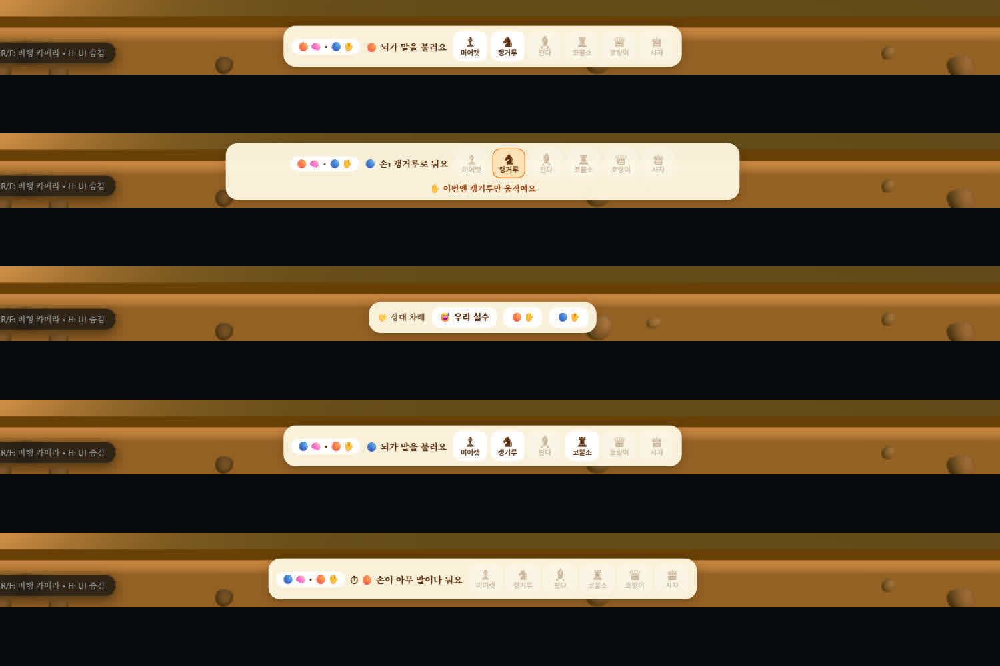

# CO-1 둘이 한 왕국 — 브라우저 확인 (2026-11-07)

계획서: [협동 계획서 §4.1](../plans/2026-11-07-coop-multiplayer-plan.md). 실행: ego-browser, 개발 서버 `localhost:3000`. 스크립트와 원자료는 [round-01.mjs](2026-11-07-coop-team/round-01.mjs), [result-01.json](2026-11-07-coop-team/result-01.json)에 있다.
시작 전 localStorage 를 떠 두었다가(빈 상태였다) 끝에 되돌렸다.

## 무엇을 했나

1. 손과 뇌를 「둘이 한 왕국」(수마다 교대)으로 두고 새 판을 열었다. 상대는 첫 판이라 쉬움 라이벌이다.
2. 첫 수에서 🟠 가 뇌로 캥거루를 불렀다. 이어 다음을 시도했다.
   - 미어캣 버튼 누르기
   - `setHandBrain('pawn')` 으로 종류 바꾸기
   - `executeChessMove` 로 폰 e2-e4 두기(클릭이 아닌 길)
   - 캥거루 g1-f3 두기
3. 상대 차례에 🟠✋ 와 🔵✋ 를 이어 눌렀다.
4. 둘째 수에서 🔵 가 뇌인지 보고, 21초 동안 아무것도 부르지 않았다. 손에게 넘어간 뒤 폰을 두었다.
5. 나머지 수는 자동으로 두었다. 뇌는 AI 조언(쉬움)의 종류를 버튼으로 부르고, 손은 그 종류 안에서 쉬운 봇 수(slip 0.3)를 두었다. 판이 끝날 때까지 이어 갔다.

## 결과

| 확인 | 결과 |
| :--- | :--- |
| 첫 수 자리 표시 | 「🟠🧠 · 🔵✋ 🟠 뇌가 말을 불러요」 |
| 부른 뒤 잠금 | 미어캣 버튼이 꺼진다(`disabled`). 엔진도 종류 바꾸기를 거부한다(`setHandBrain` 이 `false`) |
| 엔진 우회 | 폰 e2-e4 를 `executeChessMove` 로 두려 하면 `false`, 화면에 「✋ 이번엔 캥거루만 움직여요」. 캥거루 g1-f3 은 `true` |
| 상대 차례 버튼 | 「😅 우리 실수」·「🟠✋」·「🔵✋」가 나온다. 둘 다 누르면 하이파이브 글자가 뜬다(DOM 확인) |
| 둘째 수 교대 | 「🔵🧠 · 🟠✋ 🔵 뇌가 말을 불러요」 |
| 20초 인계 | 「⏱ 🟠 손이 아무 말이나 둬요」, 종류 버튼이 모두 꺼진다. 그 뒤 폰을 두는 것이 허용된다 |
| 교대가 끝까지 이어지나 | 자기 편 84수 내내 뇌 자리가 🟠/🔵 번갈아 바뀌었다 |
| 완주 | 168반수에서 흑의 체크메이트로 팀이 졌다. 엔진이 판 끝 화면을 띄웠다 |
| 팀 판 연출 단축 | 잡기 27번 모두 카메라 복귀가 0.22초, 잡기 한 번 전체는 1.93~2.68초 |
| 판 기록 | start 에 `handBrain:'family', roles:'move'`. coop 기록은 `highfive` 1번, `handover` 1번 |

위 그림의 다섯 줄은 순서대로 다음과 같다.
1. 🟠 뇌가 부를 차례
2. 캥거루 잠금과 우회 차단 안내
3. 상대 차례의 😅·✋ 버튼
4. 🔵 뇌가 부를 차례
5. 20초 인계

판 중간 화면은 [d1-midgame.jpg](2026-11-07-coop-team/d1-midgame.jpg), 판 끝 화면은 [d2-end.jpg](2026-11-07-coop-team/d2-end.jpg)에 있다.

## 보인 것·남은 것

- **하이파이브 글자는 캡처에 잡히지 않았다.** DOM 에는 떴지만 1.6초 뒤 사라지고, 캡처 한 장에 약 1초가 걸린다. 크기와 위치는 눈으로 보지 못했다.
- **🧠 이모지가 작게 보인다.** 이 창 크기에서는 분홍 덩어리처럼 보이고, 휴대폰 화면에서는 재 보지 않았다.
- 판이 끝난 뒤에도 바에 「상대 차례 · 😅 · ✋」가 남는다. 진 뒤 「우리 실수」를 누를 수 있다는 점은 그대로 두었고, 사람 시험(CO-3)에서 다시 본다.
- **혼자 판과 연출 길이를 비교하지 않았다.** 혼자 판의 잡기 복귀 길이는 이번 실행에서 재 보지 않았다. 코드상으로는 `fxSettings().quick` 과 같은 길(복귀 0.22초)을 탄다.
- 자동 대국이라 사람 둘의 대화·답답함은 재지 못했다. CO-3 짝 5쌍 시험에서 본다.
