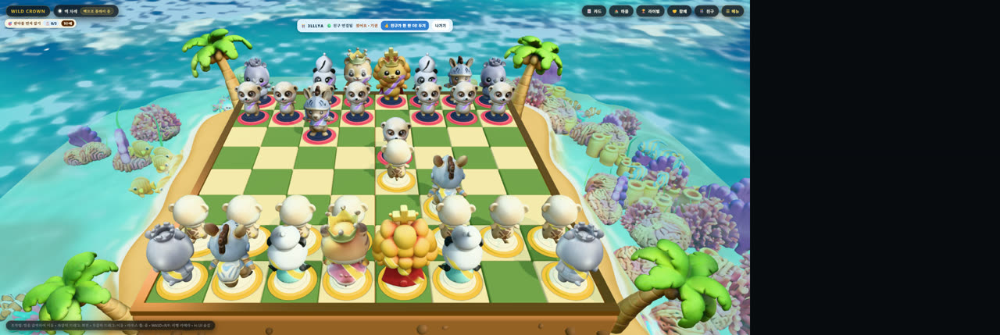

# 친구와 두기 👫 (초대 1:1 대전) — 확인 (2026-11-07)

사용자 결정(11-07): 「아는 사람 초대해서 1:1 플레이를 먼저」. 협동 계획서의 CO-4(원격)를 CO-2·CO-3 보다 앞당겼다.
중계는 Supabase Realtime 방송 채널이다. 무료 한도(켜진 프로젝트 2개) 때문에 새 프로젝트를 만들지 못해, fortune-fusion 프로젝트의 채널을 빌려 쓴다(DB 표·로그인은 안 쓴다).
배포는 Cloudflare 다. Pages 가 Workers 정적 파일로 바뀌어 `wrangler deploy` 로 올렸다.

- 배포 주소: https://wildcrown.yonghane.workers.dev
- 스크립트·원자료: [2026-11-07-online-1v1/](2026-11-07-online-1v1/)

## 어떻게 시험했나

- **두 기기 흉내.** 방장은 ego-browser(`127.0.0.1:3000`, 마지막엔 배포 주소), 손님은 앱 안 브라우저(`localhost:3000`)다. 저장소가 따로라 두 사람처럼 동작한다.
- **수를 두는 길.** 클릭과 같은 길인 `executeChessMove` 로 두었다. 규칙 층으로는 엔진이 보내는 `onlinemove` 사건만 들어간다.
- **도착 시간.** 보낸 쪽 `Date.now()` 와 받은 쪽에서 반수(ply)가 늘어난 시각의 차이다. 같은 PC 시계를 쓰고, 30~50ms 간격으로 확인했다.

## 결과

| 확인 | 결과 |
| :--- | :--- |
| 방 만들기 | 6글자 코드, 주소가 `?room=코드` 로 바뀜, 「🟡 친구를 기다리는 중 · 내 차례 (백)」 |
| 손님 입장 | 초대 주소만 열면 흑으로 자리 잡음. 양쪽 「🟢 친구 연결됨」. 방장 쪽 초대 창은 친구가 들어오면 저절로 닫힘 |
| 수 주고받기 | 바보의 메이트 4수가 양쪽에서 같다. 방장 「졌어요 · 체크메이트」, 손님 「이겼어요 · 체크메이트」 |
| 차례 지키기 | 흑 차례에 방장이 흑 말을 움직이려 하면 `false` |
| 도착 시간 | 62 · 83 · 99 · 129 · 156 · 163ms (6번, 배포↔로컬 1번 포함). 첫 수 1번은 손님 쪽 측정이 늦게 시작해 뺐다 |
| 손님 새로고침 | 같은 자리(흑)로 돌아와 e4 를 다시 받는다. 두 번째 새로고침 때는 e4 e5 Nf3 세 수를 받고 Nc6 을 둘 수 있었다 |
| 기권 | 방장 「졌어요 · 기권」, 손님 「이겼어요 · 기권」 |
| 한 판 더 | 손님이 청함 → 방장에게 「👍 친구가 한 판 더! 두기」 → 누르면 색이 바뀐다(방장 백→흑, 손님 흑→백). 둘째 판에서도 수가 오간다 |
| 나가기 | 나간 쪽은 혼자 판으로 돌아가고 주소의 `?room=` 이 지워진다. 남은 쪽은 약 15초 뒤 「🟠 친구 연결 끊김」 |
| 배포본 | 배포 주소 방장(흑) ↔ 로컬 손님(백): d4 가 129ms 에 도착. 배포본 첫 로딩은 3.2초(이 PC·회선, 캐시 없음) |

## 시험 중에 찾아 고친 것

1. **늦게 온 방장 기록이 손님의 수를 지웠다.**
   - 손님이 새로고침 직후 e5 를 두는 사이에, 방장의 예전 기록(e4 까지)이 늦게 도착했다.
   - 손님 규칙 층은 그것을 「다른 판」으로 보고 자기 기록을 되돌렸다. 엔진(e5 있음)과 규칙 층(e5 없음)이 어긋나 다음 수를 받지 못했다.
   - 고침: 같은 판의 더 짧은 기록은 무시한다. 따라잡기에서 엔진이 수를 거부하면 판 전체를 다시 그린다.
   - 시험 2개를 더했다(`test/matchCore.test.mjs` 10·11).
2. **「한 판 더」에서 서로를 기다렸다.**
   - 방장 화면이 다시 붙으면서 손님의 요청을 잃었고, 두 쪽 모두 「물어봤어요」에서 멈췄다.
   - 고침: 이미 내가 청한 상태에서 상대 요청이 오면 바로 시작한다. 시험 9.
3. **방을 만든 뒤 초대 창이 판을 가렸다.**
   - 고침: 친구가 들어오면 창을 닫는다.
4. **친구 대전 중에 혼자 판 장치가 보였다.**
   - 손과 뇌 막대, 정찰·되감기 버튼이 떴다. 엔진은 되감기를 혼자 판에서만 받으므로 판이 어긋나지는 않았다.
   - 고침: `body.online-game` 일 때 숨긴다.

## 재 보지 않은 것·남은 것

- **숨긴 탭에서는 상대 수가 엔진에 그려지지 않는다.**
  - 앱 안 브라우저 창이 숨겨지면 애니메이션이 멈춘다. 그동안 받은 수는 규칙 층에서 검증까지 끝나고, 엔진에 그리는 것만 기다린다.
  - 휴대폰에서 탭을 내렸다 다시 올렸을 때 밀린 수가 제대로 그려지는지는 재 보지 않았다.
- **휴대폰 두 대·다른 회선에서는 재 보지 않았다.** LTE 지연, 화면 막대가 겹치는지도 아직 모른다.
- **방장이 창을 닫으면 손님은 방장이 돌아올 때까지 기다리기만 한다.** 방장만 판 전체를 저장한다(탭 sessionStorage). 몰수·무효 타이머(기획서 §12.1)는 넣지 않았다. 친구 대전이라 판단했다.
- **판이 끝난 뒤 새로고침하면 방장 판이 빈 판으로 보인다.** `replayResume` 이 끝난 판을 다시 두지 않기 때문이다. 결과 글자는 남는다.
- **친구 대전 중에도 왼쪽 위 미션 칩(「판다를 먼저 잡기 0/3」)이 보인다.** 엔진의 판 보고는 혼자 판만 받으므로 보상은 없다. 표시만 남는다.
- **채널 이름 `wildcrown:<코드>` 를 아는 사람은 그 방 메시지를 볼 수 있다.** 공개 방송 채널이고, 6글자 코드라 우연히 맞히기는 어렵다. 받은 수는 chess.js 로 검증하지만, 남이 끼어들어 hello 를 보내면 「방이 찼어요」만 받는다.
