# 잡기 30칸 녹화(CX-0)와 역전 세기(CX-1) — 확인 (2026-11-08)

계획서: [잡기 30가지 연출](../plans/2026-11-08-capture-matchup-plan.md). 갤러리: [index.html](2026-11-08-cx0-captures/index.html). 개발 서버에서 `http://localhost:3000/docs/qa/2026-11-08-cx0-captures/index.html` 로 열면 44개 영상이 한 화면에서 돈다.

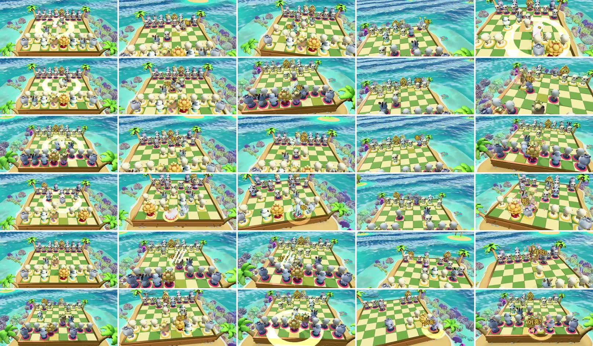

## 찍는 방법 (CX-0)

1. **국면.** 봇 60판 시뮬([pair_sim-60.json](../research/2026-11-08-capture-pairs/pair_sim-60.json))의 칸별 가장 짧은 수순을 [make-lines.mjs](2026-11-08-cx0-captures/make-lines.mjs) 가 이어 하기 기록과 마지막 잡기 한 수로 바꾼다([lines.json](2026-11-08-cx0-captures/lines.json)).
   - 잡는 쪽 색을 내 색으로 두어 카메라가 잡는 쪽 뒤에 선다.
   - 체크가 같이 걸리는 칸이 둘 있다(비숍→비숍 `Bxd7+`, 퀸→퀸 `Qxe7+`). 그래서 세기가 한 단계 높다.
   - 폰→룩은 승급 잡기(`bxa1=Q`)라 끝에 「승급!」이 같이 나온다.
2. **녹화.** [record.mjs](2026-11-08-cx0-captures/record.mjs)(ego-browser). 칸마다 저장을 넣고 새로고침한 뒤 엔진이 준비되면, 게임 캔버스(1920×921)를 `captureStream(30)` + `MediaRecorder`(VP9)로 찍는다.
   - 수를 두고 연출이 끝나는 순간(`debugBusy` 가 꺼짐)에 멈춘다. 상대 응수는 들어가지 않는다.
   - 끝에 저장을 비웠다.
3. **변환.** webm → mp4(540px, 24fps, CRF 32)와 썸네일(길이의 55% 지점)을 만들었다. 영상 37개는 3.8MB, 썸네일은 0.6MB 다.

녹화 방식은 이 엔진에서 **된다.** 30칸 모두 오류 없이 찍혔다. 다만 이 PC 의 ego-browser 는 화면을 초당 29번까지만 그려서(메모리 기록), 영상이 실제로는 약 16fps 다(4초에 64프레임). GIF 대신 mp4 를 남긴 이유는 크기다. 같은 30개가 GIF(400px)로 31MB, mp4 로 3.8MB 였다.

## 지금 모습에서 본 것 (CX-0)

- **잡기 한 수가 끝날 때까지 2.35~4.05초**(수를 둔 때부터 연출 끝까지, `result-before.json` 의 `busyMs`).
  - 같은 칸을 다시 재면 ±0.9초까지 흔들렸다. 폰→퀸이 4,049ms 에서 3,133ms 로 줄었는데 세기는 같았다. 칸끼리 시간을 비교하는 데는 쓰지 못한다.
- **폰이 잡히는 칸(첫 열)은 카메라가 다가가지 않아 장면이 판 전체 중 작은 점이다.** 잡기의 44.8% 가 이 칸들이다. 층 2의 잡힌 말 반응은 크게(위치·회전) 움직여야 보인다는 계획서 8절 4번과 맞다.
- 잡는 말별 글자(뽁!·퍽!·쿵!·쾅!·샤악!·어흥!)는 30칸 모두 썸네일에서 읽힌다. 잡힌 말이 무엇인지는 동물 모양으로만 갈린다.

## 역전 세기 (CX-1)

- `src/fx/impactTier.js`: `attackerFromSan` 은 기보의 첫 글자로 잡은 말을 읽는다. `isUpset` 은 잡힌 말이 잡은 말보다 3점 이상 높은지 본다. 점수는 폰 1, 나이트·비숍 3, 룩 5, 퀸 9 이고, 킹은 뺐다.
  - `impactTier` 는 역전이면 「큼」을 준다. 기보에서 잡은 말을 읽으므로 엔진 호출부 두 곳(타격·카메라 기울기)을 바꾸지 않아도 된다.
- 엔진 `landImpact`: 역전이면 잡는 말 글자 대신 **「역전!」**을 띄운다. 디버그용 `debugLastUpset()` 을 더했다.
- 역전 칸은 5개다: 폰→룩, 폰→퀸, 나이트→퀸, 비숍→퀸, 룩→퀸.
  - 봇 60판에서 합쳐 **4.9%** 였다. 계획서 처음 판의 3.4% 는 룩→퀸을 빼고 센 값이다.
- **세기가 실제로 바뀌는 것은 폰→룩 하나다.** 나머지 넷은 퀸을 잡는 칸이라 원래 「큼」이었다. 이 넷은 글자만 「역전!」으로 바뀐다.

| 확인 | 결과 |
| :-- | :-- |
| 테스트 | `test/impact.test.mjs` 에 3개를 더했다. 30칸 × (그냥·체크·메이트) 세기를 고정하고, 역전이 정확히 5칸인지 본다. 이전보다 느려지는 칸이 폰→룩(체크 포함)뿐이고 0.3초 이하인지도 본다. 전체 202 통과, `tsc` 오류 0 |
| 늘어나는 시간 | 폰→룩만 0.228초 늘어난다(멈칫 0.11 + 느린 화면 0.29×0.65, 「중간」이었을 때는 0.07). 원칙의 0.3초 안이다 |
| 화면 | 고친 뒤 5칸을 다시 찍었다. `debugLastUpset` 이 5칸 모두 `true`, 대조 2칸(폰→폰, 퀸→퀸)은 `false` 다. 폰→룩 영상에서 「역전!」 글자와 큰 카메라 기울기가 보인다 |

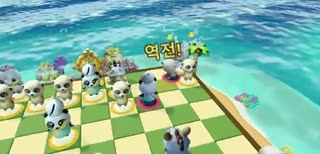

## 재 보지 않은 것

- **사람이 「역전!」을 좋게 느끼는지.** 봇이 사람의 퀸을 잡았을 때도 「역전!」이 뜬다. 계획서 8절 3번의 「놀림처럼 보일 수 있다」는 사람 시험 전까지 판정 보류다.
- **소리.** 녹화에 소리는 없다. 역전 때 소리는 「큼」 소리를 그대로 쓴다.
- 휴대폰 화면에서 글자 크기.
- 사람 시험 A(GIF 만 보고 누가 누구를 잡았나 맞히기)의 기준 정답률은 아직 재지 않았다. 갤러리 영상이 그 재료다.

## 잡힌 동물 반응 5종 (CX-2)

- **무엇을 바꿨나.**
  - 새 모듈 `src/fx/captureReaction.js` 의 `reactionPose(type, t)` 는 시간을 넣으면 자세를 돌려주는 순수 함수다. 돌려주는 값은 밀린 거리·높이·뒤로 넘어감·옆으로 넘어짐·제자리 회전·보관대로 간 비율·크기다.
  - 엔진 `retireAnimalPiece` 는 공격 방향을 받고, `stepFadingPieces` 가 이 자세를 쿼터니언으로 입힌다.
  - 전체 길이는 예전 퇴장과 같은 1.25초다. 앞 0.55초가 동물별 반응이고, 뒤는 보관대로 가는 퇴장이다.
- **반응.** 넘어진 코뿔소만 누운 채 나가고, 나머지는 퇴장하며 다시 선다.

| 잡힌 동물 | 설계 | 추적값(실제 화면, 시계 0.25배) |
| :-- | :-- | :-- |
| 미어캣(폰) | 팽이처럼 3바퀴 돌며 높이 튕겨 나감 | 최고 1.10칸, 반응 끝 1.00칸 밀림 |
| 캥거루(나이트) | 통 튀었다가 엉덩방아 | 최고 0.49칸(퇴장 통통 포함), 뒤로 31° 기울어 앉음 |
| 판다(비숍) | 바닥에서 뒤로 두 바퀴 구름 | 최대 179° 뒤집힘, 0.83칸 밀림 |
| 코뿔소(룩) | 흔들리며 버티다 옆으로 쿵 넘어짐 | 0.18칸만 밀림, 90° 누운 채 퇴장 |
| 호랑이(퀸) | 높이 떠서 뒤로 공중제비 | 최고 0.79칸, 149°까지 잡힘(표본 간격 때문에 180°는 못 잡음) |

- **확인 방법.**
  - 디버그 `debugFading()` 은 퇴장 중인 말의 높이·밀린 거리·기울기·화면 좌표를 돌려준다.
  - [trace.mjs](2026-11-08-cx0-captures/trace.mjs) 가 페이지 시계를 0.25배로 늦추고, 매 프레임 기록과 잡힌 말 둘레 연속 캡처를 함께 했다. 원자료는 [result-trace.json](2026-11-08-cx0-captures/result-trace.json) 이다.
- **테스트.** `test/captureReaction.test.mjs` 6개.
  - 길이가 1.25초인지 본다.
  - 시작 자세가 원래 자리인지 본다.
  - 60fps 한 프레임에 0.2칸·1/4바퀴를 넘는 끊김이 없는지 본다. 판다의 두 바퀴(4π)는 0 과 같은 자세라 한 바퀴 단위로 비교한다.
  - 다섯 반응의 서명이 서로 다른지, 무게 순서(미어캣이 가장 멀리·높이, 코뿔소가 가장 덜)가 맞는지 본다.
- 전체 테스트 208개 통과, `tsc` 오류 0.
- **30칸 다시 녹화.** CX-2 만 넣은 영상은 커밋 `152fe3c` 에 있다. 지금 갤러리 맨 위는 CX-3 까지 넣은 영상이다. 수를 둔 때부터 연출 끝까지 걸린 시간은 30칸 평균 +0.12초였다. 같은 칸을 다시 재도 ±0.9초까지 흔들려서, 늘었다고 할 수 없다. 반응은 예전 퇴장 1.25초 안에서 돈다.

| 잡힌 동물 | 연속 장면(잡힌 말 둘레를 잘라 냄, 왼쪽부터 시간 순) |
| :-- | :-- |
| 미어캣 | 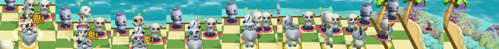 |
| 캥거루 | 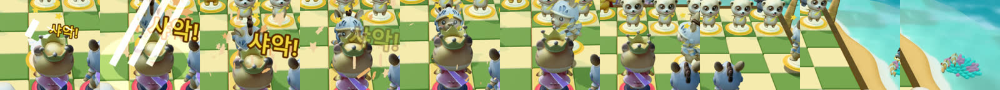 |
| 판다 | 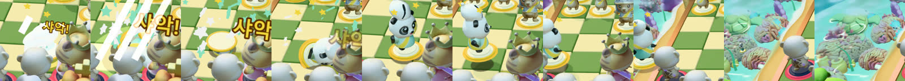 |
| 코뿔소 | 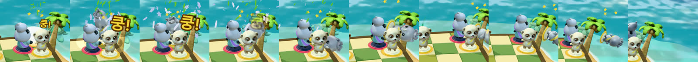 |
| 호랑이 | 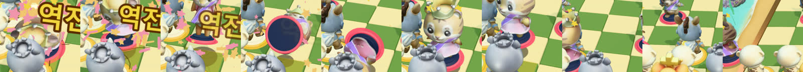 |

### CX-2 에서 재 보지 않은 것

- **기본 카메라 거리에서 사람이 반응을 알아보는지.**
  - 폰이 잡히는 칸은 카메라가 다가가지 않아, 30칸 영상에서는 반응이 작게 보인다.
  - 위 연속 장면은 잘라 낸 것이다.
  - 사람 시험 A(소리 끈 영상만 보고 잡힌 동물 맞히기)로 재야 한다.
- **에셋이 아닌 동상(`rig === 'statue'`) 말.** 이 경로는 부서지는 연출이라 바꾸지 않았다.
- **앙파상.** 같은 반응을 쓰도록 연결했지만 화면으로는 보지 않았다.
- **어지러운 별.** 미어캣이 3바퀴 도는 동안 별이 머리를 따라가는지는 연속 장면에서 대략만 봤다.

## 잡는 동물 공격 6종 (CX-3)

- **무엇을 바꿨나.**
  - 새 모듈 `src/fx/attackStyle.js` 의 `attackStyle(type, u, contact)` 는 공격 구간(다가감 끝 → 공격 끝, 약 1.2초)의 진행과 타격 지점을 넣으면 몸 자세를 돌려준다. 자세 필드는 `moveStyle` 과 같다.
  - 양 끝은 중립이고, 준비 자세 → 타격 자세 → 중립으로 돌아온다. 새 클립은 없다.
  - 엔진은 공격 구간 매 프레임에 `applyStylePose` 로 입히고, 몸 위치에 앞으로·위로 움직임을 더한다.
  - 타격 뒤 따라 들어가는 위치는 이 자세를 뺀 몸 위치에서 시작한다(`attackPoseOffset`).
  - 공격 직전 14% 눌림(예전 예비 동작)은 동물별 준비 자세로 바꿔 지웠다. PT 확인 때 기본 카메라에서 안 보였던 것이다.
- **시간.** 이 단계는 자세만 바꾸고 `tApproach`·`tImpact`·`tStrikeDone` 은 건드리지 않는다. 그래서 엔진이 계획한 잡기 길이(`__wizardChessTelemetry.lastCaptureTiming.totalDuration`)는 그대로다.
  - 녹화의 `busyMs` 는 같은 칸에서 2.8초와 3.8초 두 값 사이를 오갔다(CX-2 녹화에서도 같았다). 연출 끝에 상대 응수가 붙는 때가 있어 생기는 측정 잡음으로 보고, 시간 비교에 쓰지 않는다. 원인은 확인하지 않았다.

| 잡는 동물 | 동작 | 추적값(시계 0.2배, 그 동물 공격만) |
| :-- | :-- | :-- |
| 미어캣(폰) | 까치발로 쭉 섰다가 앞으로 박치기 | 뒤로 -0.16 → 앞으로 0.48 rad, 키 1.20배 |
| 캥거루(나이트) | 웅크렸다 뒤로 젖히며 두 발 차기 | 앞 0.12 → 뒤로 -0.55 rad, 0.07 뜸, 키 0.84~1.10배 |
| 판다(비숍) | 그 자리에서 앞으로 한 바퀴 굴러 박치기 | 6.28 rad(한 바퀴), 최고 0.40 뜸 |
| 코뿔소(룩) | 땅을 두 번 긁고 머리 숙여 들이받기 | 흔들림 -0.12, 좌우 0.06 → 앞으로 0.36 rad |
| 호랑이(퀸) | 뒷발로 일어섰다 비틀며 할퀴기 | 뒤로 -0.35 → 앞 0.30 rad, 비틀기 0.26 |
| 사자(킹) | 가슴 펴고 젖혔다가 포효, 갈기 흔들기 | 뒤로 -0.29, 키 1.17배, 좌우 흔들기 0.26 rad |

| 잡는 동물 | 연속 장면(공격하는 말 둘레, 시간 순) |
| :-- | :-- |
| 미어캣 | 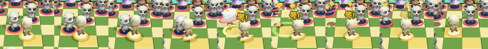 |
| 캥거루 | 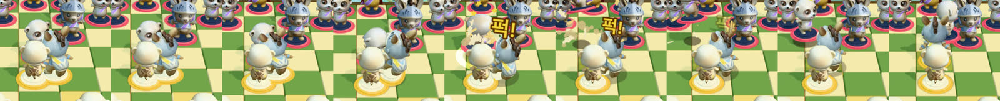 |
| 판다 | 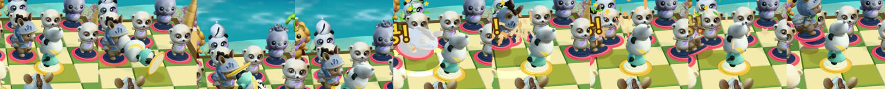 |
| 코뿔소 | 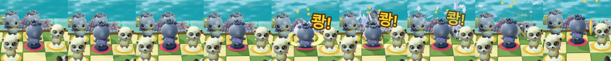 |
| 호랑이 | 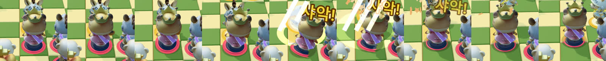 |
| 사자 | 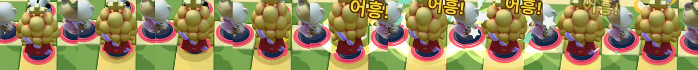 |

- **확인 방법.** 디버그 `debugAttackPose()` 가 이번 프레임의 공격 자세와 화면 좌표를 돌려준다. [trace-atk.mjs](2026-11-08-cx0-captures/trace-atk.mjs)·[result-trace-atk.json](2026-11-08-cx0-captures/result-trace-atk.json).
  - 처음 돌렸을 때 판다 칸에 호랑이 값이 섞였다. 상대 응수(호랑이의 잡기)까지 기록됐기 때문이다. 그 칸 공격자만 남기도록 고쳐 다시 쟀다.
- **테스트.** `test/attackStyle.test.mjs` 5개.
  - 여섯 종류가 다 있는지 본다.
  - 양 끝이 중립인지 본다(판다 한 바퀴는 0 과 같은 자세).
  - 60fps 한 프레임 끊김이 없는지 본다. 판다 구르기가 가장 빨라 한 프레임에 약 0.05(칸의 15%)를 움직인다.
  - 몸이 잡히는 말 쪽으로 너무 나가지 않는지 본다.
  - 타격 순간 여섯 자세가 서로 다른지 본다.
- 전체 테스트 213개 통과, `tsc` 오류 0. 30칸을 다시 녹화했고 갤러리 맨 위 표다.

### CX-3 에서 본 문제와 재 보지 않은 것

- **내 말이 공격할 때는 카메라가 그 말의 등 뒤에 선다.** 사자처럼 몸이 큰 말은 뒷모습으로만 보여, 가슴을 펴는 동작이 실루엣으로만 드러난다. 사람 시험 A 에서 「누가 잡았나」 정답률로 잴 것이다. 카메라 각도를 바꾸는 일은 이 단계에서 하지 않았다.
- 상대 말이 공격할 때(앞모습)는 따로 찍지 않았다.
- 빠른 대국에서도 자세는 그대로 나온다(시간이 같으니). 빠른 대국에서 거슬리는지는 재 보지 않았다.

## 맞대결 특례 3종 (CX-4)

코드: [captureSpecial.js](../../src/fx/captureSpecial.js) · 테스트 [captureSpecial.test.mjs](../../test/captureSpecial.test.mjs) 6개 · 엔진 `landImpact`·공격 구간·`stepRoarSways`.

| 특례 | 해당 칸 | 하는 일 | 시간 |
| :-- | :-- | :-- | :-- |
| 거울 대결 | 나이트·비숍·룩·퀸 같은 종끼리(4칸) | 잡히는 쪽이 공격자의 준비 자세를 절반 세기로 따라 한다(기울기·늘이기). 준비가 끝나면 타격 지점까지 원래 자세로 풀린다. 그 뒤는 CX-2 반응. 판다는 준비 자세가 없어 앞으로 숙이는 시늉(0.35 rad) | 그대로 |
| 사자 포효 | 킹이 잡을 때(5칸) | 잡힌 칸에서 두 칸 안의 말이 바깥쪽으로 젖혀졌다 돌아온다. 바로 옆 0.2 rad, 두 칸 0.1 rad, 0.48초 감쇠 흔들림. 다음 수가 시작되면 즉시 원래 자세로 | 그대로(공격 끝 0.48초 안) |
| 폰 콤보 | 폰 → 폰(앙파상 포함) | 그 판에서 n번째 폰끼리 잡기면 타격음·서명음이 2^((n-1)/12)배, 7반음에서 멈춤. 이때는 ±6% 무작위 음높이를 쓰지 않아 반음 계단이 들린다 | 그대로 |

### 브라우저 추적 (ego-browser, 시계 0.25배) — `trace-cx4.mjs` → `result-trace-cx4.json`

| 칸 | 기록 | 따라 하기 범위(rad) |
| :-- | :-- | :-- |
| knight>knight | mirror ✓ | pitch 0~0.06, stretch 0.92~1 |
| bishop>bishop | mirror ✓ | pitch 0~0.35 |
| rook>rook | mirror ✓ | pitch −0.06~0, yaw ±0.03 |
| queen>queen | mirror ✓ | pitch −0.17~0, lift 0.02, stretch 1~1.05 |
| king>pawn · knight · bishop · rook · queen | 흔들린 말 7 · 9 · 8 · 3 · 5 | — |
| pawn>pawn | comboN 1, 음높이 1 (이 국면은 그 판 첫 폰끼리 잡기). 첫 실행에서 상대 응수 exd5 가 comboN 2 · 1.0595 로 기록됨 | — |

- 녹화 끝에 잡힌 쪽 자세는 모두 중립(pitch 0, stretch 1)으로 돌아와 있었다.
- 10칸 녹화(`video/*-cx4.mp4`)의 수를 둔 때부터 연출 끝까지 걸린 시간은 CX-3 녹화와 칸마다 −1.07~+0.67초다. 같은 칸을 다시 재도 ±0.9초까지 흔들리는 값이라 늘었다고 할 수 없다. 코드는 `tApproach`·`tImpact`·`tStrikeDone` 을 건드리지 않는다.
- 드로우콜 게이트 98 / 100 통과(초기 국면, 새 메시 없음).
- 띠 그림 `special/*.jpg`(추적 캡처)·`special/*-sheet.jpg`(영상 프레임).

### CX-4 에서 본 문제와 재 보지 않은 것

- **약하다.** 나이트(0.06 rad + 8% 웅크림)·룩(0.06 rad 땅 긁기)의 따라 하기와 포효 흔들림은 기본 카메라 영상에서 눈으로 거의 가려지지 않는다. 사자 몸이 앞을 가리는 칸도 있다. 「살짝」이 설계였지만, 사람이 알아보는지는 사람 시험 A 에서 같이 묻는다. 너무 안 보이면 `MIRROR_SHARE`·`ROAR_TILT` 를 올린다.
- 폰 콤보 음 계단을 사람 귀로 들어 보지 않았다(헤드리스 녹화에는 소리가 없다).
- 처음 추적 때 결함 둘을 찾아 고쳤다. `debugSpecial()` 이 첫 잡기 전에는 null 이었고, 끝에 읽은 값이 상대 응수의 값이었다.
