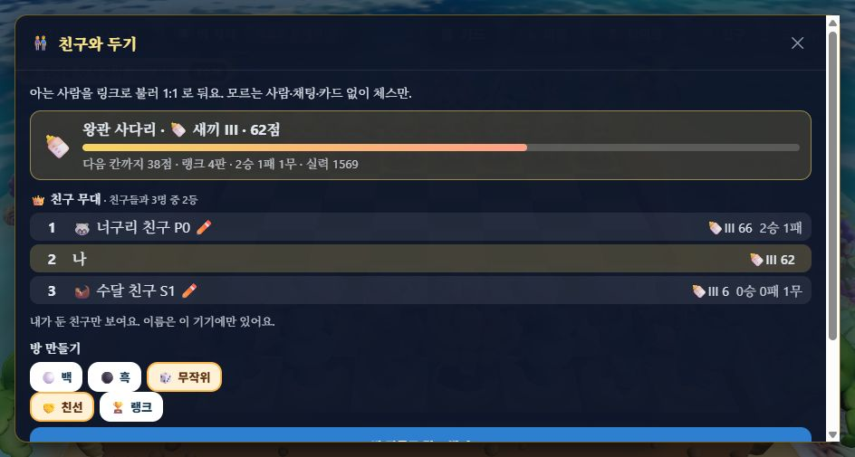
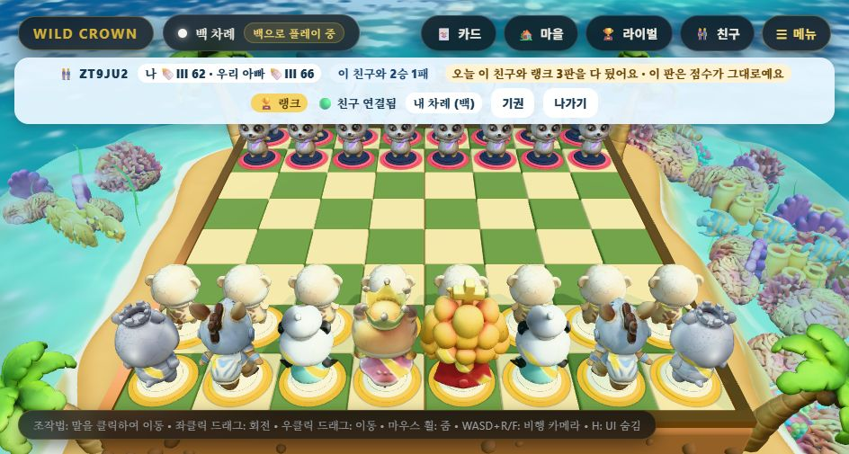
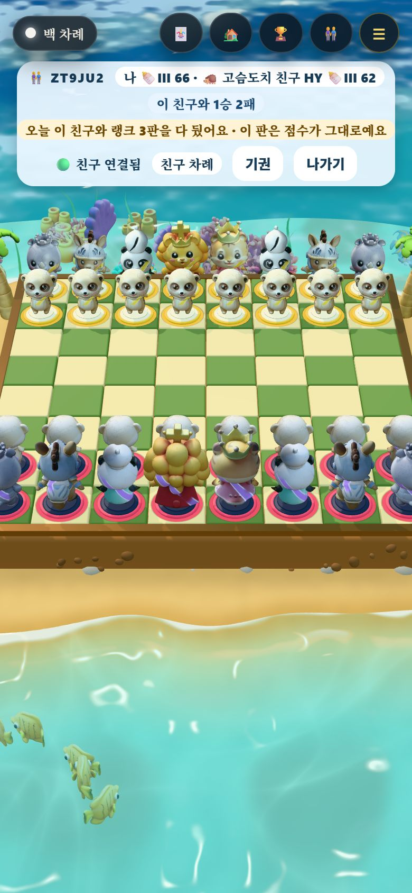

# L-3 친구 무대 — QA (2026-11-09)

계획서 [§4.4 왕관 사다리](../plans/2026-11-09-play-launch-lessons-plan.md) L-3. 근거: 조사 ⑨(전 세계 순위표 대신 아는 사람 사이 순위).

## 바꾼 것

| 곳 | 내용 |
| :-- | :-- |
| `src/rank/circle.js`(새) | 친구별 전적 `headToHead`, 친구들 사이 순위 `circleOf`(사다리 점수 순, 같은 점수는 같은 등수, 최근 둔 30명까지), 요청 검사, 기기 안 친구 이름(`wildcrown.friends.v1`), 글자(「3승 2패」·「친구들과 4명 중 2등」) |
| `worker/index.js` | `POST /api/rank/circle` — `{ id, pub, at, sig }`. 공개 키 해시가 id 와 같고, `wildcrown-circle-v1\|id\|at` 서명이 맞고, 시각이 ±10분일 때만 답한다. 무효 판은 빼고, 상한 판(점수엔 안 든 판)은 둔 판이라 전적에 넣는다 |
| `src/rank/client.js` | `fetchCircle(base, identity)` |
| `src/Online.tsx` · `styles.css` | 친구 창 「👑 친구 무대」 목록(등수 · 이름 ✏️ · 칸 · 전적), 랭크 방 막대에 친구 이름과 「이 친구와 2승 1패」 칩 |

**이름은 서버에 없다.** 처음엔 id 로 정해지는 동물 이름(「🦊 여우 친구 K3」, 끝 두 글자는 id 끝), 누르면 이 기기에서만 바꾼다(12글자). 자유 글을 서버로 보내지 않으니 채팅이 없다는 원칙(기획서 §12.1)이 그대로다.
**남의 무대는 못 읽는다.** 기기 id 는 함께 둔 친구에게 보이므로, id 만으로 답하면 친구가 내 다른 친구 목록을 읽을 수 있다. 그래서 자기 서명을 요구한다.

## 측정

### 단위 테스트 — `test/circle.test.mjs` 5개
전적(무효 빼고 상한 넣기), 순위·같은 등수, 30명 자르기, 기기 안 이름(다듬기·지우기·깨진 저장), 서명 요청(다른 id 에는 안 맞음 · 11분 지난 시각 거부). 전체 `npm test` 257/257, `tsc` 0, 번들 게이트 통과(JS gzip 395KB / 상한 400KB — 여유 5KB).

### 로컬 Worker + 두 브라우저 — **15/15** ([verify.mjs](2026-11-09-circle/verify.mjs) → [result.json](2026-11-09-circle/result.json))

| 항목 | 기대 | 결과 |
| :-- | :-- | :-- |
| 나-A 3판 · 나-B 1판(무) · A-B 1판 넣기 | counted ×5 | ✅ |
| 나의 무대 | 나·A·B, 나와 안 둔 C 없음 | ✅ A 66 · 나 62 · B 6 |
| A 와 · B 와 전적 | 2승 1패 · 1무 | ✅ |
| 둔 친구 없음 | 나 혼자 | ✅ |
| B 키로 나의 무대 묻기 | 403 pub | ✅ |
| 내 공개 키 + B 서명 | 403 signature | ✅ |
| 11분 지난 요청 · 시각과 안 맞는 서명 | 400 time · 403 | ✅ |
| 친구 창(960×600) | 3줄 · 「친구들과 3명 중 2등」 | ✅  |
| A 이름을 「우리 아빠」로 | 화면·`wildcrown.friends.v1` | ✅  |
| 같은 랭크 방, 내 막대 | 「우리 아빠」 · 「이 친구와 2승 1패」 | ✅  |
| A 막대(390×844) | 기본 동물 이름 · 「이 친구와 1승 2패」, 넘침 없음 | ✅  |

휴대폰 막대의 「오늘 이 친구와 랭크 3판을 다 뒀어요」는 시험에서 같은 날 3판을 넣었기 때문이다(R-4 상한이 맞게 뜬 것).

## 재 보지 않았다 · 남은 것

- 사람(아이·부모)이 무대를 보고 「한 판 더」를 더 두는지는 재 보지 않았다. 조사 ⑪에 따라 「친구가 앞질렀어」 푸시는 넣지 않았다.
- 친구 30명이 넘는 사람의 목록 높이(220px 스크롤)는 화면으로 보지 않았다.
- 기기를 바꾸면 이름이 사라진다(기기 안에만 있으므로). 계정·백업이 생기면 함께 옮긴다.
- 시험 기기 신분은 헤드리스 Chrome 전용 임시 프로필에만 넣었다. 사용자 브라우저 저장은 건드리지 않았다.
