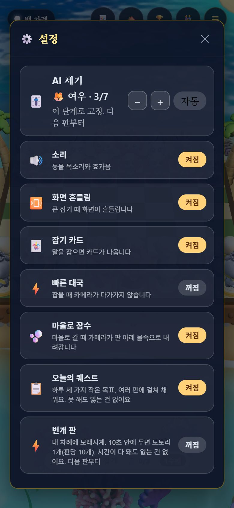

# DR-M1 딱 맞는 AI — QA (2026-11-10)

[방향 계획서](../plans/2026-11-10-direction-plan.md) §4.5 DR-M1: m1 난이도 7단계 + 설정에서 고르기 · m2 이 기기 안의 실력 점수로 다음 단계 맞추기(알리고 되돌리기) · m3 사람 같은 실수. 근거: [조사 E](../research/2026-11-10-direction/E-difficulty-matching.md).

## 바꾼 것

| 곳 | 내용 |
| :-- | :-- |
| `src/rules/ai.js` | `blind`(0..1) 옵션 — 상대의 「보기 어려운 응수」(4칸 이상 미끄러지는 비숍·룩·퀸, 뒤로 가는 말, `hardToSee`)를 그 확률로 못 본다. 한 번 생각하는 동안 같은 수는 같은 판정. `blind 0` 이면 예전과 똑같다(테스트) |
| `src/rules/strength.js`(새) | 7단계 표(탐색 깊이·실수·못 보기·동물 이름), 단계 점수, 실력 점수(Elo, 첫 5판 K150 · 15판까지 80 · 그 뒤 40), 여유 구간 [0.37, 0.65] 밖일 때만 **한 칸** 움직임, 되돌리기(뒤 3판은 올리지 않음), 고정·자동, 저장 `wildcrown.skill.v1` |
| `src/wizardChessEngine.js` | 자유 대국이 `hard` 와 `blind` 를 받는다. 라이벌 판은 그대로(못 보기 없음) |
| `src/RivalLadder.tsx` | 자유 대국이 끝나면 실력 점수 갱신 → 단계가 바뀌면 「지난 판들을 보니 실력이 늘었어요 — 다음 상대 🐼 판다 (4/7)」 + 되돌리기·좋아요. 판 끝 주머니가 떠 있는 동안은 숨었다가 닫히면 보인다. 라이벌 판은 예전 권유 그대로 |
| `src/SettingsPanel.tsx` · `styles.css` | 설정 맨 위 「🎚️ AI 세기 · 🦊 여우 · 3/7」, − · + (고르면 고정) · 자동. 숫자 점수는 보이지 않는다 |
| `src/VillageView.tsx` | **섬 장면(`islandScene.ts`·`undersea.ts`)을 마을을 열 때 받는 조각으로** — 이번 화면 코드로 첫 화면 JS 가 400KB 를 넘어서. 첫 화면 **382KB** · 늦게 받는 20KB |
| `CLAUDE.md` | 저장 키 목록에 `wildcrown.skill.v1` |

| 단계 | 탐색 | 실수 | 못 보기 | 이름 |
| --: | :-- | --: | --: | :-- |
| 1 | 1수 | 0.4 | 0.6 | 🐣 아기 미어캣 |
| 2 | 1수 | 0.2 | 0.3 | 🐿️ 다람쥐(새 기기 시작) |
| 3 | 1수 | 0.04 | 0.05 | 🦊 여우 |
| 4 | 1수 | 0 | 0 | 🐼 판다 |
| 5 | 2수 | 0.08 | 0.1 | 🦏 코뿔소 |
| 6 | 2수 | 0.05 | 0 | 🐯 호랑이 |
| 7 | 3수 | 0 | 0 | 🦁 사자 왕 |

## 측정

### m1 이웃 단계 (`node tools/step_ladder.mjs 24`, 봇끼리, 색 번갈아)

| 짝 | 약한 쪽 점수 | Elo 차 | 판 |
| :-- | --: | --: | --: |
| 1 대 2 | 0.33 | 120 | 24 |
| 2 대 3 | 0.42 | 58 | 24 |
| 3 대 4 | 0.23 | 211 | 24 |
| 4 대 5 | 0.27 | 172 | 24 |
| 5 대 6 | 0.25 | 191 | 24 |
| 6 대 7 | 0.25 | 191 | 16(v2, 같은 두 단계) |

모든 짝에서 위 단계가 세다. 목표(0.25~0.40) 밖은 2→3(0.42, 가까움)·3→4(0.23, 멂). 표본 24판은 ±0.1 쯤 흔들린다. 약한 단계끼리는 무승부가 많다(16/24 — 메이트를 못 해 200반수 상한·반복). 단계 점수 = 1단계 600 에서 Elo 차를 이어 붙임: 600 · 720 · 780 · 990 · 1160 · 1350 · 1540. 첫 표(v2)는 간격이 0.44·0.44·0.19·0.50 으로 고르지 않아 값을 다시 골랐다. 원본: [v2](../perf/2026-11-10-step-ladder-v2.txt) · [v3](../perf/2026-11-10-step-ladder-v3.txt).

### m2 맞춰 주기 (`node tools/coach_sim.mjs 300`, 가상 선수 300명 · 20판, 결과는 Elo 기대 승률로 뽑음 · 무 10%)

| 여유 구간 | 20판 안 「맞는 단계」 도달 | 마지막 판에 맞는 단계 | 오르내림 3번 이상 | 승률 중앙값 |
| :-- | --: | --: | --: | --: |
| [0.40, 0.60] | 90% | 63% | **66%** | 0.63 |
| **[0.37, 0.65] 채택** | **81%** | **61%** | **16%** | 0.65 |
| [0.35, 0.70] | 67% | 53% | 4% | 0.68 |

「맞는 단계」 = 진짜 기대 승률 0.45~0.60. 첫 시험(K 48·24, 여유 구간 없음)은 도달 47%·승률 0.68 이었다 — 센 사람이 약한 단계를 이기면 점수가 판마다 5점쯤만 올라서. 첫 판들의 K 를 키우고 여유 구간을 넣었다. 대가: 승률이 목표(0.55)보다 조금 높고, 아주 센 사람은 2단계에서 7단계까지 13판쯤 걸린다. 원본 [coach-sim.json](../perf/2026-11-10-coach-sim.json).

### m3 사람 같은 실수 (`node tools/mistake_types.mjs 12`, 약한 쪽 대 4단계 판다)

| 방식 | 큰 실수(2수 탐색 기준 150점 이상) | **응징 수가 「보기 어려운 수」** | 잃은 점수 중앙값 |
| :-- | --: | --: | --: |
| 예전: 무작위 실수(쉬움 · slip 0.3) | 4.8% | **22%** | 244 |
| 새: 1단계(slip 0.4 · blind 0.6) | 9.6% | **56%** | 358 |
| 새: 못 보기만(blind 0.6) | 8.0% | **62%** | 482 |

새 방식의 큰 실수는 절반 넘게 「멀리서 오는 수·뒤로 가는 수」에 당한다 — 사람 초보가 놓치는 쪽. 대신 한 번 실수하면 크게 잃는다(말을 흘린다). **사람 기보와 비교하지는 않았다** — 「사람이 이런 수를 놓친다」는 조사 E 의 서술(이용자 불만 · Maia)을 따른 정의다. 원본 [mistake-types.json](../perf/2026-11-10-mistake-types.json).

### 생각 시간 (Node, 국면 3개 × 3번)

| 단계 | 평균 | 가장 김 |
| :-- | --: | --: |
| 1~4 (1수) | 14~18ms | 43ms |
| 5~6 (2수) | 115ms | 263ms |
| **7 (3수)** | **1,114ms** | **2,396ms** |

**7단계는 화면을 1~2초 멈춘다.** AI 는 화면과 같은 스레드에서 생각한다(STATUS FN-5 「탐색 작업자 스레드」 미착수). 예전 가장 센 AI 는 2수였고 3수는 이번에 처음 자유 대국에 들어왔다. 아주 센 사람만 닿는 단계라 넣어 두었지만, 다음 할 일 1순위로 적는다.

### 화면 ([verify-coach.mjs](2026-11-10-dr-m1/verify-coach.mjs), 960×640 · 390×844, **14/14**)

| 항목 | 결과 |
| :-- | :-- |
| 새 기기 | 엔진 자유 대국 2단계 |
| 설정 「AI 세기」 | 「🐿️ 다람쥐 · 2/7」 한 줄 · 자동 설명 → + 누르면 「🦊 여우 · 3/7」·고정·엔진 3 → 자동 다시 켬 |
| 판 끝(실력 높게 꾸민 저장, 자유 대국 승) | 주머니 화면 동안 알림 숨김 → 닫으면 「지난 판들을 보니 실력이 늘었어요 — 다음 상대 🐼 판다 (4/7)」·엔진 4·화면 안 |
| 되돌리기 | 3단계·hold 3·엔진 3·알림 사라짐 |

 

확인 중 고친 것: 휴대폰에서 「여 / 우 · 3/7」로 끊기던 단계 이름을 따로 한 줄로, 판 끝 알림이 주머니의 「도감 열기·닫기」를 가리던 것을 주머니가 닫힌 뒤 뜨게.

### 게이트

`npm test` 279/279(실력 6 추가), `tsc` 0, 번들 첫 화면 382KB / 400 · 전체 401KB / 600, 드로우콜 첫 국면 68, 섬 장면 드로우콜 121 / 150(늦게 받은 장면으로), DR-0 마을 방문 확인 4/4 다시 통과.

## 재 보지 않았다 · 남은 것

- 사람이 「딱 맞다」고 느끼는지, 승률 0.65 가 아이에게 맞는지(계획서 §7-7 결정 — 아이는 더 높게?).
- 7단계의 화면 멈춤 → AI 를 작업자 스레드로(FN-5).
- 사람 기보로 실수 유형 비교(lichess 공개 기보 800~1200).
- 실력 점수를 친구 대전 숨은 점수와 잇기(DR-M2 m5), 친구 핸디캡(DR-M2 m4).
