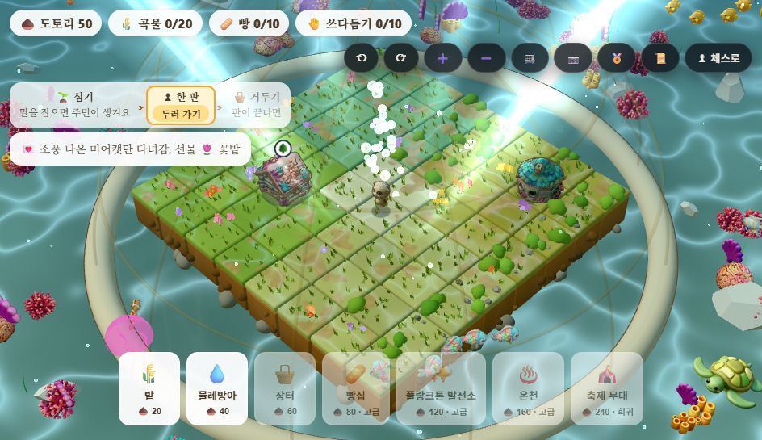
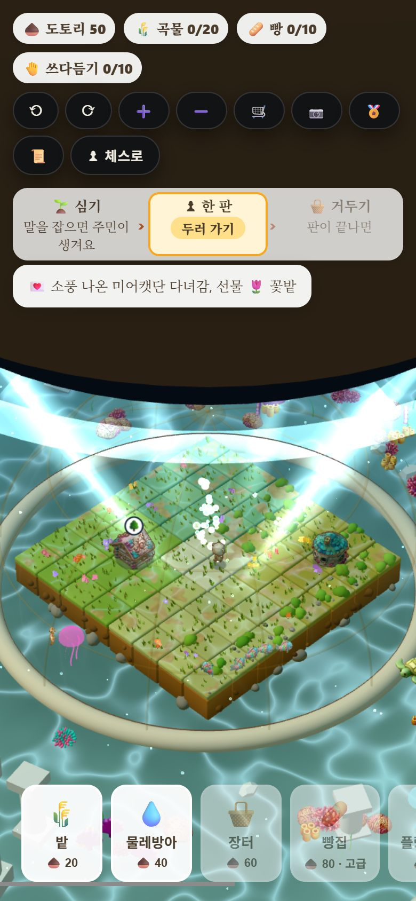

# DR-0 재기·치우기 — QA (2026-11-10)

[방향 계획서](../plans/2026-11-10-direction-plan.md) DR-0: 0a 루즈함 분해 · 0b 번들 보고·쓰지 않는 GLB·CREDITS · 0c 라이벌 방문 누수.

## 0a. 루즈함 분해 — 한 수 순환에서 무엇이 시간을 먹나 (`tools/tempo_probe.mjs`)

헤드리스 Chrome 에서 실제 엔진으로 판을 끝까지 둔다(dev 서버 3000). 내 쪽 수는 Node 에서 같은 AI(보통)로 골라 바로 넣는다 — **사람의 생각 시간은 0** 으로 두고, 그 밖의 시간만 잰다. 페이지 안 4ms 표본기로 「바쁨」(`debugBusy`)과 수 번호가 바뀐 시각을 기록했다.
엔진은 내 수 연출 동안 `isAnimatingMove`, AI 대기 동안 `aiTimer`, AI 수 연출 동안 다시 `isAnimatingMove` 로 **입력을 막는다**(`src/wizardChessEngine.js` pointerup). 그래서 「내가 둔 순간 → 다시 말을 집을 수 있을 때」 전체를 「막힌 시간」으로 본다.

| | 일반 연출(3판 · 169순환) | 빠른 연출 설정(3판 · 80순환) |
| :-- | :-- | :-- |
| 판 길이(반수) · 끝 | 69 · 111 · 155, 모두 메이트 | 61 · 33 · 63, 모두 메이트 |
| ① 내 수 연출 — 조용한 수 | 중앙값 **0.80초** (p90 0.95) | 0.80초 (p90 1.11) |
| ① 내 수 연출 — 잡는 수 | 중앙값 **2.45초** (p90 2.80) | 2.17초 (p90 2.52) |
| ② AI 대기(고정 540ms + 탐색) | **0.55초** (p90 0.56) — 탐색은 10ms 안팎 | 0.55초 |
| ③ AI 수 연출 — 전체 / 잡는 수 | 0.70초 / **2.51초** | 0.80초 / 2.12초 |
| **막힌 시간 한 순환** | 중앙값 **2.12초** · p90 **4.61초** | 2.17초 · 4.80초 |
| 한 판 막힌 시간 합 | 91 · 153 · 199초 | 88 · 42 · 84초 |
| 막힌 시간의 구성 | 내 수 연출 44% · AI 대기 20% · AI 수 연출 36% · **잡기 연출이 31%** | 44% · 20% · 37% · 잡기 35% |

원본: [tempo-normal.json](../perf/2026-11-10-tempo-normal.json) · [tempo-quick.json](../perf/2026-11-10-tempo-quick.json) (순환마다 한 줄).

**읽기**
1. 내가 한 수 두면 **평균 2초, 잡기가 끼면 4.5초 넘게** 판을 만질 수 없다. 112반수 판이면 생각 시간을 빼고도 막힌 시간이 약 2분(56순환 × 2.1초)이다. 11-06 의 「연출만 3.7분」 추정과 같은 방향이다.
2. **AI 대기 0.55초는 거의 전부 고정 지연**(`setTimeout 540`)이다. 탐색은 10ms 안팎이다. 막힌 시간의 20% 가 「생각하는 척」이다.
3. **잡기 연출이 조용한 수의 3배**(2.45초 대 0.80초)다. 재미 계획서의 「잡기가 판을 0.3초 넘게 늘리지 않는다」(`src/fx/impactTier.js` 주석)와 다르다 — 잡기 한 번이 약 1.65초를 더한다.
4. **「빠른 연출」 설정은 거의 빠르지 않다**: 조용한 수는 그대로, 잡는 수만 2.45 → 2.17초(−11%).
5. 그러므로 DR-2 의 「AI 차례에 막지 않기 + 선입력」은 막힌 시간의 56%(② + ③)를 사용자 손에서 걷어 낸다. 고정 지연 540ms 를 줄이는 것만으로도 20% 를 걷을 수 있다(DR-1 에 넣을 후보).

한계: 사람의 생각 시간이 없다. 표본이 6판이다. rAF 가 제한될 수 있는 헤드리스 창이지만 연출은 시간 기반이라 길이는 그대로다(재 보지는 않았다). 순환 3개는 판 끝(메이트)이라 조각이 비었다.

## 0b. 번들 보고 · 쓰지 않는 GLB · CREDITS

| 무엇 | 결과 |
| :-- | :-- |
| `tools/bundle_gate.mjs` | 「첫 화면 JS」(index.html 의 script·modulepreload)와 「늦게 받는 JS」를 따로 보고. 지금 **첫 화면 397KB · 늦게 0KB**(코드 나누기가 하나도 없다). 상한은 그대로 전체 400KB — 나누는 것은 사용자 결정(계획서 §7-2) |
| `tools/prune_dist.mjs` + `npm run build` | `dist/packs/legend/` 에서 `_w`·`_b` 로 끝나지 않는 GLB **37개 · 35.9MB** 를 지운다. 제작 입력(`lion.glb`·`lion_s2.glb` …)과 study-game 예비 동물(wolf·zebra …)이다. `public/` 에는 남는다(제작 도구가 읽음). 배포 폴더 **129MB → 91MB** |
| 확인 ([verify-prune.mjs](2026-11-10-dr0/verify-prune.mjs)) | 정리된 빌드로 게임 시작 → e4·d5·exd5(잡기) → 외형 단계가 열린 카드·주민이 사는 섬 열기. `/packs/` GLB **27개 받음 · 실패 0 · 접미사 없는 파일 요청 0** ([result](2026-11-10-dr0/result-prune.json), [캡처](2026-11-10-dr0/prune-village.jpg)) |
| `CREDITS.md`(새) | 실행 라이브러리(three MIT · chess.js BSD-2 · react MIT), 에셋 출처(자체 제작 도구, savanna = Quaternius CC0), 구조만 읽은 GPL·AGPL 저장소, 넣을 예정인 lichess 퍼즐(CC0) |

남긴 것: savanna 팩(11.6MB)은 `?pack=savanna` 로 열 수 있어 배포에 둔다. cathedral 대체 팩의 원 출처는 이번에 확인하지 못했다(`CREDITS.md` 에 적음).
확인할 때 4173 포트에 11-06 에 띄운 같은 저장소의 `vite preview` 가 떠 있었다(내가 띄운 것이 아니라 끄지 않았다). 그 서버가 방금 만든 `dist` 를 내보냈고, 판단 근거인 「접미사 없는 파일 요청 0」은 서버와 무관하게 엔진이 무엇을 요청하는지다.

## 0c. 라이벌 방문 누수 닫기

| 무엇 | 전 | 후 |
| :-- | :-- | :-- |
| 규칙 | 라이벌 건물이 서 있으면 라이벌마다 **4시간마다 도토리 10** | 판을 **4번 끝낼 때마다 손님 한 명**(가장 오래 기다린 라이벌), 선물은 **흔한 소품 하나**(꽃밭·벤치·표지판 — 보관함으로), 도토리 0 |
| 예전 저장 | 방문 시각(ms) | 첫 열기에 지금 판 수로 바꾸고 아무도 안 온다 |
| 화면 | 「💌 ○○ 다녀감, 🌰 +10」 | 「💌 ○○ 다녀감, 선물 🌷 꽃밭」 |

**측정** (`node tools/visit_sim.mjs` → [visit-sim.txt](../perf/2026-11-10-visit-sim.txt), 14일 · 라이벌 3명 건물이 다 섬 · 판 수입 평균 22 로 어림)

| 습관 | 판 수입(도토리) | 예전 방문 도토리 | **예전 방문 몫** | 새 방문 소품 |
| :-- | --: | --: | --: | --: |
| 판 안 두고 하루 6번 열기 | 0 | 2,520 | **100%** | 0 |
| 하루 1판 · 2번 열기 | 308 | 840 | **73%** | 3 |
| 하루 3판 · 3번 열기 | 924 | 1,260 | **58%** | 10 |
| 하루 8판 · 4번 열기 | 2,464 | 1,680 | **41%** | 28 |

예전 규칙에서는 라이벌 셋이 각자 4시간마다 주므로, 습관에 따라 **도토리 수입의 41~100%가 체스와 무관**했다. 첫 안(라이벌마다 판 4번)은 많이 두는 사람에게 소품 84개(14일)라 「전체에서 판 4번마다 한 명」으로 줄였다.

**화면 확인** ([verify-visit.mjs](2026-11-10-dr0/verify-visit.mjs), 960×640 · 390×844, **4/4**): 예전 시각 값이 든 저장 → 첫 열기 손님 없음·방문 기록이 판 수 8 로 · 도토리 50 그대로 → 판 4번 뒤 열기 「💌 소풍 나온 미어캣단 다녀감, 선물 🌷 꽃밭」 · 도토리 50 그대로 · 보관함 꽃밭 1.
 

## 테스트

`npm test` 270/270(마을 테스트에 방문 3개 — 판 수·소품·시계 무관 / 예전 저장 / 판 4번마다 한 명), `tsc` 0 오류, 번들 게이트 통과(397KB).

## 재 보지 않았다 · 남은 것

- 사람의 생각 시간을 넣은 판 길이는 재지 않았다(판 기록 `pace` 로 사람 시험에서).
- 방문 소품이 매대 판매를 줄이는지(공짜 흔한 소품)는 재지 않았다. 흔한 등급만 주므로 고급 이상 매대는 그대로다.
- 「첫 화면 400 · 전체 600」 상한 나누기, AI 고정 지연 540ms 줄이기, 잡기 연출 길이 — 다음 단계(§7-2 결정 · DR-1 · DR-2)로.
