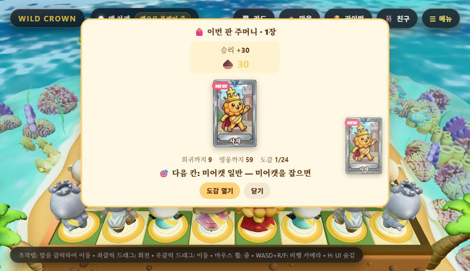
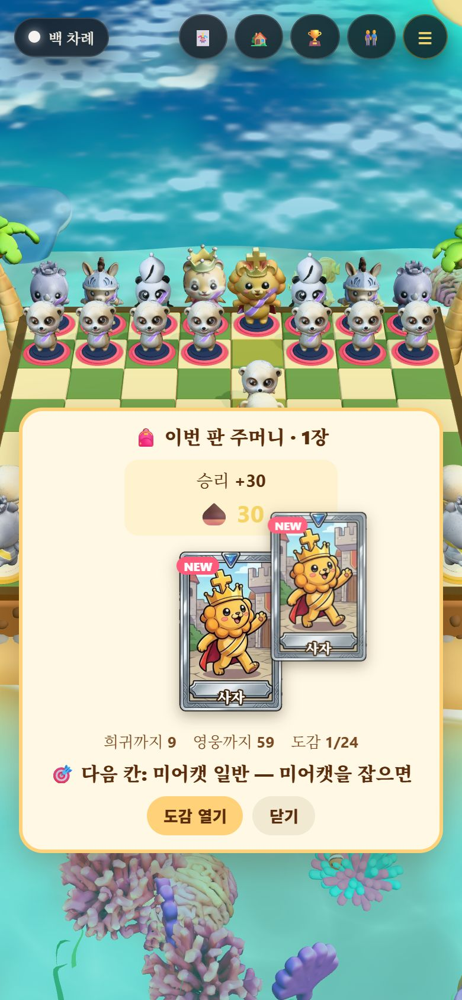

# DR-1 손맛 — QA (2026-11-10)

[방향 계획서](../plans/2026-11-10-direction-plan.md) DR-1: 1a 음 계단 넓히기 · 1b 판 끝 하나씩 세기 · 1c 그 자리 건너뛰기 + AI 고정 지연 줄이기(DR-0a 결과로 1c 에 합침).

## 바꾼 것

| 곳 | 내용 |
| :-- | :-- |
| `src/fx/captureSpecial.js` | `momentumSteps(history, color)` — 한쪽이 잡기·체크를 이어 간 횟수(상대 수는 건너뜀, 조용한 수에서 끊김) |
| `src/wizardChessEngine.js` | 잡기 소리는 폰 계단(CX-4)과 흐름 계단 중 높은 쪽, 체크 소리도 흐름 계단을 탄다(반음씩, 7반음 상한). AI 고정 지연 540 → **250ms**(`AI_DELAY_MS`). 연출 중 판을 누르면 그 수가 **4배 빨리** 흐른다(`SKIP_SPEED`, 끝으로 순간이동하지 않아 안무 순서가 그대로). AI 가 두기 직전에 누르면 바로 둔다. 연출 중 누름은 말을 고르지 않는다. API `skipAnimation()` |
| `src/audio/sfx.js` | `play(name, delay, pitch)` — 정해진 음높이로 |
| `src/cards/acornTally.js`(새) · `CardLayer.tsx` · `styles.css` | 판 끝 주머니에 「승리 +30 · 🎯 미션 +8 · 💰 현상금 +6 …」을 320ms 마다 한 줄씩, 한 줄마다 소리가 반음 위로, 합계는 끝에 금색. 누르면 바로 끝. `prefers-reduced-motion` 이면 한 번에. **이미 번 것만 센다** |

## 측정

### 1a 음 계단 (`node tools/momentum_sim.mjs 40` → [txt](../perf/2026-11-10-momentum-sim.txt))

| 짝 | 잡기·체크 소리 | 오른 음(계단 ≥ 2) | 판당 오른 음(중앙값) | 가장 높은 계단 | 예전 폰 계단만이었다면 |
| :-- | --: | --: | --: | --: | --: |
| 보통 대 보통 40판 | 1,151 | 377 (33%) | **9번** | 9(소리는 7에서 멈춤) | 55번(판당 1.4) |
| 쉬움 대 보통 40판 | 992 | 364 (37%) | **9번** | 9 | 51번 |

예전에는 폰끼리 잡을 때만 음이 올랐다(판당 1~2번). 이제 한 판에 9번쯤 「이어 가고 있다」가 들린다. 사람이 알아채는지는 재 보지 않았다(사람 질문 「소리가 올라가는 걸 알아챘나」).

### 1c 막힌 시간 (`tools/tempo_probe.mjs`, 실제 엔진, 생각 시간 0, 각 3판)

| | DR-0(전) 169순환 | DR-1 125순환 | DR-1 + 계속 누름(`--skip`) 123순환 |
| :-- | :-- | :-- | :-- |
| 내 수 연출(조용한 수 포함 전체) | 0.82초 | 0.83초 | **0.24초** |
| 내 잡는 수 연출 | 2.45초 | 2.44초 | **0.66초** |
| AI 대기 | 0.55초 | **0.26초** | 0.26초 |
| AI 수 연출 | 0.70초 | 0.71초 | **0.20초** |
| **막힌 시간 한 순환** 중앙값 · p90 | 2.12 · 4.61초 | **1.87** · 4.73초 | **0.71 · 1.28초** |
| 100순환당 막힌 시간 | 262초 | 247초 | **86초** |

원본: [dr1](../perf/2026-11-10-tempo-dr1.json) · [dr1-skip](../perf/2026-11-10-tempo-dr1-skip.json) · 비교 [dr0](../perf/2026-11-10-tempo-normal.json).
- 아무것도 안 누르면 AI 지연만 줄어 중앙값 −12%. **누르면 −66%** — 잡기 연출이 2.45초에서 0.66초가 된다.
- `--skip` 은 50ms 마다 누르는 「상한」이다. 사람은 이보다 덜 누른다.

### 화면 ([verify-tally.mjs](2026-11-10-dr1/verify-tally.mjs), 960×640 · 390×844, **6/6**)

| 항목 | 결과 |
| :-- | :-- |
| e2e4 를 두고 0.12초 뒤 **실제 마우스로** 판 가운데 클릭 | 연출 0.35초에 끝남(DR-0 조용한 수 0.80초) · 아무 칸도 선택 안 됨 — 두 폭 모두 |
| 판 끝 주머니 | 처음 0줄·🌰 0 → 1.2초 뒤 「승리 +30」·합계 30·끝(금색), 소리 기록 `button` |
| 누르면 바로 | 80ms 안에 모든 줄·합계·끝 |

 

캡처의 두 번째 사자 카드는 원래 있던 「카드가 주머니로 날아가는」 연출이다. 휴대폰 폭에서는 날아가는 동안 도토리 칸 위를 잠깐 지나간다(1초 안에 사라짐).

### 게이트

`npm test` 273/273(음 계단 1 · 하나씩 세기 2 추가), `tsc` 0, 번들 **398KB / 400KB**(+1KB, 여유 2KB), 드로우콜 첫 국면 68 · 잡기 최대 75(전과 같음).

## 재 보지 않았다 · 남은 것

- 음 계단·하나씩 세기를 사람이 알아채는지·좋아하는지(사람 시험).
- 실제로 사람이 연출 중에 판을 누르는지 — 누른다는 것을 알려 주는 표시가 없다. 첫 판 안내 한 줄이 필요할 수 있다.
- 잡기 연출 자체의 길이(2.45초)는 그대로다. 누르지 않는 사람에게는 여전히 길다 → DR-2.
- 번들 여유가 2KB 다. DR-2 전에 §7-2(첫 화면 400 · 전체 600) 결정이 필요하다.
- 번개 판의 빠른 수 도토리는 하나씩 세기에 넣지 않았다(`Blitz.tsx` 가 따로 준다).
