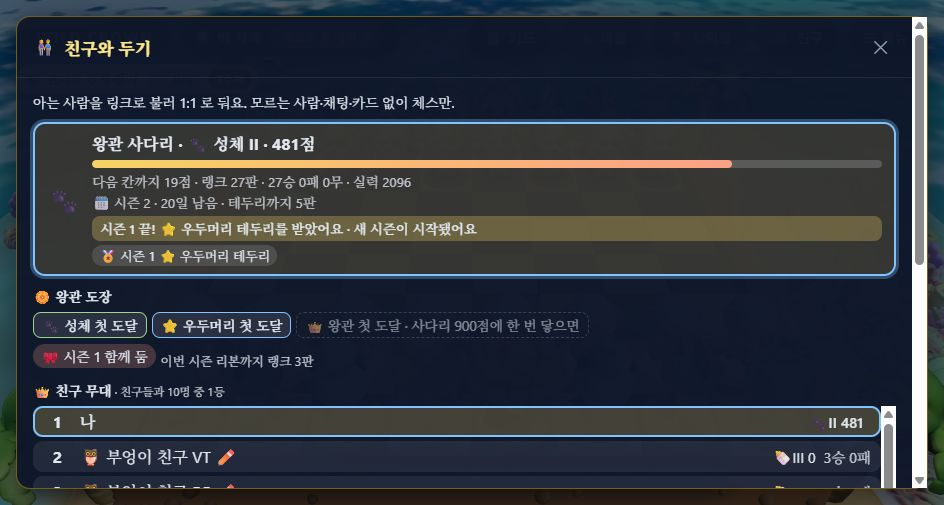
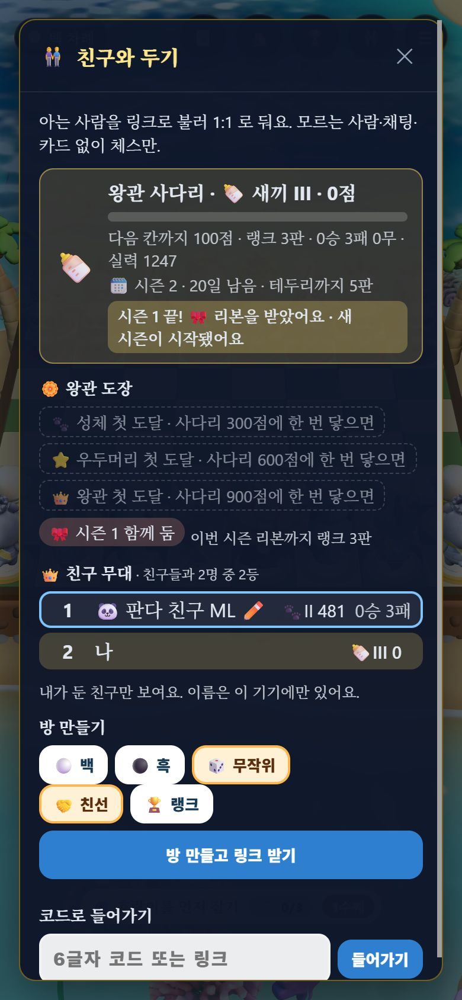
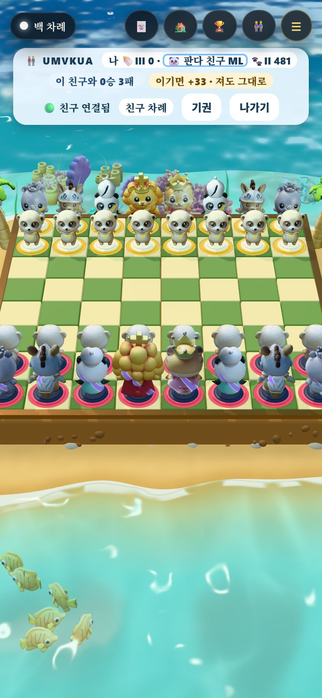

# LA-RW1 왕관 도장 · 친구 테두리 — QA (2026-11-10)

[랭커 보상 계획서](../plans/2026-11-10-ranker-rewards-plan.md) RW-1(첫 도달 도장 · 시즌 리본)·RW-2(테두리를 친구에게도). 근거: [랭커 보상 조사](../research/2026-11-10-ranker-rewards/README.md) ⓐ 다섯 겹 · ⓖ 모두가 받는 줄지 않는 것 · ⓕ 「놓치면 끝」 없음.

## 바꾼 것

| 곳 | 내용 |
| :-- | :-- |
| `src/rank/rankMarks.js`(새) | 첫 도달 도장(`newFirsts`·`firstStamp`·`firstLine`), 도장첩 목록(`rankMarks`), 리본 글자(`ribbonText`·`ribbonLeft`) |
| `src/rank/season.js` | **리본 문턱 `RIBBON_MIN_GAMES = 3`**(테두리는 그대로 5). 시즌 기록은 3판부터 남기고 `frame` 은 5판 이상일 때만. `bestTrophy` 는 테두리만 고른다 |
| `worker/migrations/0005_firsts.sql` | `firsts` 표, 이미 닿았던 사람 채우기(players.peak · trophies.peak) |
| `worker/index.js` | 판을 넣을 때 처음 닿은 큰 등급을 `firsts` 에 넣고 counted 응답 `ladder.first` 로 알림. `/player` 에 `firsts`, 시즌 기록에 `games`·`frame`. `/circle` 줄마다 친구의 가장 높은 테두리 `frame` |
| `src/Online.tsx` · `styles.css` | 친구 창 「🏵️ 왕관 도장」(첫 도달 셋 — 못 받은 것은 받는 법을 함께, 시즌 리본, 「이번 시즌 리본까지 랭크 n판」), 판 뒤 한 줄에 「🎉 처음으로 ⭐ 우두머리! 도장을 받았어요」, 친구 무대 줄과 랭크 방 막대의 친구 이름에 테두리 색, 새 시즌 알림이 리본만 받은 사람에게는 「🎀 리본을 받았어요」 |
| `tools/ladder_sim.mjs` | 5) 6시즌 랭커 보상 시뮬(`--per` 시즌당 판 수, `--ribbon` 리본 문턱) |

도토리·카드·코인은 붙이지 않았다(계획서 §3). 섬(영주 증서·돈으로 못 사는 표시)에는 아직 보이지 않는다 — 계획서 §7 의 사용자 결정 2 를 기다린다.

## 측정

### 1. 봇 시뮬 — 리본 문턱 정하기 (`node tools/ladder_sim.mjs --per <30|150> --ribbon <3|5>`)

새 무리 40개 × 6명이 6시즌을 둔다. 사람마다 두는 양이 다르다(활동 0.1~1.5 배). `--per 30` 은 한 사람이 시즌에 평균 10판, `--per 150` 은 50판쯤이다.

| 가벼운 시즌(10판) · 활동 적음 | 리본 중앙값 | 리본 3개 이상 | 6시즌 동안 아무것도 못 받음 |
| :-- | --: | --: | --: |
| 리본 5판 | 2 | 44% | **26%** |
| **리본 3판(채택)** | 5 | 77% | **0%** |

활동이 보통·많음이면 두 문턱 모두 리본 6개(100%)다. 원본: [per30-ribbon5](../perf/2026-11-10-ranker-rewards-sim-per30-ribbon5.json) · [per30-ribbon3](../perf/2026-11-10-ranker-rewards-sim-per30-ribbon3.json) · [per150-ribbon3](../perf/2026-11-10-ranker-rewards-sim-per150-ribbon3.json) · [per150-ribbon5](../perf/2026-11-10-ranker-rewards-sim-per150-ribbon5.json).

첫 도달 도장을 6시즌 안에 받은 비율(실력대별):

| 실력대 | 가벼운 시즌(10판): 성체 · 우두머리 · 왕관 | 많이 두는 시즌(50판): 성체 · 우두머리 · 왕관 |
| :-- | :-- | :-- |
| 약함 <1300 | 10% · 0 · 0 | 27% · 0 · 0 |
| 보통 | 58% · 1% · 0 | 80% · 24% · 5% |
| 강함 | 81% · 5% · 0 | 97% · 73% · 34% |
| 아주 강함 ≥1900 | 88% · 16% · 0 | 100% · 91% · 70% |

**계획서 목표 대비:** 「약함 대역 6시즌 리본 3개 이상」은 맞췄다(가벼운 시즌에도 활동 적은 사람 77%). 「약함 대역 성체 첫 도달 절반 이상」은 **못 맞췄다**(10~27%). 사다리가 실력을 따라가게 만든 설계(L-1)라 약한 사람이 성체에 닿기 어렵다. 약한 쪽은 리본과 RW-4 과정 도장(끝까지 둔 판 등)으로 받게 한다 — 성체 문턱을 낮추지 않는다.

### 2. 단위 테스트
`test/rankMarks.test.mjs` 3개(첫 도달은 한 번·낮은 것부터·건너뛰면 둘 다, 받는 법 글자, 리본 3판·이번 시즌 즉시), `test/season.test.mjs` 갱신(3판 = 리본만, 2판 = 없음, 리본만인 시즌은 테두리 아님). 전체 `npm test` 264/264, `tsc` 0, 번들 게이트 통과(JS gzip 396KB / 400KB — 남은 여유 4KB).

### 3. 로컬 Worker + 두 브라우저 — **11/11** ([verify.mjs](2026-11-10-rank-marks/verify.mjs))

1단계 지금 시각, 2단계 Worker 시계 28일 밈(`--var NOW_SHIFT_MS:2419200000`). 브라우저 쪽 시계는 시험 탭 안에서만 같이 밀었다(`Page.addScriptToEvaluateOnNewDocument`).

| 단계 | 항목 | 결과 |
| :-- | :-- | :-- |
| 1 | 나: 9명과 3판씩 27승 → counted 응답 `ladder.first` | ✅ 317점에서 adult, 607점에서 alpha, 각각 한 번 |
| 1 | `/player` | ✅ firsts adult·alpha · 이번 시즌 27판 · ribbonGames 3 |
| 1 | 3패 상대 O0 | ✅ firsts 없음 · 3판 |
| 2 | 나: 시즌 넘김 | ✅ 481점(−300)에도 firsts 그대로 · 지난 시즌 테두리 alpha(27판, frame) |
| 2 | O0: 시즌 넘김 | ✅ 시즌 1 기록 games 3 · frame false(리본만) |
| 2 | O0 의 친구 무대 | ✅ 내 줄 frame alpha · O0 자기 줄 frame 없음 |
| 2 | 내 친구 창(960×600) | ✅ 성체·우두머리 도장 받음, 왕관은 「사다리 900점에 한 번 닿으면」, 「🎀 시즌 1 함께 둠」, 「이번 시즌 리본까지 랭크 3판」  |
| 2 | O0 친구 창(390×844) | ✅ 도장 셋 다 받는 법, 리본 1, 「시즌 1 끝! 🎀 리본을 받았어요」, 무대의 내 줄에 우두머리 테두리  |
| 2 | 같은 랭크 방, O0 막대 | ✅ 친구(나) 이름에 우두머리 테두리, 넘침 없음  |
| 2 | 같은 방, 내 막대 | ✅ O0 이름은 테두리 없음(리본만) |

**시험 중 고친 것:** 2단계 첫 실행에서 O0 의 무대가 「불러오지 못했어요」였다. 시험 탭의 시계를 미는 스크립트가 `Page.enable` 없이 들어가지 않아, 서명 시각이 서버와 28일 어긋났다(응답 400 time). 제품 코드 문제가 아니라 시험 스크립트 문제였다.

## 재 보지 않았다 · 남은 것

- 도장·리본·테두리가 아이에게 의미 있는지, 못 받은 도장을 「받는 법」과 함께 보여 주는 것이 압박이 되는지는 사람 시험 전에는 모른다.
- 휴대폰 폭에서 못 받은 도장 셋이 세 줄을 차지한다. 다 받은 뒤의 모습과 10시즌 넘는 리본 줄은 보지 않았다(리본은 4개까지만 그린다).
- 섬 쪽 표시(증서·돈으로 못 사는 표시)는 사용자 결정 뒤.
- 번들 여유가 4KB 남았다. LA-RW2 전에 번들을 줄일 방법을 같이 봐야 한다.
- 시험 기기 키는 `%TEMP%` 에만 두었다. 사용자 브라우저 저장은 건드리지 않았다(헤드리스 임시 프로필).
