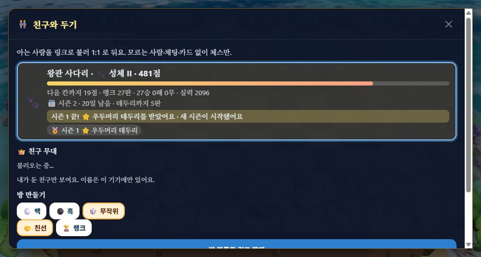
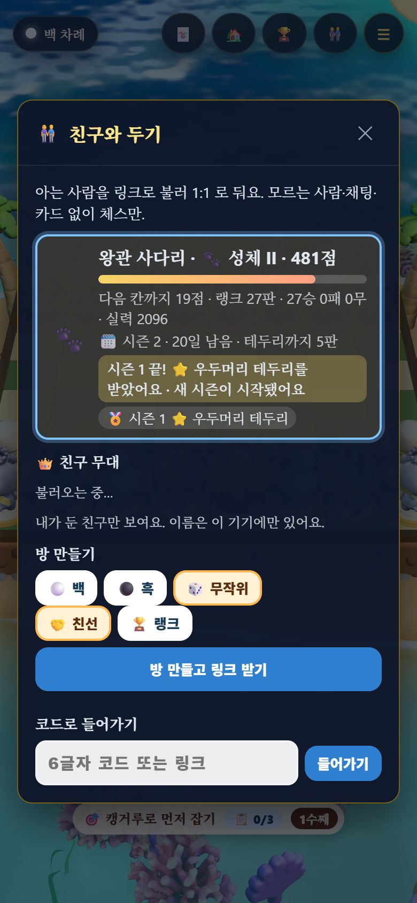
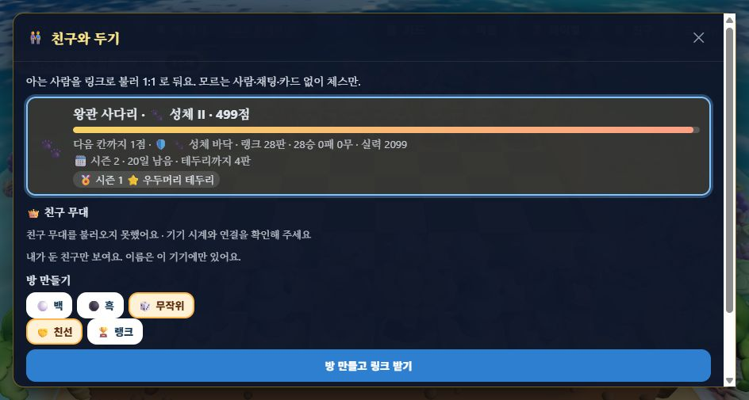

# L-4 시즌 — QA (2026-11-10)

계획서 [§4.4 왕관 사다리](../plans/2026-11-09-play-launch-lessons-plan.md) L-4. 근거: 조사 ⑦(부드러운 초기화 — Brawl Stars 6단계 → 2단계), ⑪(아이 선: 쉬면 깎이는 감소 없음, 보상은 겉모습만).

## 바꾼 것

| 곳 | 내용 |
| :-- | :-- |
| `src/rank/season.js`(새) | 시즌 번호(28일, 한국 시각 월요일 0시, 첫 시즌 2026-11-02), 초기화 `seasonReset`, 넘기기 `rollSeason`, 테두리 `trophyOf`·`bestTrophy` |
| `src/rank/ladder.js` | 옛 `seasonReset`(한 등급 아래 시작점)을 빼고 season.js 로 옮김 |
| `worker/migrations/0004_season.sql` | `players.season · peak · sgames`, `trophies` 표 |
| `worker/index.js` | `player()` 가 시즌이 지난 사람을 그 자리에서 넘기고 테두리를 남긴다(정해진 시각에 도는 작업 없음). `/player` 에 `season`·`trophies`. 친구 무대는 아직 안 넘겨진 친구를 읽기만 넘긴 점수로. 시험용 `NOW_SHIFT_MS`(로컬에서만, 배포 설정에 없음) |
| `src/rank/ladderText.js` | 「🗓️ 시즌 2 · 12일 남음 · 테두리까지 2판」, 「🏅 시즌 1 ⭐ 우두머리 테두리」, 새 시즌 첫 판 전까지만 「시즌 1 끝! … 테두리를 받았어요 · 새 시즌이 시작됐어요」 |
| `src/Online.tsx` · `styles.css` | 친구 창 내 랭크 칸에 시즌 줄·새 시즌 알림·테두리 칩, 가장 높은 테두리 등급으로 칸 테두리 색(새끼·성체·우두머리·왕관). 친구 무대를 못 불러오면 「불러오지 못했어요 · 기기 시계와 연결을 확인해 주세요」 |

### 정한 규칙

| 규칙 | 값 | 근거 |
| :-- | :-- | :-- |
| 시즌 길이 | 28일 | 계획서 첫 안. 사람 반응은 재 보지 않았다 |
| 초기화 | 사다리 **300점(큰 등급 하나) 빼기**, 새끼 등급은 그대로, 바닥·연승 비움, 실력(Glicko)은 그대로 | 시뮬(아래) |
| 쉬다 돌아오면 | 여러 시즌을 건너뛰어도 초기화는 **한 번만** | 조사 ⑪ 「쉬면 깎이는 감소 없음」 |
| 테두리 | 그 시즌 최고 점수의 등급. 그 시즌 점수에 든 랭크 판 **5판 이상**일 때만. 도토리·카드·코인 없음 | 조사 ⑪ · 계획서 §4.4. 5판은 첫 안(재 보지 않았다) |

## 측정

### 1. 시뮬 — 초기화 방식 고르기 (`node tools/ladder_sim.mjs --reset <방식>`)

친구 무리 40개 × 6명이 시즌 하나(약 200판)를 둔 뒤 초기화, 다음 시즌 약 50판. 「되찾음」은 지난 시즌 마지막 등급을 다시 찍었는가(새끼였던 사람 제외).

| 방식 | 초기화 직후 실력-사다리 순위 상관 | 50판 뒤 | 되찾음(보통 · 강함 · 아주 강함) | 되찾는 판 수 중앙값 |
| :-- | --: | --: | :-- | :-- |
| **300점 빼기(채택)** | **0.776** | 0.901 | 32/51 · 41/58 · 42/50 | 26 · 16 · **5** |
| 한 등급 아래 시작점 | 0.731 | 0.902 | 30/51 · 41/58 · 42/50 | 29 · 25 · 15 |
| 초기화 없음 | 0.917 | 0.911 | 전원 · 1판 | — |

300점 빼기가 순서를 더 지키고(같은 등급 안의 차이가 남는다) 강한 쪽이 빨리 돌아온다. 「없음」은 새 출발이 없다. 원본: [minus300](../perf/2026-11-10-season-sim-minus300.json) · [tierStart](../perf/2026-11-10-season-sim-tierStart.json) · [none](../perf/2026-11-10-season-sim-none.json). 약함(<1300) 9명은 50판 안에 되찾지 못했다 — 지난 시즌에 실력 목표보다 위에 있던 사람들이다.

### 2. 단위 테스트 — `test/season.test.mjs` 4개
경계 시각(월요일 0시 KST, 마지막 날 「1일」), 초기화 세 방식, 세 시즌 쉬어도 한 번만·최고 점수 테두리·5판 미만 없음, 글자. 전체 `npm test` 261/261, `tsc` 0, 번들 게이트 통과(JS gzip 395KB / 400KB).

### 3. 로컬 Worker — 시즌 경계를 실제로 넘김 ([verify.mjs](2026-11-10-season/verify.mjs))

1단계는 지금 시각(시즌 1), 2·3단계는 Worker 시계를 28일 민 상태(`--var NOW_SHIFT_MS:2419200000`, 시즌 2). **11/11**

| 단계 | 항목 | 결과 |
| :-- | :-- | :-- |
| 1 | 나: 9명과 3판씩 27승 | ✅ 시즌 1 · 27판 · ⭐ 우두머리 781점 |
| 1 | 3패 상대 | ✅ 새끼 0점 · 3판 |
| 2 | 친구 무대(나는 아직 안 넘겨짐) | ✅ 481(= 781 − 300) |
| 2 | 나 읽기 | ✅ 시즌 2 · 481점(🐾 성체 II) · 바닥 0 · 연승 0 · 시즌 판 0 · 테두리 [시즌 1 우두머리 781] · 실력 2096 그대로 |
| 2 | 다시 읽기 | ✅ 481 · 테두리 1개(두 번 깎이지 않음) |
| 2 | 3판만 둔 상대 | ✅ 0점 · 테두리 없음 |
| 2 | 친구 창 960×600 · 390×844 | ✅ 우두머리 테두리 색 · 「🗓️ 시즌 2 · 20일 남음 · 테두리까지 5판」 · 새 시즌 알림 · 「🏅 시즌 1 ⭐ 우두머리 테두리」 |
| 2 | 새 시즌 첫 판 | ✅ counted · 시즌 판 1 · 테두리 1 |
| 3 | 기기 시계가 서버와 어긋남(서버만 28일 밈) | ✅ 「친구 무대를 불러오지 못했어요 · 기기 시계와 연결을 확인해 주세요」 — 2단계 캡처에서 「불러오는 중…」이 멈춰 있던 것을 고침 |

(2단계 캡처의 「불러오는 중…」은 위 3단계에서 고친 뒤의 문구로 바뀐다.)

## 재 보지 않았다 · 남은 것

- 28일·5판·300점이 아이·부모에게 맞는지(새 시즌에 다시 두는지, 떨어짐을 속상해하는지)는 사람 시험 전에는 모른다. 「시즌 끝 며칠 전」 알림은 넣지 않았다(조사 ⑪ 푸시 금지).
- 친구 무대 목록에는 친구의 테두리를 아직 보여 주지 않는다.
- 첫 시즌은 2026-11-02 에 시작한 것으로 셈한다. 출시일에 맞추려면 `SEASON_EPOCH` 를 바꾸고 D1 의 `players.season` 을 그 번호로 맞춘다.
- 로컬 시험 중 `wrangler dev` 를 끌 때 `workerd` 가 남아 8787 을 계속 잡는 일이 있었다(새 Worker 의 요청이 멈춘 옛 것으로 감). 이 세션이 띄운 프로세스만 PID 로 껐다.
- 시험 기기 키는 `%TEMP%` 에만 두었고 커밋하지 않는다. 사용자 브라우저 저장은 건드리지 않았다(헤드리스 임시 프로필).
