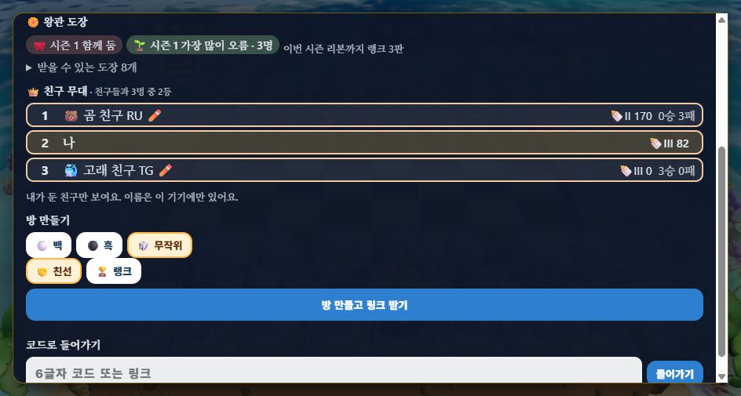
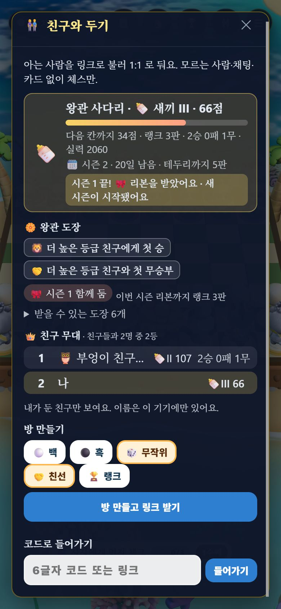
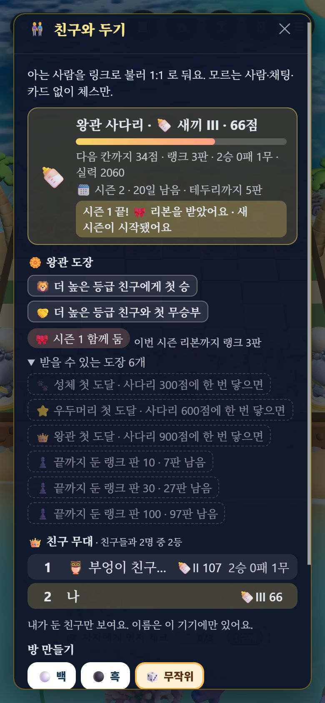

# LA-RW2 친구 무대 시즌 상 · 과정 도장 — QA (2026-11-10)

[랭커 보상 계획서](../plans/2026-11-10-ranker-rewards-plan.md) RW-3(친구 무대 시즌 상)·RW-4(과정 도장). 근거: [랭커 보상 조사](../research/2026-11-10-ranker-rewards/README.md) ⓐ 작은 무리 1등 · ⓖ 줄지 않는 것 · ⓗ 상징 상은 고루 퍼질 때 일한다(Gallus) · ⑪ 과정 칭찬.

## 바꾼 것

| 곳 | 내용 |
| :-- | :-- |
| `src/rank/awards.js`(새) | `seasonStats`(판 기록 → 사람마다 최고·시작·끝 점수), `stageAwards`(🏆 무대 1등 · 🌱 가장 많이 오름), `upsetFeat`·`processStamps`·`featLine`·`awardText` |
| `worker/migrations/0006_awards.sql` | `awards` 표 |
| `worker/index.js` | 시즌을 넘길 때(`player()`) 지난 시즌 내 판과 그 시즌 나와 둔 친구들의 판(`matches.ladder`)으로 상을 계산해 넣는다. 판을 넣을 때 판 전 등급이 나보다 높은 친구를 이기거나 비기면 `firsts` 에 `upset-win`·`upset-draw`, counted 응답 `ladder.feat`. `/player` 에 `awards` |
| `src/Online.tsx` · `styles.css` | 친구 창 「🏵️ 왕관 도장」을 **받은 것만 펼치고** 못 받은 것은 「받을 수 있는 도장 n개」 아래로 접는다(받는 법은 그 안에). 상 칩 「🌱 시즌 1 가장 많이 오름 · 3명」. 판 뒤 한 줄에 「🦁 더 높은 등급 친구에게 첫 승! 도장을 받았어요」 |
| `tools/ladder_sim.mjs` | 6시즌 시뮬에 무대 상·과정 도장(`--no-rise` 비교) |

### 정한 규칙

| 규칙 | 값 |
| :-- | :-- |
| 무대 | 그 시즌 나와 랭크 판을 둔 친구들 + 나, **3명 이상**. 나는 그 시즌 **5판 이상** |
| 🏆 무대 1등 | 그 시즌 최고 사다리 점수가 가장 높은 사람. 같으면 함께 |
| 🌱 가장 많이 오름 | 시즌 첫 판 전 → 마지막 판 뒤 점수 차이가 가장 큰 사람(0 보다 커야). 1등이 혼자면 그 사람은 빼고 다음 사람에게 |
| 과정 도장 | 끝까지 둔 랭크 판 10·30·100(점수에 든 판 수), 나보다 높은 등급 친구에게 첫 승·첫 무승부 |
| 보상 | 글자 기록과 칩뿐. 도토리·카드·코인 없음. 줄지 않는다 |

각 사람의 상은 **자기 무대 기준**이다. 두 사람의 무대가 다르면 둘 다 「1등」일 수 있다.

## 측정

### 1. 봇 시뮬 — 「가장 많이 오름」이 필요한가 (`node tools/ladder_sim.mjs --per <30|150> --ribbon 3 [--no-rise]`)

6명 무리 40개 × 6시즌, 사람마다 두는 양이 다름. 「무리의 절반 이상이 상을 한 번은 받음」이 계획서 목표다.

| 시즌당 판 | 상 종류 | 한 번이라도 받은 사람 | **절반 이상 받은 무리** | 무리 안 1등 상을 한 사람이 가져간 비율(평균) |
| :-- | :-- | --: | --: | --: |
| 10판 | 1등 + 가장 많이 오름(채택) | 62% | **95%** | 67% |
| 10판 | 1등만 | 41% | 45% | 67% |
| 50판 | 1등 + 가장 많이 오름(채택) | 59% | **97%** | 88% |
| 50판 | 1등만 | 24% | 3% | 88% |

1등만 두면 무리에서 가장 센 사람이 1등을 거의 다 가져간다(많이 두면 88%). 「가장 많이 오름」이 상을 퍼뜨린다 — 계획서 목표를 맞췄다.
실력대별로 한 번이라도 받은 비율(10판 · 채택): 약함 26% · 보통 62% · 강함 81% · 아주 강함 86%. **약한 쪽은 여전히 적다.** 약한 쪽은 과정 도장으로 받는다:

| 실력대 | 첫 50판 안 「위 등급 첫 승」(10판 · 50판 시즌) | 「위 등급 첫 무승부」 |
| :-- | :-- | :-- |
| 약함 | 27% · 55% | 40% · 69% |
| 보통 | 46% · 70% | 26% · 57% |
| 강함 | 75% · 71% | 7% · 31% |
| 아주 강함 | 65% · 58% | 7% · 23% |

「끝까지 둔 판 10·30」은 50판이면 누구나 받는다. 계획서 목표 「약한 쪽도 50판 안에 2개 이상」은 이것만으로 맞는다.
원본: [per30](../perf/2026-11-10-stage-awards-per30.json) · [per30-norise](../perf/2026-11-10-stage-awards-per30-norise.json) · [per150](../perf/2026-11-10-stage-awards-per150.json) · [per150-norise](../perf/2026-11-10-stage-awards-per150-norise.json).

### 2. 단위 테스트 — `test/awards.test.mjs` 4개
시즌 통계, 상(아이 = 가장 많이 오름 · 부모 = 1등만 · 친구 없음 · 3명 미만 · 5판 미만 · 같은 점수 함께 1등), 글자, 과정 도장(같은 등급은 아님 · 줄지 않음). 전체 `npm test` 268/268, `tsc` 0, 번들 게이트 통과(JS gzip 397KB / 400KB — 남은 여유 3KB).

### 3. 로컬 Worker + 두 브라우저 — **13/13** ([verify.mjs](2026-11-10-stage-awards/verify.mjs))

1단계 지금 시각, 2단계 Worker 시계 28일 밈. 브라우저 시계는 시험 탭 안에서만 같이 밀었다.

| 단계 | 항목 | 결과 |
| :-- | :-- | :-- |
| 1 | 무대 판 9개(부모 P · 아이 K · 친구 F) | ✅ counted ×9 |
| 1 | H 15승 → 433점(성체) | ✅ |
| 1 | 새 기기 U 가 H 를 이김 · 비김 · 또 이김 | ✅ `upset-win` → `upset-draw` → 다시는 안 줌(null) |
| 1 | U `/player` firsts | ✅ upset-win · upset-draw |
| 1 | 시즌 1 무대 | ✅ P 6판 170점 · K 6판 82점 · F 6판 0점 · 상 아직 없음 |
| 2 | P(부모) | ✅ 🏆 시즌 1 무대 1등 · 3명 |
| 2 | K(아이) | ✅ 🌱 시즌 1 가장 많이 오름 · 3명(1등인 P 는 빠짐) |
| 2 | F(6패, 새끼라 안 잃음 → 오름 0) | ✅ 상 없음 |
| 2 | 다시 읽기 | ✅ 상 1개 그대로 |
| 2 | K 친구 창(960×600) | ✅ 상 칩 · 받은 도장 0 · 「받을 수 있는 도장 8개」 접힘  |
| 2 | U 친구 창(390×844) | ✅ 받은 도장 = 위 등급 첫 승·첫 무승부 · 접힌 6개 안에 「끝까지 둔 랭크 판 10 · 7판 남음」  · 펼친 모습  |

**확인 중 바꾼 것:** 첫 화면 확인에서 휴대폰 친구 창에 못 받은 도장 8개가 한 화면 가까이를 차지했다. 「받을 게 이렇게 많다」는 압박이 될 수 있어(조사 ⓙ ICO 「안 하면 손해」), 받은 것만 펼치고 못 받은 것은 접었다. 다시 돌려 위 표가 접은 뒤의 결과다.
`npm run build` 를 Worker 가 떠 있는 동안 돌리면 `dist` 를 지우다 둘 다 멈춘다(L-4 때와 같다). 빌드는 Worker 를 끈 뒤에 한다.

## 재 보지 않았다 · 남은 것

- 「1등」 상을 못 받은 아이가 속상해하는지, 「가장 많이 오름」이 위로가 되는지는 사람 시험 전에는 모른다.
- 시즌 상은 그 사람이 시즌이 바뀐 뒤 처음 열 때 계산된다. 무대 친구가 30명을 넘거나 그 시즌 판이 2000개를 넘으면 잘린다(읽기 상한) — 실제 크기에서는 재 보지 않았다.
- 무대 상을 친구 무대 줄(친구가 받은 상)에 보여 주는 것은 하지 않았다.
- 번들 여유가 3KB 남았다. 다음 화면 작업 전에 줄일 곳을 찾아야 한다(예: `Online.tsx` 의 랭크 칸을 따로 지연 로드).
- 시험 기기 키는 `%TEMP%` 에만 두었다. 사용자 브라우저 저장은 건드리지 않았다(헤드리스 임시 프로필).
