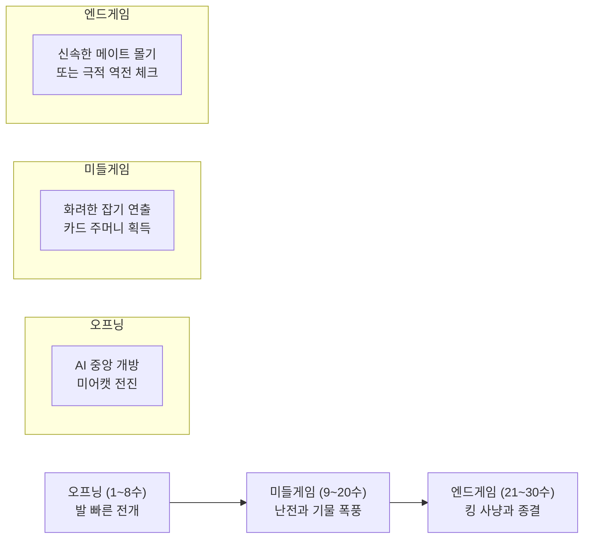
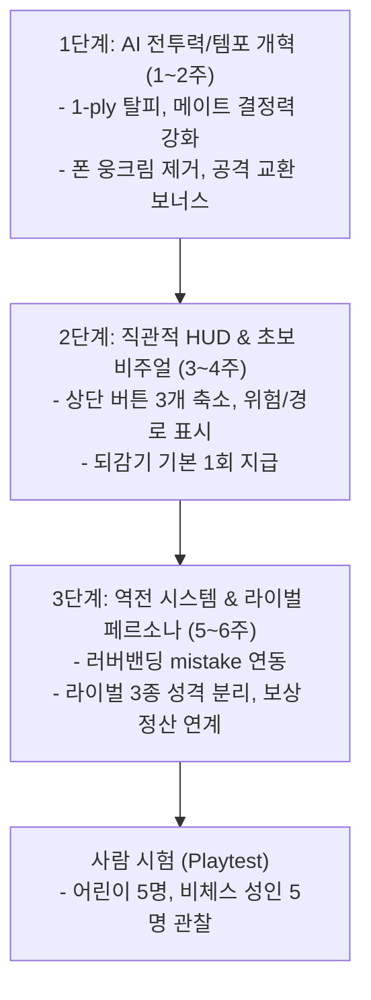

# WILD CROWN 재미 혁신 및 역전 메커니즘 설계서

---

## 0. 1~3번 사용자 불만에 대한 사전 진단

통합자가 수정 중인 1~3번에 대해 설계 관점에서 핵심 방향을 보탭니다.
- **1번(말 식별 불량):** 체스판 조명과 3D 셰이더 특성상 상단 뷰에서 말 텍스처만으로는 흑백 구분이 어렵습니다. 말 머리 모양 외에 **말이 딛고 있는 원형 발판(Base)의 색상 대비(예: P1 순백/골드 림 vs AI 흑요석/다크퍼플 림)**와 **선택 시 발밑에 퍼지는 진영별 고유 오라(Glow)**를 반드시 주어야 합니다.
- **2번(쫄 뒤 방어/승부 지연):** [브리핑 사실 1]에서 드러나듯 현재 AI(`chooseSmartAIMove`)는 1수 앞(1-ply)만 보며 폰 전진과 공격받는 칸 회피만 단순 계산합니다. 이로 인해 기물을 교환하거나 돌파하지 못하고 폰 벽 뒤에 웅크리게 됩니다. 탐색 깊이를 최소 2~3수로 늘리고, 킹 압박 및 기물 교환 보너스를 주어야 해소됩니다.
- **3번(상단 HUD 난잡함):** [브리핑 사실 6]의 12개 이상 나열된 버튼은 게임의 캐주얼한 첫인상을 파괴합니다. 화면에는 `[되감기/카드]`, `[힌트/정찰]`, `[햄버거(설정·기권·시점 통합 메뉴)]` 3가지만 남기고, 개발용 기능(언어·영역·흑으로 플레이·AI 수 두기 등)은 설정 모달로 수납해야 합니다.

---

## 1. 재미의 기준: 타깃 유저에게 "재미있다"란 무엇인가

### 1.1 대상 유저 정의
WILD CROWN의 핵심 타깃은 레이팅을 겨루는 정통 체스 플레이어가 아닙니다. **귀여운 동물 캐릭터에 이끌려 들어온 8~12세 어린이**와 **체스 룰은 대략 알지만 엔드게임 전술은 모르는 라이트 성인**입니다.

### 1.2 "재미있다"의 정의
이 타깃에게 재미는 "완벽한 정석을 두어 ELO 1500을 찍는 것"이 아닙니다.
1. **유레카 모먼트(영웅 경험):** 내가 발견한 한 수로 상대 큰 말(호랑이=퀸, 코뿔소=룩)을 '쾅!' 하고 잡아먹을 때의 손맛([브리핑 사실 7]의 잡기 연출).
2. **명확하고 빠른 결말:** 지지부진하게 폰만 밀다가 끝나는 게 아니라, 5~7분 안에 드라마틱하게 승패가 결정되는 통쾌함.
3. **노력이 헛되지 않는 성장:** 설령 게임에서 지더라도 귀여운 카드를 모으고 섬 마을이 자라나는 무패의 감각([브리핑 사실 5]).

### 1.3 측정 가능한 정량 신호 (UX 지표)

| 지표명 | 측정 방법 및 목표치 | 해석 및 의도 |
| :--- | :--- | :--- |
| **평균 판당 턴/시간** | **25~35수 / 5~7분 이내** (추정) | 45수를 넘어가는 지루한 교착 판 비율을 5% 미만으로 억제. |
| **결정적 순간(Epic Moment) 발생 빈도** | **판당 2.5회 이상** (추정) | 메이저 기물 포획(호랑이/코뿔소), 더블 어택, 체크 발생 횟수. |
| **연속 판 진행률 (Next Game Rate)** | **종료 직후 "다음 판" 클릭 60% 이상** (추정) | 피로감 없이 "한 판 더!"를 외치게 만드는 핵심 지표. |
| **초반 좌절 이탈률 (Rage Quit)** | **10수 이내 기물 잃고 창 닫기/기권 10% 이하** (추정) | 실수를 저질렀을 때 게임을 포기하지 않도록 완충되는지 측정. |
| **마을 전환율 (Village Conversion)** | **판 종료 후 마을 방문율 70% 이상** (추정) | [브리핑 사실 5]의 섬 정산이 체스의 스트레스를 힐링으로 치환하는지 확인. |

---

## 2. 역전 찬스를 넣어야 하나: 찬반 및 2원화 설계

### 2.1 결론: "반드시 넣어야 한다."
**찬성합니다.** 정통 체스는 기물 하나(특히 퀸)를 잃으면 회복이 거의 불가능한 '스노우볼' 게임입니다. 성인 고수는 기권(Resign)하면 그만이지만, 어린이는 퀸(호랑이)을 어이없게 잡히는 순간 눈물을 흘리거나 화면을 꺼버립니다. 지속 가능한 플레이를 위해서는 반드시 역전의 사다리가 필요합니다.

단, **"체스 정규 규칙을 보존하는 방식"을 기본 모드로 채택하고, "체스 룰을 파괴하는 방식"은 철저히 별도 '파티/캐주얼 모드'로 분리 격리**해야 합니다.

---

### 2.2 방식 A: 체스 규칙을 바꾸지 않는 역전 장치 (기본 랭크/일반 모드)

chess.js의 정통 합법 수 판정을 100% 유지하면서 심리적·시스템적으로 역전을 돕는 방식입니다.

1. **AI 다이내믹 러버밴딩 (고무줄 난이도):**
   - 플레이어가 기물 가치(점수)에서 -3점(비숍/나이트 1개 차이) 이상 뒤처지기 시작하면, [브리핑 사실 2]에 명시된 AI의 `mistake` 확률을 점진적으로 증가시킵니다(예: 평소 10% → 열세 시 최대 35~40%, 추정).
   - 단순한 멍청한 수가 아니라, **"AI가 과도하게 공격적으로 덤벼들다 플레이어에게 카운터 기회를 주는 수"**를 두게 유도합니다.
2. **되감기(Undo)와 슈퍼 힌트의 유기적 공급:**
   - [브리핑 사실 3]의 카드 능력 중 '되감기'는 현재 5판 뒤에야 열립니다. 초보와 어린이에게 5판은 너무 멉니다. **기본 1회 되감기를 무료 제공**하고, 큰 기물을 잃어 역전이 절실할 때 '기적의 나침반(슈퍼 힌트)' 카드가 발동하여 AI의 블런더를 찌르는 최선의 길을 3D 판 위에 빛으로 안내합니다.
3. **판 밖 보상 강화 (심리적 역전):**
   - [브리핑 사실 5]의 섬 정산을 적극 활용합니다. 게임에서 킹이 잡혀 패배하더라도 **"용감한 저항!"** 칭호와 함께 잡은 기물에 비례해 도토리/하트를 100% 온전히 보전해 줍니다. "졌지만 섬은 번창했다"는 감각을 주어 게임 오버의 상처를 지웁니다.

- **위험과 완화책:**
  - *위험:* 조금 둘 줄 아는 유저가 "AI가 나 봐주려고 일부러 대주는구나"를 눈치채는 순간 성취감이 쓰레기통에 들어갑니다.
  - *완화:* AI가 대놓고 자살하는 것이 아니라, "공격 일변도로 들어오다 뒷공간을 노출하는 형태(Aggressive Blunder)"의 가중치로 구현하여 유저가 '내가 전술로 응징했다'고 느끼게 만들어야 합니다.

---

### 2.3 방식 B: 체스 규칙을 바꾸는 역전 장치 (별도 "파티 모드" 한정)

합법 수와 기물 고유 능력을 변형하는 과감한 모드입니다.

1. **동물 잠재력 폭발 (Fury Move):**
   - 퀸(호랑이)을 잃었을 때 발동 게이지 충전. 남은 미어캣(폰) 중 하나가 1회에 한해 나이트처럼 장애물을 뛰어넘거나 2칸 대각선 공격 가능.
2. **카드 소환술 (기물 부활):**
   - 판 안 카드 드로우를 통해 잡혀 나간 판다(비숍)나 캥거루(나이트)를 빈 자기 진영 1~2열에 재배치.

- **치명적 위험:**
  - 체스를 배우려고 유입된 어린이에게 잘못된 체스 규칙을 학습시킬 위험이 있습니다.
  - chess.js 엔진과의 정합성이 깨져 예외 처리 버그가 급증합니다.
  - **따라서 기본 게임에는 절대 적용하지 않고, "신비한 동물 마법 모드"라는 이름의 별도 파티 탭으로만 실험해야 합니다.**

---

## 3. 승부를 내는 AI의 성격과 난이도 아키텍처

### 3.1 승부가 나는 AI의 행동 원칙 (Aggressive Challenger)
[브리핑 사실 1]에서 현재 AI가 수비적으로 웅크리는 이유는 1수 앞만 보며 폰 전진과 감점 회피에 집착하기 때문입니다. 재미있는 AI는 다음과 같이 움직여야 합니다.

1. **개방적 오프닝 (중앙 개방):** 폰 벽을 쌓아 진형을 잠그지 않고, 기물(캥거루, 판다)을 중앙으로 신속히 전개하여 길을 엽니다.
2. **공격적 교환 선호 (Trading Bias):** 동등한 점수(예: 판다 ↔ 캥거루)의 교환 기회가 오면 회피하지 않고 즉각 잡아먹어 판 위의 기물 수를 줄입니다. 판이 가벼워져야 초보자도 앞이 보이고 승부가 빨라집니다.
3. **피의 냄새를 맡는 킬러 인스팅트 (Endgame Killer):** 상대 킹(사자) 주변의 호위가 헐거워지면 즉시 최소 3수 메이트 탐색 가중치를 500 이상 부여하여 신속하게 게임을 끝냅니다. 질질 끄는 고문성 플레이를 원천 차단합니다.

### 3.2 난이도 선택 방식: "라이벌 페르소나 선택제"
자동 조절(완전 동적 난이도)은 유저가 성장을 체감하기 어렵습니다. [브리핑 사실 2]의 라이벌 시스템을 전면에 내세워 유저가 직접 고르게 합니다.

```
[라이벌 선택 카드 UI]
- "덜렁이 아기 여우" (초급): 실수 확률 30%, 공격해오다 자리를 자주 비움.
- "성급한 치타"     (중급): 실수 확률 15%, 앞뒤 안 가리고 내 킹을 향해 직선 돌진.
- "지혜로운 늙은 사자" (상급): 실수 확률 3%, 침착하게 폰 구조를 공략하는 수문장.
```

### 3.3 사람에게 어떻게 보이게 할 것인가 (감정 연출)
AI가 단순 계산기가 아니라 살아있는 생명체로 느껴지도록 체스판 옆에 **3D 동물 아바타의 리액션**을 넣습니다.
- 유리할 때: 꼬리를 흔들거나 의기양양하게 웃는 애니메이션.
- 큰 말을 잡혔을 때: 깜짝 놀라며 귀를 젖히고 땀을 흘리는 표정([브리핑 사실 7]의 흔들림 연출과 연동).
- 생각 풍선: 복잡한 국면에서 머리 위에 '생각하는 톱니바퀴' 이모지가 뜨며 플레이어에게 "생각할 틈"과 "압박감"을 연극적으로 전달.

---

## 4. 한 판의 흐름과 드라마틱 템포

한 판의 목표 길이는 **25~35수, 5~7분(추정)**입니다.



1. **시작 (1~8수, 약 1.5분): "경쾌한 전개"**
   - 폰 교착을 유발하는 닫힌 체스 오프닝을 피하고, 나이트/비숍이 중앙으로 튀어나와 4~5수 안에 첫 교전이 발생하도록 유도.
   - [브리핑 사실 4]의 "시작 미션(예: 캥거루로 첫 수 두기)"을 화면 상단에 토스트 팝업으로 띄워 첫 발을 떼는 두려움을 없앰.
2. **중반 (9~20수, 약 3분): "난전과 잡기의 축제"**
   - [브리핑 사실 7]의 잡기 연출(화면 기울기, 진동, 카드 획득)이 판당 3~4회 연속으로 터지는 구간.
   - 플레이어가 호랑이(퀸)나 코뿔소(룩)로 상대 기물을 연속 격파하며 도파민 분비.
3. **끝 (21~30수, 약 1.5분): "클라이맥스와 신속한 종결"**
   - 기물이 4~6개 남았을 때 AI는 불필요한 폰 잔여 수순을 밟지 않고 킹을 직접 노림.
   - 플레이어가 이길 때는 화려한 "CHECKMATE!" 축하 폭죽과 함께 섬으로 전환, 패배할 때도 킹이 유쾌하게 뒤집어지며 즉시 결과 정산으로 직행.

---

## 5. 화면(UI/UX): 초보자를 위한 시각 보조와 기본값

[브리핑 사실 6]의 지저분한 버튼 문제를 해결하고 초보자가 지금 무엇을 해야 하는지 직관적으로 알게 하는 디스플레이 규칙입니다.

### 5.1 시각 보조 요소의 기본값 (Default Setting)

| 장치명 | 기본 상태 | 화면 표현 방식 | 설명 및 이유 |
| :--- | :---: | :--- | :--- |
| **이동 가능 칸** | **기본 켜짐 (ON)** | 타일 위 반투명 발바닥 도트 | 초보자는 말이 어디로 가는지 모르면 조작 자체를 포기함. |
| **위험 칸 (공격받는 말)** | **기본 켜짐 (ON)** | 위험한 내 말 발밑에 붉은 경고 펄스 | [브리핑 사실 3]의 정찰 카드 효과를 기본 시각화로 흡수하여 멍청한 실수를 사전 차단. |
| **직전 수 궤적** | **기본 켜짐 (ON)** | 상대 말이 이동한 경로에 황금빛 잔상선 | "상대가 방금 뭘 뒀지?"를 3D 환경에서 즉시 인지시킴. |
| **추천 수 (힌트)** | **기본 꺼짐 (OFF)** | 전구 아이콘 클릭 시에만 1회 안내선 표시 | 상시 켜두면 게임이 '빛나는 칸만 누르는 두더지 잡기'로 전락함. |
| **기물 점수 차이 (+3, -5)** | **기본 꺼짐 (OFF)** | 설정에서만 토글 가능 | 체스 점수 숫자는 초보에게 압박감과 절망감만 줌. 아바타 표정 게이지로 대체. |

### 5.2 상단 HUD 재구성안
- **좌측 상단:** 라이벌 동물 미니 프로필 + 표정 (승세에 따라 변화).
- **중앙:** 획득한 카드 슬롯 2개 ([브리핑 사실 3]의 정찰, 되감기).
- **우측 상단 (단 3개 버튼):**
  1. `[되감기]` (잔여 횟수 배지 표시)
  2. `[도움말/힌트 전구]` (막혔을 때 누름)
  3. `[햄버거 메뉴 ≡]` (클릭 시 새 게임, 기권, 카메라 시점, 그래픽 설정 팝업)

---

## 6. 만드는 순서 (로드맵) 및 검증 계획



### 6.1 단계별 구축 및 완료 조건 (DoD)

- **1단계: AI 전투력 및 템포 개혁 (가장 시급)**
  - 작업: [브리핑 사실 1]의 한 수 보기 엔진 탈피. 2~3수 미니맥스/알파베타 적용, 폰 벽 방어 가중치 삭제, 킹 공격 및 메이트 몰기 가중치 부여.
  - **완료 조건 (DoD):** AI끼리 100판 자가 대진 시 평균 판당 수가 35수 이하로 떨어지고, 무승부/교착 판 비율이 5% 미만일 것 (측정 검증).
- **2단계: 직관적 HUD 및 시각 보조 구축**
  - 작업: [브리핑 사실 6]의 복잡한 버튼 축소, 이동 가능 칸/위험 칸 셰이더 적용, 기본 되감기 1회 UX 연동.
  - **완료 조건 (DoD):** 체스를 처음 하는 유저가 튜토리얼 텍스트 없이 첫 3수를 15초 이내에 둘 것 (추정치).
- **3단계: 역전 메커니즘 및 라이벌 완성**
  - 작업: 점수차 열세 시 AI 실수율 동적 보정(러버밴딩), [브리핑 사실 2]의 라이벌 3종(초·중·고급) 분리, [브리핑 사실 5]의 패배 시 보상 루프 완성.
  - **완료 조건 (DoD):** 대형 기물을 먼저 잃은 판 중 역전승 비율이 15~25% 발생할 것 (추정치).

### 6.2 사람 시험 (Playtest) 프로토콜
- **대상:** 8~12세 어린이 5명, 체스 룰만 아는 20~40대 성인 5명.
- **방식:** 아무런 힌트 없이 3판 연속 플레이하게 한 뒤 관찰 (Think Aloud 기법 병행).
- **핵심 관찰 질문:**
  1. 기물을 뺏겼을 때 포기하지 않고 '되감기'나 다음 수를 고민하는가?
  2. 상단 버튼을 누르려다 헤매거나 혼란스러워하지 않는가?
  3. 판이 끝났을 때 "내가 졌다/이겼다"를 즉시 이해하고 마을 화면으로 기분 좋게 넘어가는가?

---

## 7. 리스크 분석: 틀릴 수 있는 곳 셋, 하지 않을 것, 가장 약한 결정

### 7.1 우리가 틀릴 수 있는 세 가지 가설
1. **"러버밴딩 실수 조절이 자연스러울 것이다"라는 가설의 위험:**
   - AI의 실수가 부자연스러우면 초등학생조차 "어? AI가 바보짓 해서 그냥 이겼네? 시시해"라며 성취감을 잃을 수 있습니다.
2. **"위험 칸 표시가 초보를 똑똑하게 만들 것이다"라는 가설의 위험:**
   - 붉은색 경고 표시를 너무 남발하면 판 전체가 경고창으로 뒤덮여 시각적 피로도가 급증하고, 생각을 멈춘 채 '빨간 불 안 들어온 칸'만 기계적으로 클릭하는 역효과가 날 수 있습니다.
3. **"섬 정산(마을)이 패배의 쓰라림을 완전히 지워줄 것이다"라는 가설의 위험:**
   - 체스 본판에서 처참하게 패배한 감정적 박탈감이 크면, 뒤이어 나오는 아기자기한 도토리 정산 화면([브리핑 사실 5])을 '약 올리는 것'으로 받아들이고 스킵할 수 있습니다.

### 7.2 절대 하지 않을 것 (Non-Goals)
1. **정통 체스 모드에 기물 스킬/마법 도입 금지:**
   - 폰이 갑자기 뒤로 가거나 번개를 쏘는 식의 물리적 룰 파괴는 chess.js의 무결성을 깨고 장기적인 체스 학습 가치를 훼손하므로 정규 모드에선 절대 배제합니다.
2. **복잡한 정통 체스 용어의 UI 노출 금지:**
   - 화면에 "앙파상(En Passant)", "프로모션(Promotion)", "캐슬링 권한 상실" 같은 딱딱한 텍스트를 직접 노출하지 않고, "스페셜 전진!", "사자의 숨결!" 같은 동물 테마 연출명으로 치환합니다.
3. **인위적인 시간제한(블리츠 타이머) 강제 금지:**
   - 초보자와 어린이에게 틱톡거리는 초시계는 극심한 스트레스 요인입니다. 싱글 AI 모드에서는 무제한 턴 타임을 기본으로 유지합니다.

### 7.3 설계 중 가장 약한 결정 하나 (The Weakest Decision)
- **가장 취약한 결정: "플레이어 열세 시 AI의 실수율을 올려 역전을 유도하는 동적 난이도(Rubber-banding) 정책"**
- **취약한 이유:** 
  - 체스는 본질적으로 완벽 정보 공개 게임(Perfect Information Game)입니다. 마리오 카트처럼 뒤처진 사람에게 킬러 아이템을 주는 것이 체스판 위에서는 조금만 실력이 붙어도 "조작된 판", "어거지 승리"로 느껴지기 가장 쉽습니다.
- **방어 및 완화책:**
  - AI의 실수(Blunder) 알고리즘을 '기물을 멍청하게 헌납하는 수'로 짜지 않고, **'승기를 잡았다고 판단한 AI가 무리하게 킹 사냥을 시도하다 카운터 체크에 걸리는 극적인 전술적 오판'**으로 정밀하게 제한해야 합니다. 또한 설정에서 "공정한 결투(동적 난이도 OFF)" 옵션을 두어 실력파 유저의 선택권을 보장해야 합니다.
